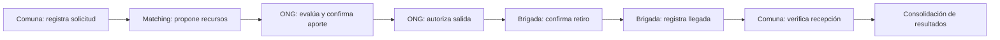

# Alivía

**Plataforma de coordinación y trazabilidad de ayuda humanitaria ante emergencias y desastres.**

Alivía está diseñada para relacionar las necesidades de las comunidades con los recursos disponibles de organizaciones humanitarias y acompañar cada operación, desde la solicitud de ayuda hasta la recepción y supervisión territorial. Su alcance contempla situaciones como lluvias intensas e inundaciones en Piura, donde resulta esencial conocer qué se necesita, qué se ha autorizado, qué se transporta y qué se recibió efectivamente.

Este repositorio reúne las **especificaciones funcionales y técnicas**, los **diagramas del sistema**, los **prototipos interactivos de alta fidelidad** y los **entregables derivados**. Los prototipos permiten explorar los flujos con datos locales; no constituyen por sí solos una implementación productiva con backend o integraciones oficiales activas.

## Funcionamiento general

El proceso de atención conecta necesidades, existencias, decisiones y entregas:



La **supervisión territorial** de Defensa Civil permite consultar riesgos, cobertura de atención y resultados. En paralelo, el sistema contempla la incorporación de observaciones y alertas de fuentes externas para informar a los usuarios autorizados. Dichas observaciones **no declaran automáticamente una emergencia ni autorizan recursos**; la coordinación opera en escenarios habilitados conforme a las reglas del sistema.

### Actores

| Actor | Responsabilidad principal |
| --- | --- |
| **Jefe de Comuna** | Registrar necesidades, consultar su atención y confirmar la recepción de ayuda. |
| **Jefe de ONG** | Gestionar inventarios, evaluar propuestas, confirmar aportes y autorizar salidas. |
| **Jefe de Brigada** | Consultar despachos, verificar rutas y registrar retiros y llegadas. |
| **Jefe de Defensa Civil** | Consultar riesgos territoriales, cobertura humanitaria e informes finales. |

### Reglas esenciales

- El **matching** propone recursos, pero no los compromete automáticamente.
- **Confirmar un aporte** y **autorizar su salida** son decisiones diferentes.
- La **autorización** compromete disponibilidad; la confirmación válida del **retiro** descuenta las existencias físicas.
- **Registrar llegada** no equivale a **confirmar recepción**. La recepción distingue cantidades recibidas físicamente, conformes y no conformes.
- Las discrepancias quedan registradas y **no reactivan automáticamente el matching**.
- Las observaciones territoriales son informativas y no sustituyen las decisiones institucionales.
- El informe final se publica bajo las condiciones del escenario, después del evento de finalización establecido.

## Organización del repositorio

```text
alivia/
├── docs/          # Documentación funcional, análisis y diseño técnico
├── diagramas/     # Diagramas UML/PlantUML y sus imágenes
├── prototipos/    # Sistema de diseño y diez interfaces interactivas
├── entregables/   # Materiales preparados a partir del proyecto
└── README.md      # Presentación y guía general del repositorio
```

### Documentación — [`docs/`](docs/README.md)

La documentación está organizada en catorce secciones numeradas (`00` a `13`) que abarcan definición del problema, negocio, procesos, requisitos, gestión, análisis, arquitectura, datos, comunicaciones, interfaces, construcción, pruebas, infraestructura y despliegue/operación.

Puntos de entrada recomendados:

- [Problema y alcance](docs/00-definicion/README.md)
- [Actores y reglas de negocio](docs/01-negocio/README.md)
- [Flujo y macroprocesos](docs/02-procesos/README.md)
- [Requisitos y casos de uso](docs/03-requisitos/README.md)
- [Arquitectura lógica](docs/06-arquitectura/README.md)
- [Modelos de datos](docs/07-datos/README.md)
- [Comunicaciones e integraciones](docs/08-comunicaciones/README.md)
- [Diseño de interfaz](docs/09-interfaz/README.md)
- [Infraestructura y servicios cloud](docs/12-infraestructura/README.md)

### Diagramas — [`diagramas/`](diagramas/README.md)

Incluye diagramas de **casos de uso** generales, por actor y por proceso; **secuencias** de operaciones humanas y automáticas; y diagramas **estructurales** de clases, paquetes, componentes y despliegue. Cada diagrama tiene su fuente `.puml` y una imagen `.png` para consulta visual.

### Prototipos — [`prototipos/`](prototipos/README.md)

El conjunto de prototipos utiliza un sistema visual compartido y reproduce los procesos con datos precargados e interacciones locales.

| Carpeta | Pantallas principales |
| --- | --- |
| [`00-sistema-diseno/`](prototipos/00-sistema-diseno/README.md) | Identidad visual, componentes, navegación y escenario común. |
| [`01-solicitud/`](prototipos/01-solicitud/README.md) | MK-01: panel de Comuna; MK-02: registro de solicitud. |
| [`02-matching/`](prototipos/02-matching/README.md) | MK-03: inventario ONG; MK-04: evaluación de propuesta. |
| [`03-autorizacion/`](prototipos/03-autorizacion/README.md) | MK-05: autorización de salida. |
| [`04-traslado/`](prototipos/04-traslado/README.md) | MK-06: despachos; MK-07: ruta, retiro y llegada. |
| [`05-recepcion/`](prototipos/05-recepcion/README.md) | MK-08: recepción y documentos. |
| [`06-supervision/`](prototipos/06-supervision/README.md) | MK-09: supervisión territorial; MK-10: informe final. |

Cada mockup principal cuenta con una **interfaz HTML**, una **captura PNG** y una **especificación Markdown**; también se incluyen imágenes de estados alternativos relevantes.

**[Abrir catálogo de interfaces](prototipos/index.html)** · **[Consultar instrucciones de los prototipos](prototipos/README.md)**

> Los HTML funcionan con datos locales. Las operaciones representadas, los mapas esquemáticos y las descargas generadas desde los prototipos no implican conexiones activas con una API, un servicio cartográfico validado o una base de datos de producción.

### Entregables — `entregables/`

Carpeta destinada a los materiales finales preparados a partir de la documentación, los diagramas y los prototipos, como presentaciones y otros archivos de entrega. Su contenido puede variar conforme avance el proyecto.

## Diseño técnico

La arquitectura documentada separa una **interfaz web**, una **API de backend**, los módulos funcionales y la **persistencia de datos**. Las tecnologías consideradas en el diseño incluyen **Next.js y TypeScript** para frontend, **NestJS** para backend, **Prisma** para acceso a datos y **PostgreSQL** como base de datos. Las decisiones sobre alojamiento y despliegue se describen en [`docs/12-infraestructura/`](docs/12-infraestructura/README.md) y [`docs/13-despliegue-operacion/`](docs/13-despliegue-operacion/README.md); no se presentan aquí como servicios ya desplegados.

Los cinco módulos de dominio son **Identity**, **Shelter**, **Inventory**, **Logistics** y **Territory**. Su organización y los contratos de comunicación se detallan en la documentación técnica.

## Orden sugerido de lectura

1. [Definición y problema](docs/00-definicion/README.md) para conocer el propósito y alcance.
2. [Procesos](docs/02-procesos/README.md) y [casos de uso](diagramas/README.md) para entender la coordinación entre actores.
3. [Datos](docs/07-datos/README.md), [arquitectura](docs/06-arquitectura/README.md) y [comunicaciones](docs/08-comunicaciones/README.md) para conocer el diseño técnico.
4. [Catálogo de prototipos](prototipos/index.html) para explorar cómo se representan los procesos en las interfaces.
