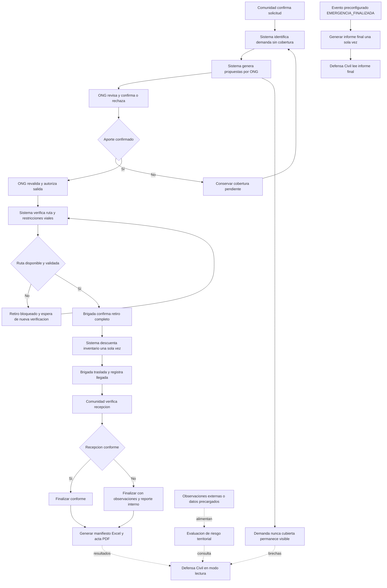

# Flujo general de coordinación humanitaria

## 1. Objetivo

Representar de extremo a extremo la coordinación de solicitudes, propuestas, autorización, traslados, recepciones y supervisión territorial. Este documento muestra **cómo se conectan las actividades**, sin reproducir los pasos internos de cada macroproceso.

## 2. Inicio, fin y participantes

- **Inicio operativo:** representante de una comunidad confirma una solicitud válida en el contexto de atención configurado.
- **Participantes humanos:** Jefe de Comuna/Albergue, Jefe de ONG, Jefe de Brigada y Jefe de Defensa Civil.
- **Procesos automáticos:** matching, verificación de ruta, actualización consistente de inventario, generación de documentos, incorporación de información territorial y consolidación final.
- **Fin por despacho:** la comunidad finaliza su recepción, conforme o con observaciones, y se generan documentos del envío.
- **Cierre de emergencia del escenario:** evento externo preconfigurado, distinto del fin de un despacho.

## 3. Diagrama general

## 4. Puntos de control

| Punto | Condición | Consecuencia |
|---|---|---|
| PC-01 | Solicitud inválida. | No se confirma; requiere corrección. |
| PC-02 | Inventario insuficiente. | No se comprometen existencias inexistentes; queda demanda sin cobertura. |
| PC-03 | ONG rechaza o reduce. | La porción no aceptada permanece pendiente de otra propuesta. |
| PC-04 | Stock cambia antes de autorización. | Se revalida; la operación no crea compromisos incompatibles. |
| PC-05 | Ruta no disponible según datos viales. | No hay retiro ni descuento físico. |
| PC-06 | Retiro verificado. | Se registra una sola vez el cambio de stock. |
| PC-07 | Brigada llega. | Se habilita comprobación comunitaria; no se presupone conformidad. |
| PC-08 | Comunidad detecta daño o faltante. | Recepción finaliza con observaciones; discrepancia queda registrada. |
| PC-09 | Se recibe evento de cierre del escenario. | Informe consolidado final disponible solo tras ese evento. |

## 5. Flujos paralelos y dependencias de negocio

1. El matching puede continuar buscando ayuda para cantidades que **nunca** recibieron cobertura; los bienes ya autorizados no se vuelven a ofrecer ni a solicitar para la misma porción.
2. Una recepción con observaciones puede finalizar aunque parte de lo enviado no se haya recibido conforme. Los faltantes **de esa recepción** no vuelven automáticamente al matching.
3. Supervisión territorial no constituye una fase que deba autorizar o completar un despacho. Las consultas de Defensa Civil no producen acciones operativas.
4. Los datos de riesgo se originan en observaciones externas o precargadas, no en recepciones. Las evaluaciones pueden mantenerse vigentes aun cuando una comunidad esté atendida.
5. Las observaciones/alertas de fuentes externas pueden motivar avisos a usuarios autorizados, pero **no crean una declaración automática de emergencia** ni sustituyen decisiones institucionales.

## 6. Límites de la representación

- La selección de conductores y vehículos pertenece a la brigada fuera de la plataforma.
- No existe seguimiento GPS en tiempo real.
- La prioridad de referencia aplica criticidad (50 %), población (30 %) y antigüedad (20 %); las fuentes externas se consumen mediante adaptadores con procedencia verificable.
- El escenario de una emergencia activa es suficiente para esta versión; coordinación de emergencias simultáneas es evolución posible.
- Ni los porcentajes de avance ni los colores del mapa pueden confundirse con una certificación automática de seguridad de una zona.
