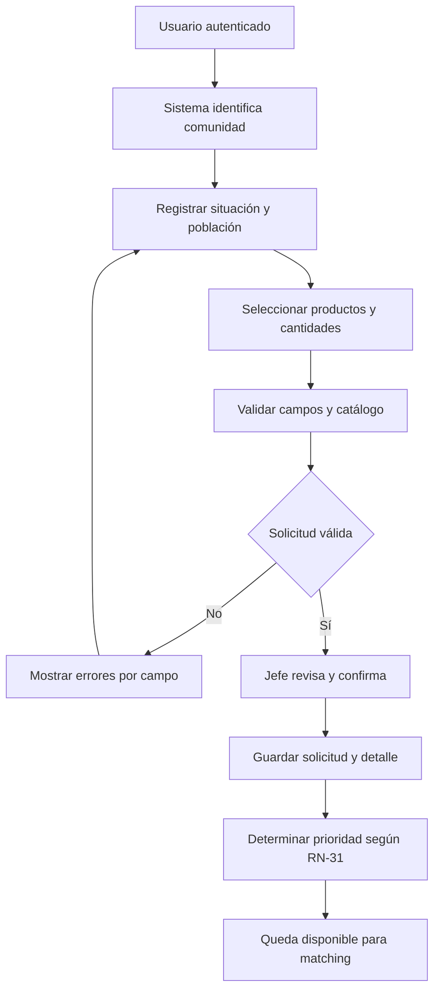

# Proceso 1. Registro de solicitud de ayuda

## 1. Ficha del proceso

| Campo       | Definición                                                                                                 |
| ----------- | ---------------------------------------------------------------------------------------------------------- |
| Responsable | Jefe de Comuna/Albergue.                                                                                   |
| Apoyo       | Plataforma Alivía.                                                                                         |
| Objetivo    | Registrar necesidades de ayuda válidas, cuantificadas y asociadas a una comunidad.                         |
| Disparador  | El representante autorizado identifica necesidades de ayuda dentro del escenario configurado.              |
| Entrada     | Sesión válida, comunidad asignada, catálogo de productos, situación de afectación y cantidades requeridas. |
| Salida      | Solicitud confirmada, identificada y elegible para matching.                                               |
| Exclusión   | Edición o cancelación de solicitudes confirmadas.                                                          |

## 2. Secuencia de actividades

### 2.1. Identificar al responsable y la comunidad

El jefe inicia sesión y el sistema identifica automáticamente su comunidad. El registro queda restringido a esta entidad, sin permitir solicitudes a nombre de otras comunidades.

### 2.2. Registrar situación de afectación

El usuario indica la población afectada, describe la situación actual y justifica la necesidad de ayuda. La información se registra de forma agregada, sin recopilar datos personales ni expedientes individuales de beneficiarios.

### 2.3. Introducir necesidades por producto

El usuario selecciona uno o varios productos activos del catálogo e indica la cantidad positiva requerida para cada uno, respetando su unidad de medida. No se permite repetir un mismo producto dentro de la solicitud.

### 2.4. Validar y corregir

El sistema verifica los campos obligatorios, la pertenencia de la comunidad, la existencia y vigencia de los productos, la compatibilidad de las unidades, las cantidades y la ausencia de duplicados.

Si encuentra errores, identifica los campos afectados y solicita su corrección antes de permitir la confirmación.

### 2.5. Confirmar y registrar

El jefe revisa la información y confirma una única solicitud con todas sus líneas de producto.

El sistema registra su identificador, fecha y hora, autor y estado inicial. Los envíos repetidos accidentalmente no deben generar solicitudes duplicadas.

### 2.6. Determinar prioridad y habilitar matching

El sistema calcula la prioridad según la criticidad del producto, la población afectada y la antigüedad de la solicitud, aplicando la política de referencia definida en `RN-31`.

Una vez confirmada, la solicitud queda disponible para el motor de matching, sin comprometer existencias durante esta etapa.

## 3. Diagrama de flujo

## 4. Alternativas y restricciones

| Caso                                   | Tratamiento                                                |
| -------------------------------------- | ---------------------------------------------------------- |
| Producto inexistente o inactivo        | Rechazar la línea e identificar el error.                  |
| Cantidad nula, negativa o incompatible | Solicitar corrección antes de confirmar.                   |
| Comunidad distinta de la asignada      | Denegar la operación en el servidor.                       |
| Producto repetido                      | Impedir la confirmación hasta eliminar la duplicidad.      |
| Error de servidor o conectividad       | No informar éxito sin confirmar la persistencia.           |
| Edición o cancelación posterior        | No permitida para solicitudes confirmadas en esta versión. |

## 5. Criterios observables de finalización

Una solicitud confirmada debe conservar la comunidad, el autor, la fecha y hora, la población afectada, la situación registrada y las líneas de productos con cantidades válidas.

Por ejemplo, si se requieren tres productos distintos, se registra **una solicitud con tres líneas**, no tres solicitudes independientes.

La solicitud queda disponible para el cálculo de cobertura y la generación de propuestas, sin modificar ni comprometer inventario en esta etapa.
