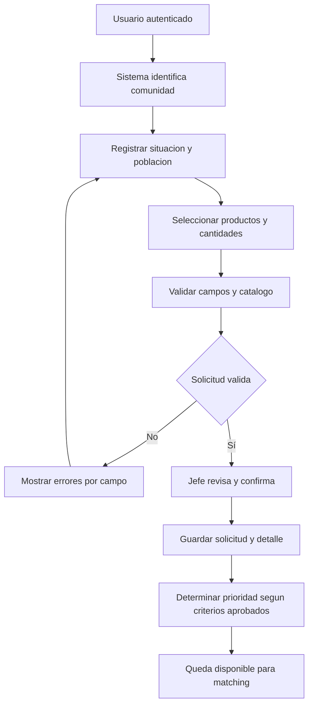

# Proceso 1. Registro de solicitud de ayuda

## 1. Ficha del proceso

| Campo | Definición |
|---|---|
| Responsable | Jefe de Comuna/Albergue. |
| Apoyo | Plataforma Alivía. |
| Objetivo | Registrar una necesidad válida, cuantificada y atribuible a una comunidad. |
| Disparador | El representante autorizado requiere ayuda en el escenario configurado. |
| Entrada | Sesión válida, comunidad asignada, catálogo de productos, situación y cantidades. |
| Salida | Solicitud confirmada, identificada y elegible para matching. |
| Exclusión | Editar o cancelar solicitudes ya confirmadas. |

## 2. Secuencia de actividades

### 2.1. Identificar al responsable y la comunidad

El jefe inicia sesión. El sistema determina automáticamente la comunidad que le corresponde y restringe el registro a esa entidad. No se permite crear una solicitud atribuyéndola manualmente a otra comunidad.

### 2.2. Registrar situación de afectación

El usuario informa la población afectada, describe la situación actual y registra la justificación de necesidad. Los datos se refieren a cantidades agregadas, no a nombres o expedientes de beneficiarios.

### 2.3. Introducir necesidades por producto

El usuario selecciona uno o más productos activos del catálogo y registra para cada uno una cantidad positiva y la unidad que le corresponde. El mismo producto no aparece duplicado dentro de la solicitud.

### 2.4. Validar y corregir

El sistema comprueba campos obligatorios, identidad de comunidad, existencia y vigencia del producto, unidad compatible, duplicados y signo de cantidades. Si detecta fallos, identifica exactamente los campos y no confirma el registro.

### 2.5. Confirmar y registrar

El jefe revisa el conjunto de datos y confirma una sola solicitud con todas sus líneas de producto. El sistema asigna identificador, fecha/hora, autor y estado inicial. Una confirmación repetida no debe originar solicitudes idénticas por un doble envío involuntario.

### 2.6. Determinar prioridad y habilitar matching

Se determina la prioridad conforme a los criterios de negocio conocidos —criticidad, población afectada y antigüedad— y se pone la solicitud a disposición del motor de propuestas. Los pesos exactos del cálculo **no están definidos** y no deben inferirse.

## 3. Diagrama de flujo

## 4. Alternativas y restricciones

| Caso | Tratamiento |
|---|---|
| Producto inexistente o inactivo | Rechazar ese renglón con mensaje identificable. |
| Cantidad nula, negativa o incompatible | Solicitar corrección antes de confirmar. |
| Comunidad ajena a la sesión | Denegar la operación en el servidor. |
| Mismo producto repetido | Impedir confirmación duplicada de líneas. |
| Error de servidor o conectividad | No afirmar éxito hasta confirmación de persistencia. |
| Edición tras confirmar | No se habilita; permanece como definición pendiente fuera de esta versión. |

## 5. Criterios observables de finalización

Una solicitud confirmada debe conservar comunidad, autor, fecha, población afectada, situación, productos válidos y cantidades. Si tiene tres productos, será **una solicitud con tres líneas**, no tres solicitudes independientes. El registro debe quedar disponible para búsquedas de cobertura sin comprometer todavía ninguna existencia.
