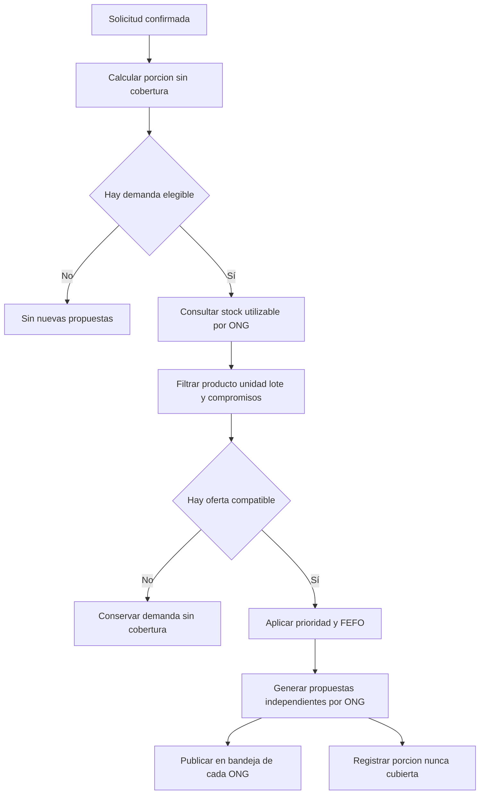

# Proceso 2. Matching de necesidades y recursos

## 1. Ficha del proceso

| Campo | Definición |
|---|---|
| Responsable | Sistema, sin actor humano específico. |
| Objetivo | Proponer aportes de ONG que cubran necesidades elegibles con lotes aptos. |
| Entrada | Solicitudes, líneas pendientes, existencias utilizables y compromisos autorizados. |
| Salida | Propuestas por ONG y demanda que permanece sin cobertura. |
| Restricción cardinal | Ninguna propuesta reserva o descuenta existencias. |

## 2. Secuencia de actividades

### 2.1. Identificar la necesidad elegible

Se toman líneas confirmadas cuya cantidad sigue sin cobertura. Se excluyen cantidades con autorizaciones vigentes pendientes de entrega y las cantidades ya recibidas conforme. Las diferencias detectadas en una recepción finalizada no se consideran una nueva demanda automática.

### 2.2. Consultar inventarios aptos

Para cada producto se consulta la existencia utilizable disponible de las ONG, identificando almacén, lote, unidad y vencimiento cuando corresponda. No se incluyen lotes vencidos, bloqueados, en cuarentena ni existencias ya comprometidas.

### 2.3. Filtrar compatibilidad

Se comparan identificadores de producto y su unidad establecida en catálogo. No se sustituyen automáticamente productos distintos por pertenecer a una misma categoría ni se convierten unidades sin una regla previamente aprobada. Se respetan múltiplos de entrega.

### 2.4. Priorizar necesidades y seleccionar lotes

El sistema organiza la atención según criticidad, población afectada y antigüedad de la solicitud, aplicando múltiplos y disponibilidad por línea sin un límite adicional inventado. Para productos perecibles se aplica FEFO entre lotes que puedan entregarse y utilizarse a tiempo. **Política de diseño:** `score = 0.50×criticidad + 0.30×min(población/1000,1) + 0.20×min(antigüedad_días/7,1)`; desempate por fecha de solicitud y UUID ascendentes. Los tres factores se normalizan en `[0,1]`. La puntuación no equivale a evaluación oficial de urgencia.

### 2.5. Construir propuestas por ONG

Una necesidad puede cubrirse parcialmente entre varias ONG. Cada propuesta identifica destinatario, producto, cantidad propuesta, origen/lote cuando corresponda y justificación, sin autorizar salida ni alterar existencia física. Si no hay existencias suficientes, se identifica la demanda nunca cubierta.

### 2.6. Mostrar propuestas y conservar pendientes

Cada ONG recibe su propia propuesta para decidir. Las propuestas pueden dejar de ser válidas si cambia inventario o cobertura; el sistema deberá revalidarlas antes de producir un compromiso. El matching se reejecuta al confirmar una solicitud, registrar stock utilizable nuevo o ajustado, y rechazar/reducir una propuesta. Cada procesamiento usa un identificador idempotente para evitar propuestas duplicadas.

## 3. Diagrama

## 4. Ejemplo ficticio verificable

Solicitud: 100 unidades de agua. Ya existen 30 unidades **recibidas conformes** y ninguna autorización vigente por el resto. Se consideran 70 unidades elegibles. ONG A posee 60 utilizables y ONG B 40; una propuesta factible sería A=60, B=10. Las 30 unidades restantes de ONG B no se comprometen por esa propuesta y las 70 propuestas todavía **no** son entregadas ni autorizadas.

Si ONG A solo acepta 40, sus 20 no aceptadas permanecen sin cobertura hasta que una nueva propuesta válida las contemple. Si el inventario cambió entre cálculo y decisión, no se puede aceptar la propuesta obsoleta sin revalidación.

## 5. Casos límite

- Oferta cero: no se genera compromiso ficticio.
- Diferentes unidades: se rechaza comparación no autorizada.
- Productos vencidos o bloqueados: se excluyen aun con cantidad física positiva.
- Propuesta rechazada: vuelve a quedar elegible la cantidad nunca autorizada.
- Compromiso vigente: no se busca de nuevo la misma cantidad durante la espera de entrega.
- Faltante de recepción finalizada: no vuelve a matching; una petición futura es independiente.
- Múltiples propuestas concurrentes: la autorización posterior debe impedir sobreasignación real, incluso si las propuestas se calcularon con información anterior.

## 6. Evidencias de resultado

El proceso finaliza con propuestas visibles para sus respectivas ONG y cantidades sin cobertura explícitas. No genera una entrega, una autorización ni un movimiento de stock.
