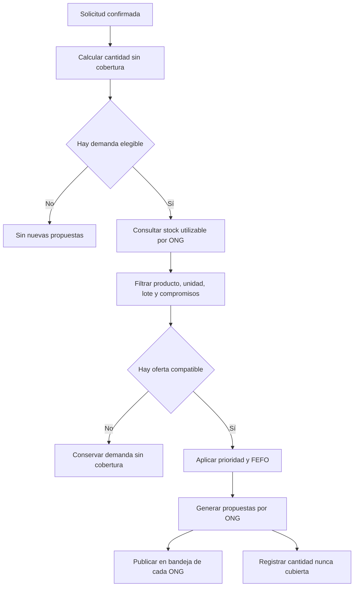

# Proceso 2. Matching de necesidades y recursos

## 1. Ficha del proceso

| Campo                 | Definición                                                                                          |
| --------------------- | --------------------------------------------------------------------------------------------------- |
| Responsable           | Sistema, sin intervención de un actor humano específico.                                            |
| Objetivo              | Generar propuestas de aportes de ONG para cubrir necesidades elegibles mediante existencias aptas.  |
| Entrada               | Solicitudes confirmadas, necesidades pendientes, inventarios utilizables y compromisos autorizados. |
| Salida                | Propuestas por ONG y cantidades que permanecen sin cobertura.                                       |
| Restricción principal | Las propuestas no reservan ni descuentan existencias.                                               |

## 2. Secuencia de actividades

### 2.1. Identificar necesidades elegibles

El sistema identifica las cantidades pendientes de cobertura en las solicitudes confirmadas, excluyendo las unidades recibidas conforme y aquellas con compromisos vigentes.

Las discrepancias de recepciones finalizadas no generan automáticamente nuevas necesidades elegibles para matching.

### 2.2. Consultar inventarios aptos

Para cada producto requerido, el sistema consulta las existencias utilizables de las ONG, considerando almacén, lote, unidad de medida y fecha de vencimiento, cuando corresponda.

Se excluyen los lotes vencidos, bloqueados o en cuarentena, así como las cantidades ya comprometidas.

### 2.3. Filtrar compatibilidad

El sistema verifica la correspondencia entre los productos solicitados y las existencias disponibles, respetando sus identificadores, unidades de medida y múltiplos de entrega.

No se permiten sustituciones automáticas entre productos de una misma categoría ni conversiones de unidades sin una regla previamente aprobada.

### 2.4. Priorizar necesidades y seleccionar lotes

Las necesidades se ordenan según criticidad del producto, población afectada y antigüedad de la solicitud, aplicando la política definida en `RN-31`.

**Fórmula de prioridad:**

`score = 0.50 × criticidad + 0.30 × min(población / 1000, 1) + 0.20 × min(antigüedad_días / 7, 1)`

Los tres factores se normalizan al intervalo `[0,1]`. Los empates se resuelven por antigüedad de la solicitud y UUID ascendente.

La asignación respeta las cantidades disponibles y los múltiplos de entrega, sin imponer límites adicionales no definidos. Para productos perecibles se aplica FEFO, priorizando lotes utilizables con vencimiento más próximo que puedan entregarse y consumirse oportunamente.

Esta puntuación es una **política técnica de priorización**, no una evaluación oficial de urgencia humanitaria.

### 2.5. Construir propuestas por ONG

Una necesidad puede distribuirse parcialmente entre varias ONG, según sus existencias aptas.

Cada propuesta identifica la ONG destinataria, el producto, la cantidad sugerida, el almacén o lote de origen cuando corresponda y su justificación.

La generación de propuestas no autoriza salidas, reserva recursos ni modifica el inventario físico. Las cantidades que no pueden cubrirse permanecen identificadas como demanda pendiente.

### 2.6. Publicar propuestas y conservar pendientes

Cada ONG recibe las propuestas que le corresponden para aceptarlas, reducirlas o rechazarlas.

Las propuestas pueden perder vigencia si cambian las existencias o la cobertura de una necesidad. Por ello, el sistema debe revalidar las condiciones antes de autorizar cualquier compromiso.

El matching se reejecuta cuando:

- Se confirma una solicitud.
- Se registra o ajusta inventario utilizable.
- Se rechaza o reduce una propuesta.

Cada evento se procesa mediante una clave idempotente para evitar la generación de propuestas duplicadas.

## 3. Diagrama de flujo

## 4. Ejemplo ficticio verificable

Una comunidad solicita **100 unidades de agua**, de las cuales 30 ya fueron recibidas conforme. No existen autorizaciones vigentes para las 70 restantes.

Las existencias utilizables son:

| ONG       | Existencia utilizable | Cantidad propuesta |
| --------- | --------------------: | -----------------: |
| ONG A     |                    60 |                 60 |
| ONG B     |                    40 |                 10 |
| **Total** |               **100** |             **70** |

Las 70 unidades propuestas cubrirían la necesidad pendiente si posteriormente fueran autorizadas y recibidas conforme. Las 30 unidades restantes de ONG B no quedan comprometidas y las propuestas todavía no representan ayuda autorizada ni entregada.

Si ONG A confirma únicamente 40 unidades, las otras 20 permanecen sin cobertura y pueden considerarse en una nueva propuesta.

Si el inventario cambia entre el cálculo y la decisión de la ONG, las cantidades deben revalidarse antes de generar un compromiso.

## 5. Casos límite

| Caso                             | Tratamiento                                                                                                                          |
| -------------------------------- | ------------------------------------------------------------------------------------------------------------------------------------ |
| Sin existencias disponibles      | Conservar la necesidad pendiente sin generar compromisos ficticios.                                                                  |
| Unidades incompatibles           | Rechazar comparaciones o conversiones no autorizadas.                                                                                |
| Lotes vencidos o bloqueados      | Excluirlos aunque tengan existencia física positiva.                                                                                 |
| Propuesta rechazada              | Mantener elegible la cantidad que nunca fue autorizada.                                                                              |
| Compromiso vigente               | Excluir la cantidad comprometida de nuevas propuestas mientras espera su entrega.                                                    |
| Faltante de recepción finalizada | No reactivar automáticamente el matching; una nueva solicitud constituye un registro independiente.                                  |
| Propuestas concurrentes          | Revalidar la disponibilidad durante la autorización para impedir sobreasignaciones, incluso con propuestas calculadas anteriormente. |

## 6. Evidencias de resultado

El proceso concluye con propuestas identificadas y visibles para sus respectivas ONG, junto con las cantidades que permanecen sin cobertura.

Su ejecución no constituye una autorización de salida, una entrega ni un movimiento de inventario. Los compromisos se establecen posteriormente mediante las operaciones correspondientes.
