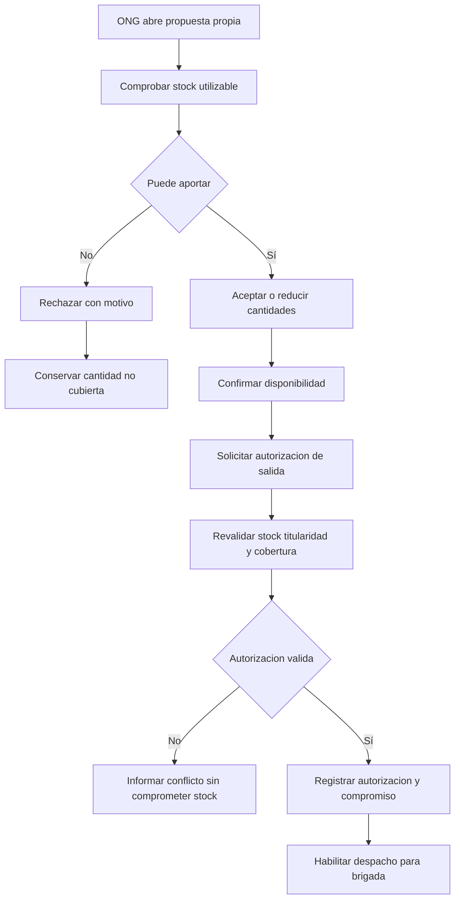

# Proceso 3. Confirmación y autorización de aportes de ONG

## 1. Ficha del proceso

| Campo | Definición |
|---|---|
| Responsable | Jefe de ONG. |
| Entrada | Propuesta vigente dirigida a la ONG y estado de existencias utilizables. |
| Resultado positivo | Disponibilidad confirmada y salida autorizada, en actos separados. |
| Resultado negativo | Propuesta rechazada con motivo y cobertura restante disponible para nuevas búsquedas. |
| Restricción | La ONG no aumenta cantidades por encima de la propuesta ni opera propuestas ajenas. |

## 2. Actividades

### 2.1. Consultar propuesta

El jefe examina comunidad destinataria, producto, cantidades propuestas, origen y justificación. La sesión limita la consulta a propuestas de su propia ONG.

### 2.2. Comprobar disponibilidad real

La ONG contrasta la propuesta con su inventario utilizable. La disponibilidad no incluye cantidades comprometidas mediante autorizaciones vigentes y pendientes de retiro.

### 2.3. Resolver el aporte

Puede confirmar la cantidad propuesta o reducirla. Ninguna línea confirmada supera el valor propuesto; si la organización no aportará nada, se rechaza la propuesta y se registra un motivo. Un aporte parcial no elimina la necesidad restante.

### 2.4. Confirmar disponibilidad

Al confirmar se conserva usuario, fecha y cantidades. Este registro expresa una decisión de la ONG, **todavía distinta de la autorización de salida**. La decisión por sí sola no representa retiro físico de mercancía.

### 2.5. Autorizar salida

En una operación posterior, el jefe autoriza explícitamente los productos confirmados. El sistema vuelve a validar disponibilidad, titularidad y cobertura. La operación debe ser atómica: si las cantidades ya no se encuentran disponibles, no se registra una autorización parcial accidental ni un compromiso incompatible.

### 2.6. Comprometer existencias sin retirarlas

Desde la autorización, las cantidades dejan de ofrecerse a otras necesidades. El inventario físico permanece sin descuento hasta que la brigada confirme el retiro completo. La autorización identifica origen, destino y productos para crear el despacho correspondiente.

## 3. Diagrama

## 4. Situaciones alternativas

| Situación | Resultado |
|---|---|
| Propuesta de otra ONG | Acceso denegado por el servidor. |
| Todas las cantidades reducidas a cero | Rechazo con motivo obligatorio. |
| Disponibilidad cambia antes de autorizar | Revalidación y rechazo de autorización incompatible. |
| Usuario pulsa autorizar dos veces | Una autorización y un compromiso, sin duplicados. |
| ONG confirma 50 de 70 sugeridos | 50 pueden seguir a autorización; 20 no quedan comprometidos. |
| Autorización registrada sin retiro | El stock físico no disminuye, pero la cantidad comprometida no puede ofrecerse a otra solicitud. |

## 5. Resultado y controles

El proceso conserva la diferencia entre propuesta, confirmación y autorización. Solo los aportes efectivamente autorizados habilitan despacho, y ninguna cantidad se descuenta del inventario físico durante la autorización. La ONG no puede cambiar su respuesta después de autorizar en la versión básica.
