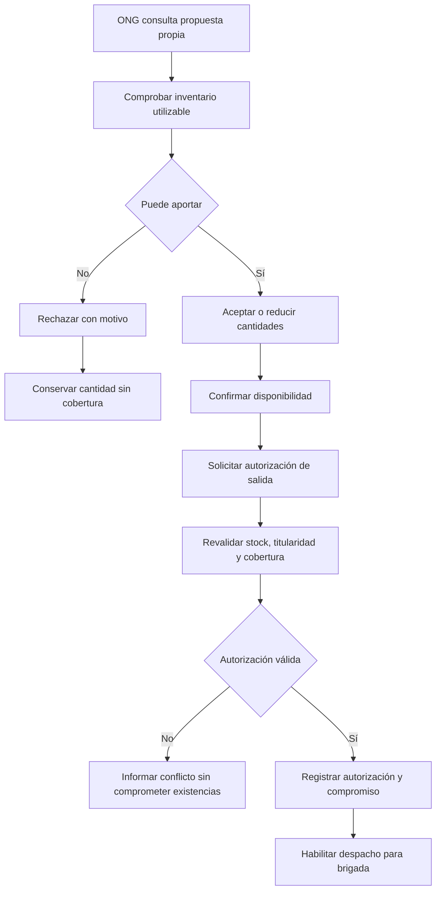

# Proceso 3. Confirmación y autorización de aportes de ONG

## 1. Ficha del proceso

| Campo              | Definición                                                                                          |
| ------------------ | --------------------------------------------------------------------------------------------------- |
| Responsable        | Jefe de ONG.                                                                                        |
| Entrada            | Propuesta vigente dirigida a la ONG e información de sus existencias utilizables.                   |
| Resultado positivo | Disponibilidad confirmada y salida autorizada mediante operaciones independientes.                  |
| Resultado negativo | Propuesta rechazada con motivo y cantidades no cubiertas elegibles para nuevas propuestas.          |
| Restricción        | La ONG no puede confirmar cantidades superiores a las propuestas ni operar sobre propuestas ajenas. |

## 2. Secuencia de actividades

### 2.1. Consultar propuesta

El jefe revisa la comunidad destinataria, los productos, las cantidades sugeridas, su origen y la justificación del aporte. El acceso se restringe a las propuestas correspondientes a su ONG.

### 2.2. Comprobar disponibilidad real

La ONG verifica las cantidades propuestas frente a su inventario utilizable, excluyendo las existencias comprometidas mediante autorizaciones vigentes pendientes de retiro.

### 2.3. Resolver el aporte

El jefe puede aceptar las cantidades propuestas o reducirlas, sin superar los valores originales.

Si la ONG decide no aportar, debe rechazar la propuesta e indicar el motivo. Las cantidades no aceptadas permanecen pendientes de cobertura.

### 2.4. Confirmar disponibilidad

El sistema registra la decisión con el usuario responsable, la fecha y las cantidades confirmadas.

Esta confirmación expresa la disposición de la ONG para aportar los recursos, pero **no constituye una autorización de salida ni un retiro físico**.

### 2.5. Autorizar salida

En una operación independiente, el jefe autoriza explícitamente la salida de los productos confirmados.

Antes de registrar la autorización, el sistema revalida la titularidad, la disponibilidad del inventario y la cobertura de la necesidad.

La operación debe ser atómica: si alguna condición impide autorizar las cantidades confirmadas, se rechaza sin generar compromisos incompatibles ni autorizaciones parciales accidentales.

### 2.6. Comprometer existencias sin retirarlas

Una vez autorizadas, las cantidades quedan comprometidas y se excluyen de nuevas propuestas.

El inventario físico no se descuenta hasta que la brigada confirme el retiro completo.

La autorización identifica el origen, destino y productos necesarios para habilitar el despacho correspondiente.

## 3. Diagrama de flujo

## 4. Situaciones alternativas

| Situación                                   | Tratamiento                                                                                 |
| ------------------------------------------- | ------------------------------------------------------------------------------------------- |
| Propuesta perteneciente a otra ONG          | Denegar el acceso en el servidor.                                                           |
| Todas las cantidades se reducen a cero      | Registrar un rechazo con motivo obligatorio.                                                |
| Cambio de disponibilidad antes de autorizar | Revalidar y rechazar la autorización si las cantidades resultan incompatibles.              |
| Solicitud de autorización repetida          | Registrar una única autorización y compromiso, sin duplicados.                              |
| ONG confirma 50 de 70 unidades propuestas   | Las 50 pueden continuar hacia la autorización; las 20 restantes permanecen sin comprometer. |
| Autorización registrada sin retiro          | Mantener el stock físico, excluyendo las cantidades comprometidas de nuevas asignaciones.   |

## 5. Resultado y controles

El proceso distingue tres etapas: **propuesta, confirmación de disponibilidad y autorización de salida**.

Solo los aportes autorizados habilitan el despacho. La autorización compromete existencias, pero no modifica el stock físico, cuyo descuento corresponde al retiro confirmado por la brigada.

En esta versión, la ONG no puede modificar su respuesta una vez autorizada la salida.
