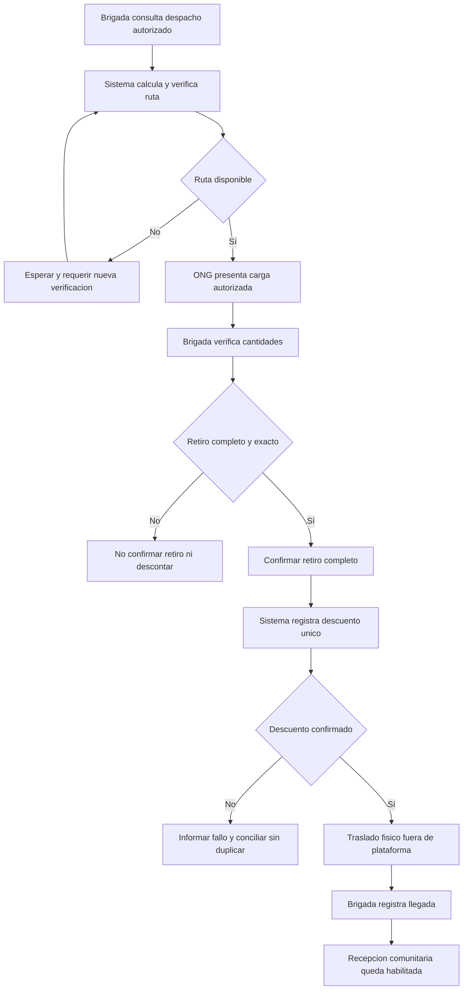

# Proceso 4. Gestión del traslado de ayuda

## 1. Ficha del proceso

| Campo | Definición |
|---|---|
| Responsable | Jefe de Brigada. |
| Apoyo | Sistema de rutas y registro logístico de Alivía. |
| Inicio | La brigada consulta un despacho con salida autorizada. |
| Fin | La brigada registra la llegada del despacho a su comunidad destino. |
| Precondición crítica | Antes del retiro completo debe existir una ruta evaluada como disponible con las restricciones viales conocidas. |
| Exclusión | Alta de vehículos, asignación de conductores, GPS continuo e incidencias internas de trayecto dentro de la aplicación. |

## 2. Actividades

### 2.1. Consultar despacho autorizado

El jefe de brigada revisa únicamente sus despachos asignados. Cada uno muestra ONG, almacén de origen, comunidad destino, productos y cantidades autorizadas. La asignación del despacho pertenece a la configuración operativa del escenario; la organización interna de transportistas se realiza fuera del sistema.

### 2.2. Obtener y verificar la ruta

El sistema solicita un recorrido entre almacén y destino, considerando información vial disponible y excluyendo tramos reportados como intransitables. Debe conservar la fecha/hora de cálculo y verificación. La ruta vence a los treinta minutos desde su verificación y cualquier tramo `UNKNOWN` o `IMPASSABLE` impide considerarla disponible; debe reevaluarse antes del retiro.

**Si no hay ruta disponible**, la operación queda a la espera y no se registra retiro ni se descuenta stock. La política exacta para tramos `UNKNOWN` y la vigencia temporal de una ruta aún necesitan definición de diseño.

### 2.3. Verificar retiro físico completo

La ONG entrega la totalidad autorizada. El jefe de brigada cuenta los productos en el punto de recojo y confirma solo si coinciden completamente con lo autorizado. La brigada no negocia aportes ni cambia sus cantidades. **No existe retiro parcial en este alcance.**

### 2.4. Registrar el descuento de inventario

Después de una confirmación de retiro válida, el sistema descuenta una única vez las cantidades físicas correspondientes y registra el movimiento. La confirmación no debe mostrarse como completada si la operación de descuento falla o queda sin resultado confirmado.

### 2.5. Trasladar la carga fuera de la plataforma

La brigada realiza el traslado mediante sus procedimientos propios. La plataforma no rastrea automáticamente el vehículo ni gestiona la elección de conductor o los incidentes internos. La ruta consultada es una ayuda a la coordinación y no reemplaza la verificación operativa del estado real de la vía.

### 2.6. Registrar llegada

Al llegar al destino, el jefe marca la llegada del despacho. Se conserva la fecha/hora, usuario y despacho. **La llegada no confirma que todo haya sido recibido en buen estado**: corresponde a la comunidad efectuar la recepción.

## 3. Diagrama de flujo

## 4. Controles y excepciones

| Escenario | Decisión funcional |
|---|---|
| Despacho no asignado a esa brigada | No autorizar consulta operativa ni cambio de estado. |
| Vía marcada como intransitable | Excluir del cálculo de ruta candidata. |
| Ausencia de ruta verificada | Bloquear retiro y esperar condiciones válidas. |
| Cantidad física menor a lo autorizado | No confirmar retiro parcial. La resolución corresponde a coordinación externa y nueva condición válida. |
| Doble clic en confirmar retiro | Mantener un solo retiro y un movimiento de descuento. |
| Error en descuento de stock | No informar éxito sin conciliación; no ejecutar reintento ciego que duplique salida. |
| Llegada registrada | Habilitar recepción posterior sin marcarla conforme automáticamente. |

## 5. Ejemplo ficticio

Un despacho contiene 40 kits autorizados desde un almacén de una ONG a una comunidad. Una vía reportada como bloqueada invalida la ruta habitual. El sistema no permite confirmar retiro hasta proporcionar una ruta evaluada como disponible. Cuando la brigada verifica los 40 kits y confirma retiro, se registra un solo descuento de 40. Más tarde, la brigada registra llegada; los 40 **todavía no cuentan como recibidos conformes**.

## 6. Resultados verificables

- Registro de despacho, cantidades autorizadas, ruta evaluada, retirada completa y llegada.
- Existencias descontadas una sola vez después de retiro confirmado.
- Separación entre estado logístico y estado de recepción.
- Ausencia de formularios de conductores, matrículas o incidencias internas.
