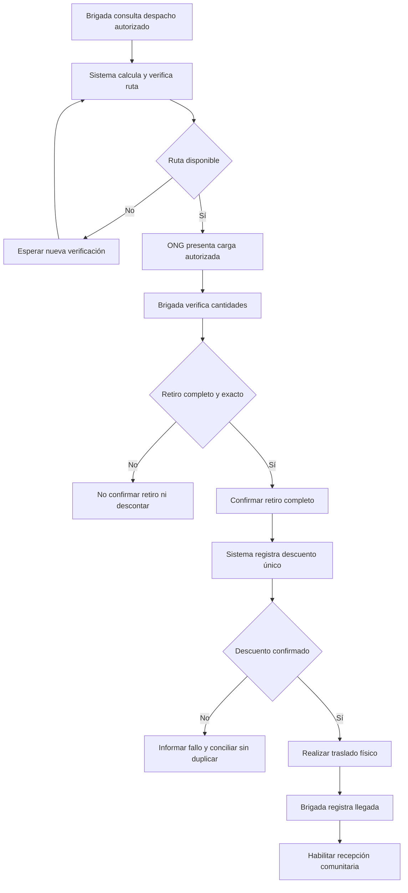

# Proceso 4. Gestión del traslado de ayuda

## 1. Ficha del proceso

| Campo                | Definición                                                                                                                 |
| -------------------- | -------------------------------------------------------------------------------------------------------------------------- |
| Responsable          | Jefe de Brigada.                                                                                                           |
| Apoyo                | Sistema de rutas y registro logístico de Alivía.                                                                           |
| Inicio               | Consulta de un despacho autorizado y asignado a la brigada.                                                                |
| Fin                  | Registro de llegada del despacho a la comunidad destinataria.                                                              |
| Precondición crítica | El retiro completo requiere una ruta verificada como disponible según las restricciones viales conocidas.                  |
| Exclusiones          | Gestión de vehículos, asignación de conductores, seguimiento GPS continuo y registro de incidencias internas del trayecto. |

## 2. Secuencia de actividades

### 2.1. Consultar despacho autorizado

El jefe consulta los despachos asignados a su brigada, identificando la ONG, el almacén de origen, la comunidad destinataria y los productos con sus cantidades autorizadas.

La asignación de despachos forma parte de la configuración operativa del escenario. La organización de transportistas corresponde a la brigada fuera de Alivía.

### 2.2. Obtener y verificar la ruta

El sistema calcula un recorrido entre el almacén y la comunidad, considerando la información vial disponible. La ruta debe cumplir las siguientes condiciones:

- No incluir tramos reportados como `IMPASSABLE`.
- No depender de tramos con estado `UNKNOWN`.
- Contar con una verificación de antigüedad inferior a treinta minutos.

Se conserva la fecha y hora del cálculo y de la verificación. Cuando esta pierde vigencia, la ruta debe reevaluarse antes del retiro.

Si no existe una ruta válida, el retiro permanece bloqueado y no se modifica el inventario.

La verificación se basa en información conocida y no garantiza la transitabilidad física al momento del traslado.

### 2.3. Verificar retiro físico completo

La ONG presenta la totalidad de los productos autorizados. El jefe de brigada comprueba físicamente las cantidades en el punto de recojo y confirma el retiro únicamente cuando coinciden con lo autorizado.

La brigada no puede modificar los aportes ni sus cantidades. **No se admiten retiros parciales en esta versión.**

### 2.4. Registrar el descuento de inventario

Tras confirmar un retiro válido, el sistema descuenta las cantidades correspondientes del inventario físico y registra el movimiento una sola vez.

Si el descuento falla o su resultado no puede confirmarse, la operación no debe mostrarse como completada. Cualquier reintento requiere comprobar su estado para evitar duplicaciones.

### 2.5. Realizar el traslado

La brigada transporta la ayuda mediante sus procedimientos internos, sin seguimiento GPS ni gestión de conductores, vehículos o incidencias del trayecto dentro de Alivía.

La ruta proporcionada sirve como referencia logística y no sustituye la comprobación operativa de las condiciones reales de tránsito.

### 2.6. Registrar llegada

Al alcanzar el destino, el jefe registra la llegada del despacho con su identificación, usuario responsable, fecha y hora.

Este registro habilita la recepción comunitaria, pero **no acredita las cantidades ni el estado de los productos entregados**. Su verificación corresponde al jefe de Comuna/Albergue.

## 3. Diagrama de flujo

## 4. Controles y excepciones

| Escenario                                 | Tratamiento                                                                                             |
| ----------------------------------------- | ------------------------------------------------------------------------------------------------------- |
| Despacho no asignado a la brigada         | Denegar su consulta operativa y cualquier cambio de estado.                                             |
| Vía reportada como intransitable          | Excluirla del cálculo de rutas candidatas.                                                              |
| Ruta no disponible o verificación vencida | Bloquear el retiro hasta obtener una evaluación válida.                                                 |
| Cantidad física inferior a la autorizada  | Impedir el retiro parcial; su resolución requiere coordinación externa y condiciones válidas.           |
| Confirmación repetida del retiro          | Registrar un único retiro y movimiento de inventario.                                                   |
| Error o resultado incierto del descuento  | No informar éxito sin comprobar el estado de la operación ni realizar reintentos que puedan duplicarla. |
| Llegada registrada                        | Habilitar la recepción comunitaria sin asumir conformidad.                                              |

## 5. Ejemplo ficticio

Un despacho contiene 40 kits autorizados para trasladarse desde el almacén de una ONG hasta una comunidad.

La ruta habitual presenta un tramo reportado como bloqueado, por lo que el sistema impide confirmar el retiro hasta encontrar un recorrido verificado como disponible.

Una vez validada la ruta, la brigada comprueba los 40 kits y confirma su retiro. El sistema descuenta las 40 unidades del inventario físico una sola vez.

Posteriormente, la brigada registra su llegada. **Los kits todavía no se consideran recibidos conformes**, pues corresponde a la comunidad verificar la entrega.

## 6. Resultados verificables

- Despacho identificado con cantidades autorizadas, ruta verificada, retiro completo y llegada registrada.
- Descuento único de existencias físicas tras confirmar el retiro.
- Distinción entre el estado logístico del despacho y la conformidad de su recepción.
- Ausencia de funciones para gestionar conductores, matrículas, vehículos o incidencias internas del trayecto.
