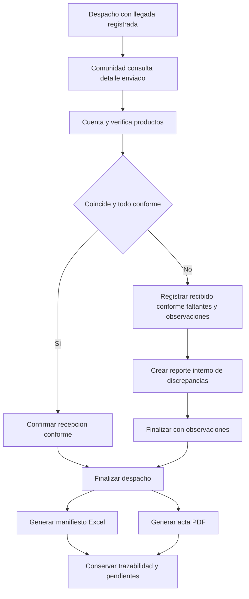

# Proceso 5. Recepción y verificación comunitaria

## 1. Ficha del proceso

| Campo | Definición |
|---|---|
| Responsable | Jefe de Comuna/Albergue. |
| Inicio | Existe un despacho hacia su comunidad con llegada registrada. |
| Objetivo | Corroborar cantidad y condición real de la ayuda respecto del despacho. |
| Resultados | Recepción conforme o con observaciones, discrepancias internas cuando corresponda y documentos finales. |
| Restricción | Una misma línea despachada no puede ser recepcionada dos veces. |

## 2. Actividades

### 2.1. Consultar despacho esperado

El representante identifica el despacho dirigido a su comunidad y consulta productos, unidades y cantidades que salieron del almacén. No puede confirmar la recepción de un despacho de otra comunidad ni de uno cuya llegada no ha sido registrada.

### 2.2. Inspeccionar físicamente la carga

Cuenta los productos realmente recibidos y comprueba su estado. Para cada línea distingue cantidad enviada, recibida físicamente, conforme y faltante físico. Las unidades provienen del catálogo del producto y deben mantenerse compatibles.

### 2.3. Confirmar recepción conforme

Si todas las líneas coinciden con el despacho y no existen discrepancias, confirma la recepción íntegra. El sistema registra usuario, fecha/hora y resultado `CONFORMING`.

### 2.4. Confirmar recepción con observaciones

Cuando existen faltantes, daños o diferencias, el jefe registra por línea las cantidades efectivamente recibidas y conformes, más observaciones. El sistema calcula el faltante físico con respecto a lo enviado y genera un **reporte interno de discrepancias**, sin crear un PDF adicional para ese reporte. Se finaliza como `WITH_OBSERVATIONS` sin esperar reposición inmediata.

### 2.5. Finalizar el despacho y generar documentos

La finalización de la recepción actualiza el despacho y habilita dos salidas documentales: manifiesto en Excel de lo enviado y acta PDF de lo recibido y sus observaciones. Los documentos no se duplican por reintentos. Las recepciones con observaciones también generan ambos documentos.

### 2.6. Preservar otras necesidades

Finalizar esta entrega no afecta otros despachos ni la demanda **nunca cubierta** de la solicitud. Las diferencias de esta recepción no reactivan el matching automáticamente. Si se requiere reponer productos dañados o faltantes, la comunidad puede presentar una petición posterior como operación nueva.

## 3. Diagrama de flujo

## 4. Cálculo ilustrativo

Se enviaron 80 frazadas. Llegaron físicamente 78; de ellas, 75 son conformes y 3 están dañadas. Entonces:

| Medida | Cantidad |
|---|---:|
| Enviada | 80 |
| Recibida físicamente | 78 |
| Conforme | 75 |
| Recibida pero no conforme | 3 |
| Faltante físico del despacho | 2 |

No sería correcto registrar cinco como faltante físico: **tres sí llegaron, pero dañadas**. En el acta se conservan 75 conformes y observaciones por las cinco unidades no satisfactorias, distinguiendo daños de faltantes físicos.

## 5. Excepciones

| Caso | Respuesta |
|---|---|
| Despacho ajeno | Acceso denegado. |
| Despacho sin llegada | No permitir confirmar recepción. |
| `recibido > enviado` o `conforme > recibido` | Invalidar valores; solicitar corrección. |
| Producto/linea no vinculado al despacho | Rechazar por inconsistencia. |
| Doble confirmación | Mantener un solo registro final por despacho. |
| Fallo al generar documentos | Conservar recepción confirmada e informar generación pendiente o error; no recrear recepción. |

## 6. Evidencia del resultado

La recepción conserva usuario, fecha, despacho, resultado y cantidades por línea. El cierre no afirma satisfacción íntegra cuando existen observaciones ni convierte la llegada previa en recepción conforme.
