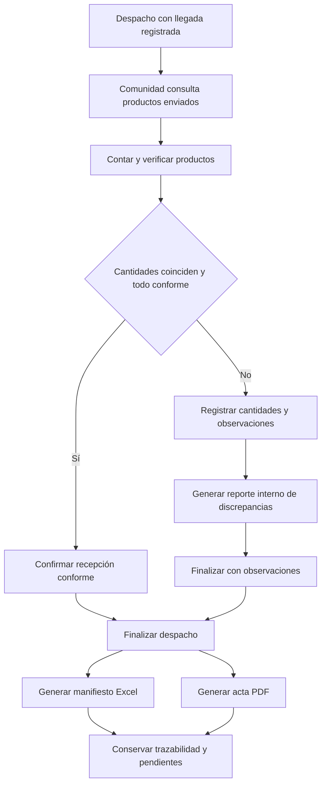

# Proceso 5. Recepción y verificación comunitaria

## 1. Ficha del proceso

| Campo       | Definición                                                                                                         |
| ----------- | ------------------------------------------------------------------------------------------------------------------ |
| Responsable | Jefe de Comuna/Albergue.                                                                                           |
| Inicio      | Despacho destinado a su comunidad con llegada registrada.                                                          |
| Objetivo    | Verificar las cantidades y condiciones de la ayuda recibida frente a lo despachado.                                |
| Resultados  | Recepción conforme o con observaciones, registro interno de discrepancias cuando corresponda y documentos finales. |
| Restricción | Cada línea de despacho solo puede recepcionarse una vez.                                                           |

## 2. Secuencia de actividades

### 2.1. Consultar despacho esperado

El jefe consulta los despachos con llegada registrada destinados a su comunidad, identificando los productos, unidades de medida y cantidades enviadas.

No puede confirmar recepciones de otras comunidades ni de despachos cuya llegada aún no se haya registrado.

### 2.2. Inspeccionar físicamente la carga

El responsable cuenta los productos recibidos y verifica sus condiciones. Para cada línea se distinguen:

- **Cantidad enviada:** unidades retiradas del almacén.
- **Cantidad recibida físicamente:** unidades que llegaron al destino, independientemente de su estado.
- **Cantidad conforme:** unidades recibidas que cumplen las condiciones esperadas.
- **Cantidad faltante física:** diferencia entre lo enviado y lo recibido físicamente.

Las cantidades respetan las unidades de medida definidas en el catálogo.

### 2.3. Confirmar recepción conforme

Si todas las cantidades coinciden con el despacho y los productos cumplen las condiciones esperadas, el jefe confirma la recepción íntegra.

El sistema registra el usuario responsable, la fecha y hora, y el resultado `CONFORMING`.

### 2.4. Confirmar recepción con observaciones

Si existen faltantes, daños u otras discrepancias, el jefe registra las cantidades recibidas y conformes por línea, junto con las observaciones correspondientes.

El sistema calcula los faltantes físicos respecto a lo enviado y genera un **reporte interno de discrepancias**, sin emitir un PDF adicional.

La recepción finaliza con el estado `WITH_OBSERVATIONS`, sin requerir una reposición inmediata.

### 2.5. Finalizar el despacho y generar documentos

Al finalizar la recepción, el sistema actualiza el estado del despacho y habilita la generación de dos documentos:

- **Manifiesto Excel:** detalla los productos y cantidades enviados.
- **Acta PDF:** registra las cantidades recibidas y las observaciones de la entrega.

Ambos documentos se generan tanto para recepciones conformes como para aquellas con observaciones. Los reintentos no deben producir duplicados.

### 2.6. Preservar otras necesidades

La finalización de una recepción no modifica otros despachos ni las cantidades de la solicitud que nunca obtuvieron cobertura.

Las discrepancias detectadas no reactivan automáticamente el matching. Si persisten necesidades por productos faltantes o dañados, la comunidad puede registrar una nueva solicitud independiente.

## 3. Diagrama de flujo

## 4. Cálculo ilustrativo

Un despacho contiene **80 frazadas enviadas**. La comunidad recibe físicamente 78, de las cuales 75 están conformes y 3 presentan daños.

| Medida                       | Cantidad |
| ---------------------------- | -------: |
| Enviada                      |       80 |
| Recibida físicamente         |       78 |
| Conforme                     |       75 |
| Recibida no conforme         |        3 |
| Faltante físico del despacho |        2 |

El faltante físico es de **2 frazadas**, no de 5, porque las 3 dañadas sí llegaron al destino.

El acta registra las 75 unidades conformes y documenta las otras 5 no satisfactorias, diferenciando las 3 dañadas de las 2 faltantes.

## 5. Excepciones

| Caso                                         | Tratamiento                                                                                                |
| -------------------------------------------- | ---------------------------------------------------------------------------------------------------------- |
| Despacho de otra comunidad                   | Denegar el acceso.                                                                                         |
| Despacho sin llegada registrada              | Impedir la confirmación de recepción.                                                                      |
| `recibido > enviado` o `conforme > recibido` | Rechazar las cantidades y solicitar corrección.                                                            |
| Producto o línea ajena al despacho           | Rechazar el registro por inconsistencia.                                                                   |
| Confirmación repetida                        | Conservar un único registro final por despacho.                                                            |
| Error al generar documentos                  | Mantener la recepción finalizada e informar el error o la generación pendiente, sin duplicar la recepción. |

## 6. Evidencias de resultado

La recepción finalizada conserva el despacho, usuario responsable, fecha y hora, resultado y cantidades verificadas por línea.

El registro distingue la llegada de la recepción y permite identificar las discrepancias sin asumir que todas las necesidades fueron satisfechas.

Los documentos generados reflejan las cantidades enviadas y recibidas, mientras que los faltantes de la recepción permanecen documentados sin reactivar automáticamente el matching.
