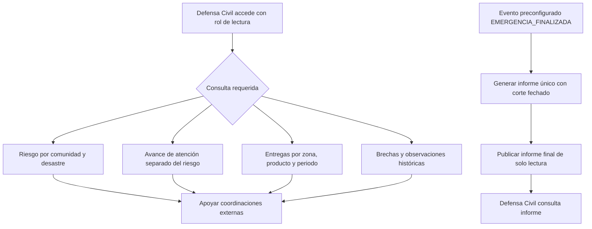

# Proceso 6. Supervisión territorial de Defensa Civil

## 1. Ficha del proceso

| Campo           | Definición                                                                                                |
| --------------- | --------------------------------------------------------------------------------------------------------- |
| Responsable     | Jefe de Defensa Civil.                                                                                    |
| Tipo de proceso | Consultas independientes de solo lectura.                                                                 |
| Inicio          | El usuario autorizado accede a las vistas territoriales o a un informe final publicado.                   |
| Finalización    | Obtención de información sobre riesgos, atención, entregas y brechas para apoyar coordinaciones externas. |
| Restricciones   | No permite modificar operaciones ni consultar inventarios privados de ONG.                                |

## 2. Supervisión operativa sin modificación

### 2.1. Consultar riesgo por comunidad

El sistema presenta un mapa territorial con las comunidades y sus evaluaciones de riesgo, identificadas por tipo de desastre, nivel, fuente y fecha.

El riesgo se determina mediante evaluaciones territoriales, independientemente de la ayuda distribuida. La visualización distingue registros recientes e históricos, sin presentar información antigua como si estuviera actualizada.

### 2.2. Consultar avance de atención

El jefe consulta el progreso de la ayuda humanitaria de forma independiente del nivel de riesgo.

La información diferencia cantidades autorizadas, en traslado y recibidas según los registros disponibles. Los despachos con llegada registrada no se contabilizan automáticamente como recibidos conformes.

### 2.3. Consultar ayudas brindadas

El sistema permite consultar las entregas confirmadas por las comunidades, con filtros previstos por zona, producto y periodo.

El acceso excluye inventarios, lotes, disponibilidad de almacenes y otros datos privados de ONG que no sean necesarios para la supervisión.

### 2.4. Consultar brechas de atención

Se presentan las necesidades pendientes de cobertura y las discrepancias históricas registradas durante las recepciones.

Estas consultas son informativas: no generan solicitudes ni reactivan procesos de matching.

## 3. Informe final posterior a la emergencia

### 3.1. Activación por evento

El cierre del escenario se activa mediante el evento preconfigurado `EMERGENCIA_FINALIZADA`.

Ninguno de los cuatro roles dispone de una función para declarar o finalizar emergencias. El procedimiento institucional real no forma parte de esta versión y no se considera integrado.

### 3.2. Consolidación y publicación

Tras recibir el evento, el sistema genera un informe consolidado que incluye:

- Fecha y hora de corte.
- Participantes de la operación.
- Solicitudes y autorizaciones.
- Despachos y recepciones.
- Cantidades atendidas y necesidades sin cobertura.
- Incidencias y discrepancias registradas.

El informe se genera **una sola vez por evento**. Los reintentos no deben duplicarlo ni modificar silenciosamente su contenido.

Una vez publicado, Defensa Civil puede consultarlo en modo de solo lectura.

### 3.3. Diferencia entre consultas e informe

La supervisión territorial permanece disponible durante la emergencia, mientras que el informe consolidado final solo se publica después del evento de finalización.

Su publicación no concede permisos adicionales para modificar operaciones ni acceder a inventarios privados.

## 4. Diagrama de consultas y publicación

## 5. Interpretación de indicadores

- **Riesgo territorial:** representa la severidad de una evaluación asociada a un desastre, fuente y fecha. No disminuye automáticamente al entregar ayuda.
- **Estado de atención:** refleja el avance humanitario según necesidades, compromisos y recepciones. Si utiliza indicadores semafóricos, sus criterios deben ser independientes de los empleados para representar el riesgo.
- **Brecha de atención:** identifica necesidades sin cobertura y discrepancias documentadas. Una recepción `WITH_OBSERVATIONS` no implica satisfacción completa de la ayuda solicitada.

## 6. Alternativas y datos no disponibles

| Situación                                           | Tratamiento                                                                                                                          |
| --------------------------------------------------- | ------------------------------------------------------------------------------------------------------------------------------------ |
| Ausencia de evaluaciones territoriales recientes    | Mostrar la fecha de los registros disponibles e indicar la falta de evidencia vigente, sin asignar niveles de riesgo no sustentados. |
| Evaluaciones de fuentes contradictorias             | Conservar cada evaluación con su fuente y fecha, sin combinar fenómenos distintos en un único nivel de riesgo.                       |
| Despacho con llegada registrada, pero sin recepción | No contabilizar sus productos como recibidos conformes.                                                                              |
| Intento de modificar solicitudes o inventarios      | Denegar la operación en el servidor.                                                                                                 |
| Evento de finalización no recibido                  | No generar ni publicar el informe final.                                                                                             |
| Recepción repetida del mismo evento                 | Mantener un único informe, sin duplicaciones ni modificaciones silenciosas.                                                          |

## 7. Resultado

Defensa Civil dispone de información territorial y resultados de atención en modo de solo lectura para apoyar coordinaciones externas.

Después del evento de finalización preconfigurado, puede consultar un informe consolidado cuyo contenido permanece inmutable desde las operaciones normales.

Ninguna de estas capacidades permite intervenir en la distribución de ayuda ni acceder a recursos privados de las ONG.
