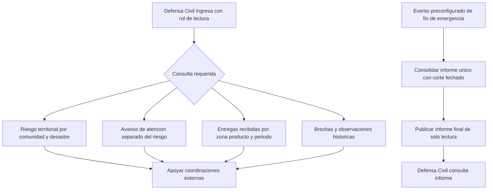

# Proceso 6. Supervisión territorial de Defensa Civil

## 1. Ficha del proceso

| Campo | Definición |
|---|---|
| Responsable | Jefe de Defensa Civil. |
| Tipo de proceso | Consultas independientes, de solo lectura. |
| Inicio | El usuario autorizado ingresa a las vistas territoriales o recibe un informe final publicado. |
| Finalización | Obtiene un panorama de riesgo, atención, entregas o brechas para coordinaciones externas. |
| Restricciones | No modifica operaciones ni evalúa existencias privadas de ONG. |

## 2. Supervisión operativa sin modificación

### 2.1. Consultar riesgo por comunidad

El sistema ofrece el mapa territorial con comunidades y evaluaciones de riesgo que conservan tipo de desastre, nivel, fuente y fecha. El nivel de riesgo depende de la evaluación territorial, no de la entrega de productos. La presentación debe distinguir información vigente de registros históricos y no atribuir falsa actualidad a datos antiguos.

### 2.2. Consultar avance de atención

La información de atención se presenta separada del riesgo. El jefe puede reconocer cantidades autorizadas, en traslado y recibidas según registros válidos. No se suman como recibidas las cargas con solo llegada registrada.

### 2.3. Consultar ayudas brindadas

Se consultan las entregas realmente confirmadas por comunidades, con posibilidad prevista de localizar resultados por zona, producto y periodo. El alcance de lectura excluye inventarios, lotes, disponibilidad de almacenes y datos privados innecesarios.

### 2.4. Consultar brechas de atención

Se muestran necesidades registradas sin cobertura, así como discrepancias históricas observables en la atención. La consulta no crea nuevas solicitudes ni reabre procesos de matching.

## 3. Informe final posterior a la emergencia

### 3.1. Activación por evento

Un evento **preconfigurado de demostración** `EMERGENCIA_FINALIZADA` marca el fin del escenario. Ninguno de los cuatro roles dispone, por este alcance, de un botón para declarar finalizada la emergencia. El mecanismo institucional real para cerrar emergencias no está integrado ni definido.

### 3.2. Consolidación y publicación

Tras el evento se produce un informe consolidado con corte de fecha/hora, participantes, solicitudes, autorizaciones, despachos, recepciones, cantidades atendidas, necesidades no cubiertas e incidencias. Se genera una sola vez por evento, y su contenido no se altera silenciosamente por reintentos posteriores. Se publica en modo lectura para Defensa Civil.

### 3.3. Diferencia entre consultas e informe

Las consultas territoriales **sí** están disponibles durante la operación; el **informe final no** se publica antes del evento. La presencia del informe no habilita acceso a inventarios privados ni edición del sistema.

## 4. Diagrama de consultas y publicación

## 5. Interpretación correcta de los indicadores

- **Riesgo territorial:** procede de una evaluación por fuente y fecha, asociada a un desastre. Su severidad no disminuye automáticamente al realizar una entrega.
- **Atención humanitaria:** deriva de necesidades, compromisos y recepciones. Su color semafórico, si se utiliza, requiere regla propia, distinta del color de riesgo.
- **Brecha de atención:** muestra ayuda todavía no cubierta o diferencias conservadas; una recepción `WITH_OBSERVATIONS` no debe etiquetarse como totalmente satisfecha sin sustento.

## 6. Alternativas y datos no disponibles

| Situación | Comportamiento |
|---|---|
| No hay evaluación territorial reciente | Mostrar fecha y ausencia de evidencia vigente; no inventar nivel. |
| Existen fuentes contradictorias | Mantener fuente y fecha de cada evaluación; criterio de agregación queda pendiente. |
| Un despacho solo registra llegada | No sumarlo a cantidad recibida conforme. |
| Se intenta modificar una solicitud o inventario | Denegar. |
| No existe evento de fin de emergencia | No generar ni publicar informe final. |
| Llega dos veces el mismo evento | No duplicar informe. |

## 7. Resultado

Defensa Civil dispone de una visión de solo lectura para coordinaciones externas y, después del evento de finalización de la demostración, de un informe consolidado inmutable desde las operaciones normales. Ninguna de estas consultas autoriza una acción de distribución.
