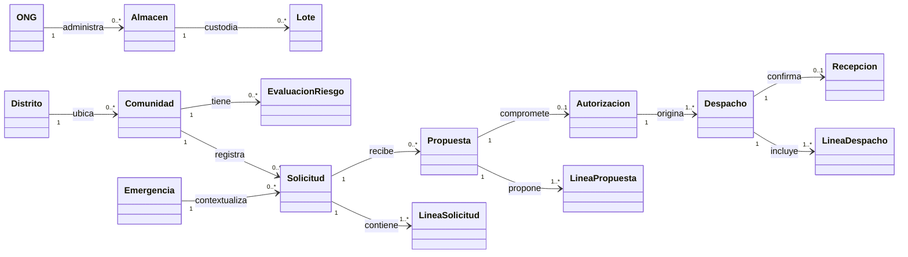

# Modelo conceptual del dominio

## 1. Propósito y alcance

El modelo conceptual identifica entidades y relaciones de negocio sin fijar nombres de tablas, ORM, rutas HTTP o componentes visuales. Una entidad conceptual no implica un microservicio ni una tabla específica. Se modela la distribución de ayuda en una emergencia activa y la supervisión territorial del mismo territorio.

## 2. Conceptos y sus límites

| Concepto | Identidad y responsabilidad conceptual | No debe confundirse con |
|---|---|---|
| Usuario | Persona con rol y pertenencia operativa | Proceso automático |
| Comunidad | Destino territorial único | Distrito o solicitud |
| ONG | Organización que dispone de almacenes y decide aportes | Brigada logística |
| Brigada | Unidad operativa que verifica retiros y registra llegadas | Vehículos y conductores individuales |
| Emergencia | Contexto de atención previamente confirmado | Observación externa o tipo de desastre |
| Solicitud | Necesidades declaradas por una comunidad en una emergencia | Una propuesta de ONG |
| Línea solicitada | Producto y cantidad requerida | Producto físico/lote |
| Lote de stock | Existencia de producto utilizable en almacén | Compromiso autorizado |
| Propuesta | Oferta sugerida a una ONG para líneas solicitadas | Autorización |
| Autorización | Compromiso válido de salida que inmoviliza disponibilidad | Retiro físico |
| Despacho | Envío autorizado desde un almacén hasta una comunidad | Solicitud completa |
| Recepción | Confirmación por comunidad de lo llegado físicamente | Llegada declarada por brigada |
| Evaluación de riesgo | Observación histórica por comunidad, fenómeno y fuente | Nivel de ayuda recibida |
| Informe final | Instantánea inmutable de cierre de emergencia | Reporte ad hoc en vivo |

## 3. Relaciones y cardinalidades conceptuales

La relación autorización-despachos es de uno a varios por almacenes; cada línea autorizada integra un único despacho. Una misma necesidad puede recibir propuestas y compromisos de varias ONG, pero un compromiso válido nunca se duplica.

## 4. Invariantes fundamentales

1. Propuesta no cambia inventario; autorización compromete cantidades; retiro disminuye stock físico.
2. Una entrega llegada no acredita recepción; solo la comunidad determina conforme y observaciones.
3. Las discrepancias de una recepción concluida no reabren automáticamente las líneas enviadas.
4. El riesgo territorial no disminuye por realizar despachos.
5. El registro de desastre de una fuente externa no constituye declaración de emergencia.
6. Cada usuario con rol de comuna, ONG o brigada administra una entidad exclusiva y cada entidad tiene un jefe único en esta versión.

## 5. Separación de conceptos de medición

Una línea solicitada puede tener simultáneamente: `solicitada`, `comprometida_no_retirada`, `enviada`, `recibida_fisica`, `recibida_conforme` y `sin_cobertura`. Se calculan sobre líneas vinculadas sin sumar dos veces el mismo flujo de ayuda. La **brecha de satisfacción** considera toda parte todavía no recibida conforme; la **brecha elegible para matching** excluye las diferencias cerradas que requieren una nueva solicitud por decisión del responsable comunitario.
