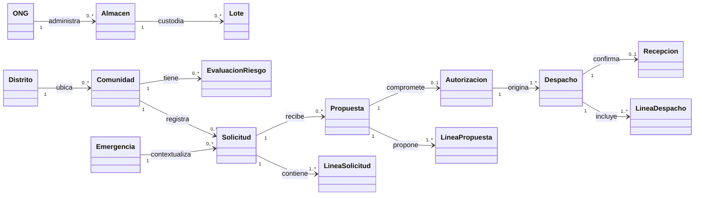

# Modelo conceptual del dominio

## 1. Propósito y alcance

El modelo conceptual define las principales entidades de Alivía, sus responsabilidades y relaciones dentro de la distribución de ayuda humanitaria y la supervisión territorial.

Representa el dominio de negocio sin depender de tablas, ORM, rutas HTTP, componentes visuales ni decisiones sobre la distribución de servicios.

## 2. Conceptos del dominio

| Concepto             | Definición                                                                                                                     |
| -------------------- | ------------------------------------------------------------------------------------------------------------------------------ |
| Usuario              | Persona con un rol y una entidad operativa asociada según sus permisos.                                                        |
| Comunidad            | Entidad territorial destinataria de ayuda, distinta del distrito que la contiene.                                              |
| ONG                  | Organización responsable de sus almacenes, inventarios y decisiones de aporte.                                                 |
| Brigada              | Unidad operativa encargada de verificar retiros y registrar llegadas, sin representar individualmente vehículos o conductores. |
| Emergencia           | Escenario de atención previamente configurado, independiente de las observaciones externas y los tipos de desastre.            |
| Solicitud            | Registro de necesidades de una comunidad dentro de una emergencia.                                                             |
| Línea de solicitud   | Producto del catálogo y cantidad requerida dentro de una solicitud.                                                            |
| Lote de stock        | Existencias de un producto en un almacén, con su identificación y condición de utilización.                                    |
| Propuesta            | Sugerencia de aporte dirigida a una ONG, sin compromiso de inventario.                                                         |
| Autorización         | Compromiso de salida que excluye cantidades de nuevas asignaciones, sin representar un retiro físico.                          |
| Despacho             | Envío autorizado desde un almacén hacia una comunidad.                                                                         |
| Recepción            | Verificación comunitaria de las cantidades y condiciones de los productos entregados.                                          |
| Evaluación de riesgo | Registro territorial asociado a una comunidad, tipo de desastre, fuente y fecha, independiente de la ayuda recibida.           |
| Informe final        | Consolidado de resultados generado al finalizar el escenario, conservado como una instantánea inmutable.                       |

## 3. Relaciones y cardinalidades

Una autorización puede originar varios despachos según los almacenes involucrados, pero cada línea autorizada pertenece a un único despacho.

Una necesidad puede recibir propuestas de distintas ONG sin duplicar los compromisos válidos sobre una misma cantidad.

## 4. Invariantes del dominio

1. **Inventario:** las propuestas no comprometen existencias; las autorizaciones reducen la disponibilidad para asignar y los retiros confirmados descuentan el stock físico.
2. **Recepción:** la llegada de un despacho no acredita conformidad. La comunidad verifica las cantidades y condiciones recibidas.
3. **Cobertura:** las discrepancias de recepciones finalizadas no reactivan automáticamente el matching.
4. **Riesgo territorial:** las entregas humanitarias no modifican automáticamente las evaluaciones de riesgo.
5. **Emergencia:** las observaciones externas no constituyen declaraciones formales de emergencia.
6. **Titularidad:** los jefes de comuna, ONG y brigada mantienen una vinculación exclusiva con su entidad, que dispone de un único responsable en esta versión.

## 5. Cantidades y cobertura

Una línea de solicitud puede relacionarse con las siguientes cantidades:

| Cantidad                   | Significado                                                               |
| -------------------------- | ------------------------------------------------------------------------- |
| `solicitada`               | Unidades requeridas por la comunidad.                                     |
| `comprometida_no_retirada` | Unidades autorizadas pendientes de retiro físico.                         |
| `enviada`                  | Unidades retiradas del almacén para su traslado.                          |
| `recibida_fisica`          | Unidades que llegaron a la comunidad, independientemente de su condición. |
| `recibida_conforme`        | Unidades recibidas que cumplen las condiciones esperadas.                 |
| `sin_cobertura`            | Unidades elegibles que todavía no cuentan con cobertura válida.           |

Estas cantidades se calculan a partir de las operaciones relacionadas, evitando contabilizar dos veces un mismo aporte.

Se distinguen dos tipos de brecha:

- **Brecha de satisfacción:** cantidad solicitada que todavía no se ha recibido conforme, incluidos los aportes autorizados o en tránsito.
- **Brecha elegible para matching:** cantidad pendiente de cobertura que puede recibir nuevas propuestas, excluyendo compromisos vigentes y discrepancias de recepciones finalizadas.

Las cantidades faltantes o no conformes de una recepción cerrada requieren una nueva solicitud comunitaria para volver a considerarse en el matching.
