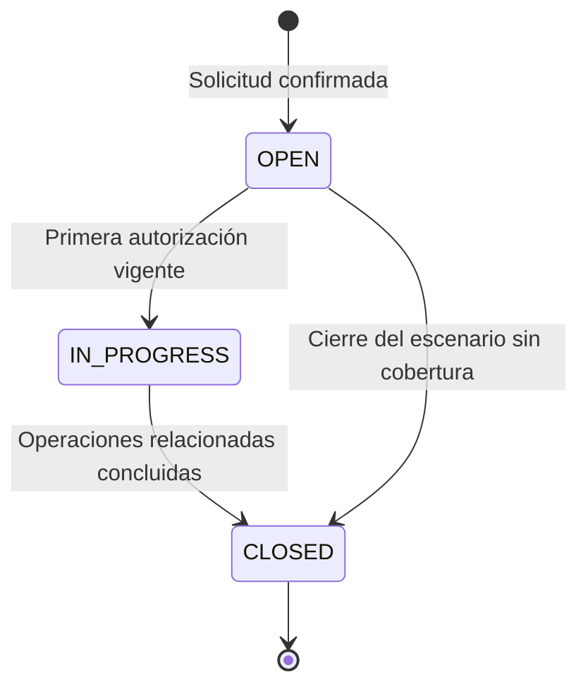
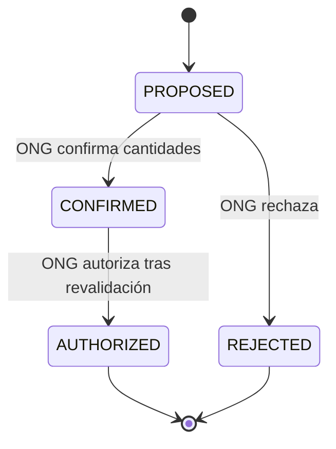
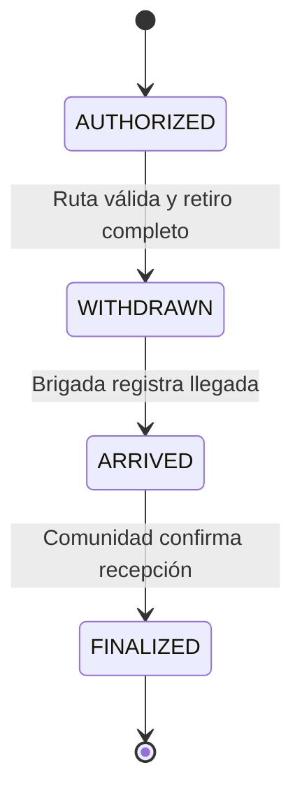
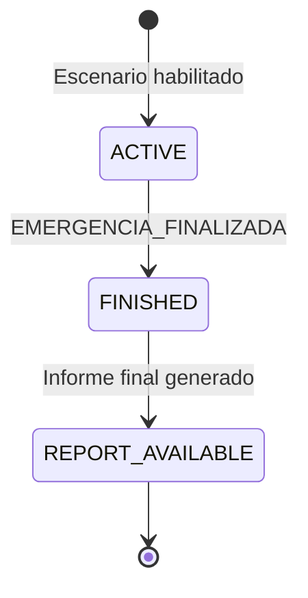

# Ciclos de vida y transiciones

## 1. Principios generales

Los estados representan hechos confirmados del proceso operativo. El servidor controla cada transición mediante la validación de precondiciones, titularidad, estado vigente e idempotencia.

Los estados generales pueden derivarse de las operaciones y sus líneas de detalle, pero no sustituyen las cantidades registradas ni permiten modificaciones arbitrarias desde la interfaz.

## 2. Ciclo de vida de la solicitud

| Estado        | Significado                                                                                  |
| ------------- | -------------------------------------------------------------------------------------------- |
| `OPEN`        | Solicitud confirmada con necesidades registradas.                                            |
| `IN_PROGRESS` | Solicitud con ayuda comprometida o en proceso de atención.                                   |
| `CLOSED`      | Ciclo de atención concluido dentro del escenario, aunque existan necesidades no satisfechas. |

Las solicitudes confirmadas no pueden editarse ni cancelarse por el jefe de Comuna. El estado `CLOSED` conserva las cantidades históricas y no implica satisfacción completa.

## 3. Ciclo de vida de propuestas y autorizaciones

| Estado       | Significado                                                     |
| ------------ | --------------------------------------------------------------- |
| `PROPOSED`   | Aporte sugerido, sin compromiso de inventario.                  |
| `CONFIRMED`  | Cantidades aceptadas por la ONG, pendientes de autorización.    |
| `REJECTED`   | Propuesta rechazada por la ONG.                                 |
| `AUTHORIZED` | Aporte autorizado, con cantidades comprometidas para su salida. |

Si una propuesta pierde validez antes de autorizarse, la operación se rechaza y debe recalcularse una nueva propuesta. La anterior no se modifica silenciosamente.

## 4. Ciclo de vida del despacho y la recepción

Las transiciones cumplen las siguientes condiciones:

- **Ruta:** debe verificarse antes del retiro y puede encontrarse en estado `AVAILABLE`, `UNAVAILABLE` u `OUTDATED`.
- **Retiro:** únicamente se confirma cuando las cantidades físicas coinciden con la totalidad autorizada.
- **Llegada:** acredita el arribo del despacho, sin confirmar la conformidad de los productos.
- **Recepción:** finaliza como `CONFORMING` o `WITH_OBSERVATIONS`. Este último resultado conserva las discrepancias en un reporte interno.
- **Documentos:** al finalizar la recepción se genera un manifiesto Excel y un acta PDF, sin duplicados por despacho y tipo documental.

## 5. Ciclo de vida del escenario de emergencia

| Estado             | Significado                                              |
| ------------------ | -------------------------------------------------------- |
| `ACTIVE`           | Escenario configurado y habilitado para operaciones.     |
| `FINISHED`         | Finalización activada por el evento preconfigurado.      |
| `REPORT_AVAILABLE` | Informe consolidado generado y disponible para consulta. |

Las observaciones territoriales externas no producen transiciones de emergencia.

El informe final se genera una sola vez por evento. Su identificador y `finished_at` determinan el corte temporal; procesar nuevamente el mismo evento no duplica ni modifica silenciosamente el informe publicado.

## 6. Validación de transiciones y concurrencia

| Operación            | Condición de rechazo                                                      | Resultado                                                           |
| -------------------- | ------------------------------------------------------------------------- | ------------------------------------------------------------------- |
| Confirmar propuesta  | Propuesta no vigente, ONG ajena o cantidades superiores a las propuestas. | Sin cambio de estado; informar conflicto.                           |
| Autorizar salida     | Stock insuficiente, cobertura ya comprometida o propuesta no confirmada.  | Sin autorización ni compromiso; puede requerir una nueva propuesta. |
| Confirmar retiro     | Ruta vencida, desconocida o intransitable; cantidades incompletas.        | Sin retiro ni descuento de inventario.                              |
| Registrar llegada    | Despacho no retirado o ajeno a la brigada.                                | Sin cambio de estado.                                               |
| Confirmar recepción  | Despacho sin llegada, recepción finalizada o cantidades inválidas.        | Sin duplicación; conservar y devolver el estado vigente.            |
| Finalizar emergencia | Evento sin identidad configurada.                                         | No generar ni publicar informe final.                               |

Las operaciones críticas deben ejecutarse de forma consistente e idempotente para evitar transiciones y efectos duplicados ante solicitudes concurrentes o reintentos.
