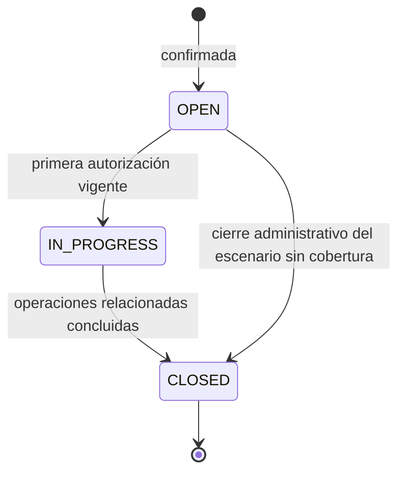
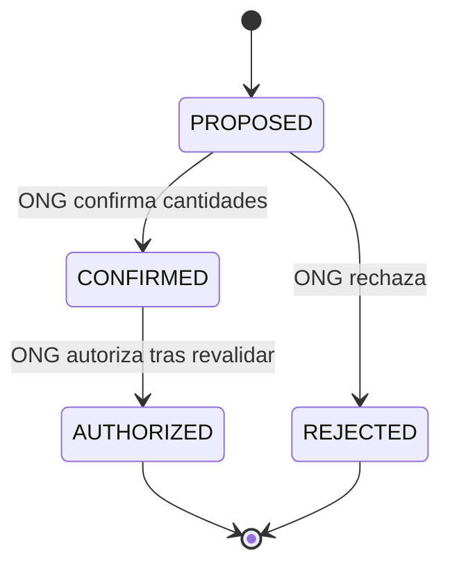
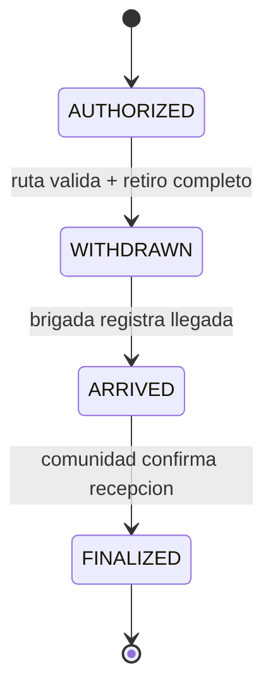
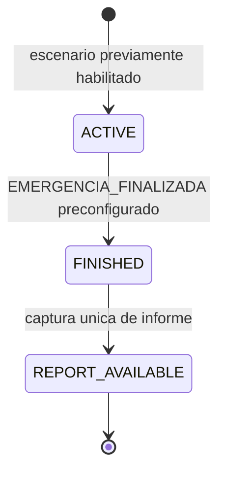

# Ciclos de vida y transiciones

## 1. Principio

Un estado expresa un hecho confirmado por la operación correspondiente. El servidor controla cambios mediante precondiciones, versión actual, titularidad e idempotencia. El navegador no modifica estados arbitrariamente. Los estados de alto nivel pueden ser derivados de las líneas de detalle; nunca sustituyen las cantidades verificadas.

## 2. Solicitud

`OPEN` identifica demanda registrada; `IN_PROGRESS`, atención comprometida o en curso; `CLOSED`, fin del ciclo de atención de esa solicitud en el escenario. `CLOSED` no certifica satisfacción total. La solicitud confirmada no se edita ni cancela desde la interfaz del jefe de Comuna.

## 3. Matching y autorización

Una propuesta confirmada no compromete existencias hasta el acto `AUTHORIZED`. Si una propuesta pierde validez antes de autorizar, el comando de autorización falla y se recalcula una propuesta nueva. No se reescribe la anterior silenciosamente.

## 4. Despacho, ruta y recepción

- La ruta tiene `AVAILABLE`, `UNAVAILABLE` u `OUTDATED` y se verifica **antes** de retirar.
- El retiro solo es completo y debe coincidir con todo lo autorizado por ese despacho.
- La llegada registra fecha, no conformidad.
- La recepción produce `CONFORMING` o `WITH_OBSERVATIONS`; la segunda genera discrepancia interna.
- La finalización desencadena manifiesto Excel y acta PDF, generados idempotentemente por despacho y tipo.

## 5. Riesgo territorial y cierre de emergencia

Las importaciones de datos territoriales son observaciones fechadas y no producen esta transición. La repetición del mismo evento de cierre debe devolver el informe publicado sin crear otro. En el diseño, `finished_at` e identificador de evento fijan el corte temporal del contenido.

## 6. Errores y carreras concurrentes

| Comando | Condición de rechazo | Efecto sobre estado |
|---|---|---|
| Confirmar cantidades | Propuesta no vigente, ONG incorrecta, cantidades superiores | Sin cambio; mostrar conflicto. |
| Autorizar | Falta stock, cobertura ya comprometida, propuesta no confirmada | Sin cambio; puede generarse nueva propuesta. |
| Retirar | Ruta desactualizada, desconocida o intransitable; cantidades no completas | Sin retiro ni movimiento. |
| Registrar llegada | Despacho todavía no retirado o ajeno a brigada | Sin cambio. |
| Recibir | Despacho no llegado, recepción ya finalizada o cantidades inválidas | Sin duplicación; devolver estado vigente. |
| Finalizar emergencia | Evento sin identidad configurada | No publica informe. |
