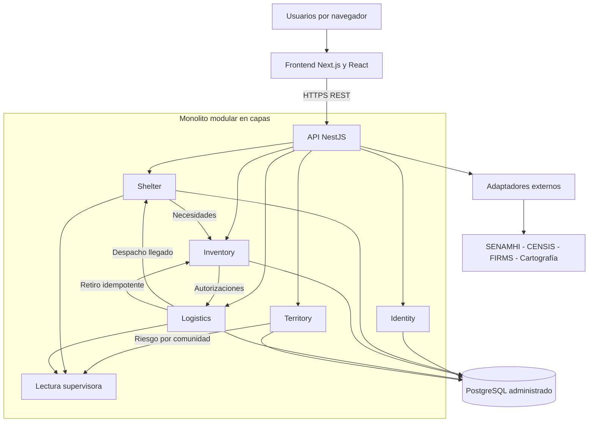

# Arquitectura lógica de Alivía

## 1. Estilo arquitectónico

Alivía adopta una arquitectura web con **frontend independiente y backend monolítico modular organizado en capas**, mantenidos en repositorios Git separados.

El frontend utiliza Next.js y React, mientras que el backend se desarrolla con NestJS. Este último se despliega como una única aplicación, con módulos que mantienen responsabilidades y contratos definidos, sin requerir microservicios.

La arquitectura distingue cuatro capas:

- **Presentación:** interfaces por rol y comunicación mediante contratos HTTP.
- **Aplicación:** coordinación de casos de uso, transacciones y operaciones entre módulos.
- **Dominio:** reglas de negocio independientes del framework, ORM y proveedores externos.
- **Infraestructura:** persistencia, almacenamiento e integración con servicios externos.

El backend se organiza en cinco módulos: `Identity`, `Shelter`, `Inventory`, `Logistics` y `Territory`.

## 2. Componentes y dependencias

Las interacciones internas utilizan **contratos de módulo y eventos de aplicación**, sin acceder directamente a los repositorios privados de otros módulos.

Las referencias entre entidades de distintos módulos se mantienen mediante identificadores lógicos y validaciones coordinadas desde la capa de aplicación.

## 3. Responsabilidades de los componentes

| Componente           | Responsabilidad                                                                                               | Datos propios                           |
| -------------------- | ------------------------------------------------------------------------------------------------------------- | --------------------------------------- |
| Frontend             | Navegación, formularios, interfaces por rol, estados accesibles y mapas.                                      | Sin persistencia operativa propia.      |
| API HTTP             | Recepción de peticiones, validación de entrada, autenticación, autorización y respuestas con errores tipados. | Sin lógica de negocio propia.           |
| Identity             | Usuarios, roles, pertenencia y auditoría de acceso.                                                           | `identity`                              |
| Shelter              | Comunidades, solicitudes, recepciones e informe final.                                                        | `shelter`                               |
| Inventory            | Productos, lotes, movimientos, matching y autorizaciones.                                                     | `inventory`                             |
| Logistics            | Despachos, rutas, vías y documentos.                                                                          | `logistics`                             |
| Territory            | Desastres, niveles, observaciones y evaluaciones de riesgo.                                                   | `territory`                             |
| Adaptadores externos | Obtención y normalización de información de proveedores.                                                      | Datos entregados al módulo responsable. |

Cada módulo administra sus datos y expone las operaciones necesarias mediante contratos definidos.

## 4. Reglas de capas y coordinación

### 4.1. Separación de responsabilidades

- **Presentación:** recibe acciones del usuario y representa resultados, sin decidir permisos ni calcular saldos definitivos.
- **Aplicación:** ejecuta casos de uso, coordina módulos, transacciones y eventos, sin depender de componentes visuales.
- **Dominio:** establece invariantes de inventario, autorización, estados, matching y recepción, sin depender de Prisma, Next.js o bibliotecas HTTP.
- **Infraestructura:** implementa repositorios PostgreSQL/Prisma, clientes externos, servicios cartográficos y almacenamiento de archivos.

### 4.2. Operaciones entre módulos

| Operación             | Coordinación                                                                                                                                              |
| --------------------- | --------------------------------------------------------------------------------------------------------------------------------------------------------- |
| Autorizar aporte      | `Inventory` revalida disponibilidad y cobertura de forma atómica antes de registrar el compromiso.                                                        |
| Confirmar retiro      | `Logistics` verifica ruta y retiro completo; solicita a `Inventory` el descuento idempotente antes de confirmar el despacho.                              |
| Registrar recepción   | `Shelter` valida las líneas y registra una recepción única, cuya finalización desencadena la actualización logística y generación documental idempotente. |
| Supervisar territorio | Un servicio de consulta combina información autorizada de `Territory`, `Shelter` y `Logistics`, sin exponer inventarios privados a Defensa Civil.         |
| Finalizar escenario   | Una tarea de aplicación procesa `EMERGENCIA_FINALIZADA` y conserva una única instantánea del informe consolidado.                                         |

Estas interacciones deben respetar los límites de cada módulo y evitar dependencias directas entre sus implementaciones internas.

## 5. Criterios de diseño

La modularidad busca mantener las reglas del dominio aisladas, facilitar las pruebas y permitir cambios sin afectar componentes no relacionados.

Los patrones de diseño se incorporan únicamente cuando resuelven una necesidad concreta. Los eventos internos pueden utilizar mecanismos de publicación/suscripción sin requerir servicios independientes.

La separación por capas y módulos no implica despliegues individuales ni acceso compartido indiscriminado a sus datos.

## 6. Calidad y límites arquitectónicos

| Atributo      | Criterio                                                                                  |
| ------------- | ----------------------------------------------------------------------------------------- |
| Seguridad     | Sesiones, tokens y cookies protegidos; autorización por rol y titularidad en el servidor. |
| Rendimiento   | Paginación e índices para consultas de solicitudes, lotes y entregas.                     |
| Confiabilidad | Transacciones críticas y mecanismos de idempotencia.                                      |
| Integración   | Adaptadores intercambiables con identificación de fuente y fecha de los datos.            |
| Evolución     | API REST versionada, contratos verificables y relaciones mediante identificadores.        |

La arquitectura no contempla seguimiento GPS continuo, administración de flotas, declaraciones automáticas de emergencia ni microservicios obligatorios.

Este documento define la arquitectura seleccionada para la construcción de Alivía, sin presuponer componentes desplegados o integraciones operativas.
