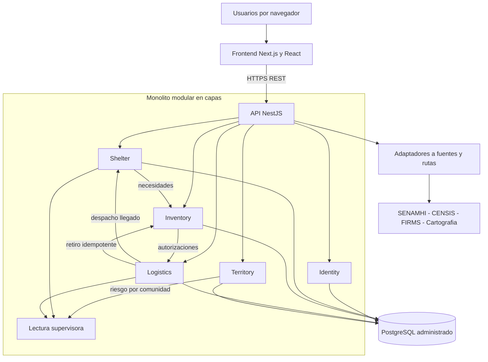

# Arquitectura lógica de Alivía

## 1. Estilo de referencia

Alivía se diseña como una **aplicación web con frontend independiente y backend monolítico modular organizado en capas**. «Monolito modular» significa un proceso de despliegue de la API que contiene módulos con límites de responsabilidad; no significa una base de código sin estructura ni obliga a microservicios. Frontend y backend tendrán repositorios Git distintos.

El modelo utiliza capas de presentación, aplicación, dominio e infraestructura. La capa de dominio contiene reglas sin depender del navegador, del ORM o del proveedor cloud. La presentación ofrece interfaces por rol y consume contratos HTTP. Los módulos públicos del backend son Identity, Shelter, Inventory, Logistics y Territory.

## 2. Componentes y dependencias

Las flechas internas representan interacciones a través de **contratos de módulo** y eventos de aplicación; no autorizan importar directamente entidades de infraestructura de otro módulo. Las relaciones entre datos de módulos se conservan mediante IDs lógicos y validación coordinada del lado de la aplicación, y no mediante acceso arbitrario a repositorios privados.

## 3. Responsabilidades arquitectónicas

| Componente | Función | Propietario de datos |
|---|---|---|
| Frontend | Navegación, formularios, vistas por rol, estados accesibles y mapas | Ningún dato operacional persistente |
| API HTTP | Recepción, validación, autenticación, autorización y errores tipados | Solo transporte, sin decisiones de negocio |
| Identity | Usuarios, pertenencia, roles y auditoría de acceso | `identity` |
| Shelter | Comunidades, solicitudes, recepciones e informe de fin | `shelter` |
| Inventory | Productos, lotes, movimientos, matching y autorizaciones | `inventory` |
| Logistics | Despachos, rutas, vías y documentos | `logistics` |
| Territory | Fenómenos, niveles, observaciones y evaluaciones de riesgo | `territory` |
| Adaptadores | Obtención de información externa y normalización de proveedor | Datos entregados a módulos propietarios |

## 4. Reglas de capas

- **Presentación:** transforma acciones humanas en comandos y representa respuestas; no autoriza recursos ni calcula stock definitivo.
- **Aplicación:** coordina casos de uso, transacciones, validaciones entre módulos y eventos. No contiene componentes React.
- **Dominio:** expresa invariantes de saldo, estados, pertenencia, matching y recepción; no importa Prisma, Next.js ni bibliotecas HTTP.
- **Infraestructura:** repositorios PostgreSQL/Prisma, proveedores cartográficos, clientes externos y almacenamiento de archivos.

### 4.1. Casos críticos de coordinación

1. Autorizar: Inventory verifica de forma atómica disponibilidad y cobertura; registra un compromiso válido.
2. Retirar: Logistics valida ruta y retiro completo; solicita a Inventory descuento idempotente y solo entonces confirma el despacho.
3. Recibir: Shelter valida líneas y registra recepción única; el resultado provoca finalización logística y generación documental idempotente.
4. Supervisar: un servicio de consulta agrega proyecciones permitidas de Territory, Shelter y Logistics, sin conceder a Defensa Civil acceso al inventario privado.
5. Cerrar: una tarea de aplicación procesa el evento preconfigurado y congela una única instantánea de informe.

## 5. Criterios de diseño

Se elige separación modular por estabilidad del dominio y facilidad de prueba. MVC puede describir la organización de la interfaz, pero no sustituye el modelo de capas de backend. No se exige aplicar Singleton, Factory u Observer artificialmente; se emplean construcciones equivalentes solo si simplifican una necesidad real. Los eventos internos de aplicación pueden implementar publicación/suscripción sin elevarlos a microservicios.

## 6. Calidad y límites

- Seguridad: tokens y cookies seguros, comprobación de roles/titularidad en cada operación.
- Rendimiento: consultas paginadas e índices para solicitudes, lotes y entregas.
- Confiabilidad: claves de idempotencia y transacciones críticas.
- Integrabilidad: adaptadores intercambiables por proveedor con datos etiquetados de procedencia.
- Evolución: API REST versionada, datos vinculados por IDs y contratos probados.
- Alcance: sin GPS continuo, flota administrada, decisión autónoma de emergencia ni microservicios obligatorios.

Esta es una arquitectura seleccionada para construcción, no una afirmación de que existen servidores activos o código finalizado.
