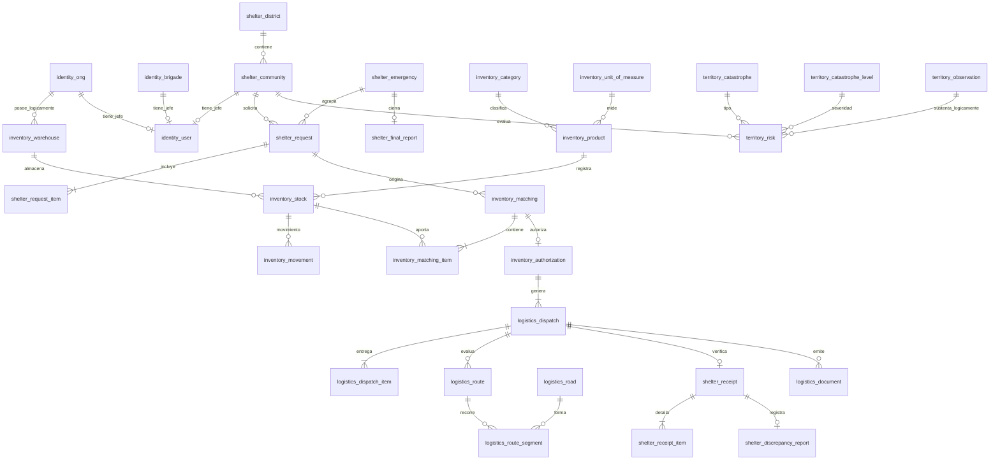

# Modelo relacional global

## 1. Motor y estructura

El diseño selecciona PostgreSQL con Prisma, un único proyecto de base de datos y cinco schemas físicos: `identity`, `shelter`, `inventory`, `logistics` y `territory`. Cada schema es propietario de sus tablas. Las FKs **internas** son restricciones físicas. Las referencias **entre módulos** son UUID lógicos y se validan en la capa de aplicación mediante contratos y transacciones controladas; no deben confundirse con FKs físicas.

El modelo conserva las tablas originales y aplica extensiones mínimas: brigadas con jefe único, emergencia, informe final, auditoría de operaciones y observaciones externas. No introduce módulo de flota, gestión de beneficiarios, devoluciones operativas ni tabla separada de reservas.

## 2. Entidades principales y relaciones

**Importante:** las relaciones que atraviesan schemas se muestran como dependencias conceptuales y se identifican mediante IDs lógicos, sin prometer FKs físicas. Algunas relaciones se limitan a una sola entidad por restricción de negocio incluso cuando son opcionales antes de la carga de datos inicial.

## 3. Convenciones de persistencia

| Convención | Regla |
|---|---|
| PK | UUID generado por servidor/BD. |
| Fechas | `timestamptz` en UTC; interfaz convierte al huso local del usuario. |
| Cantidades | `numeric(18,3)` no negativo, precisión según unidad de producto. |
| Ubigeo | Texto de seis caracteres, no entero. |
| Estado | Enum por schema cuando conjunto es fijo; catálogos editables para productos, criticidad y niveles. |
| Auditoría | Eventos de inserción, sin actualización ni borrado por usuarios normales. |
| Archivos generados | Registro de ubicación y checksum; binarios en almacenamiento externo, no en campos bytea generales. |
| Multientidad | Toda consulta se restringe por usuario autenticado y entidad titular. |

## 4. Restricciones cruzadas obligatorias

1. `identity.user.ong_id` es único cuando no es nulo; igualmente `community_id` y `brigade_id`, para preservar un jefe por entidad.
2. `shelter.request_item`: `UNIQUE(request_id, product_id)`.
3. `shelter.receipt`: `UNIQUE(dispatch_id)`; `receipt_item`: `UNIQUE(dispatch_item_id)`.
4. `inventory.authorization`: `UNIQUE(matching_id)`; claves idempotentes para autorizar y retirar.
5. `logistics.dispatch_item`: `UNIQUE(matching_item_id)` por renglón autorizado.
6. `logistics.route_segment`: `UNIQUE(route_id, sequence)`.
7. `logistics.document`: `UNIQUE(dispatch_id, type)`.
8. `shelter.final_report`: `UNIQUE(emergency_id)` y `UNIQUE(operation_key)`.
9. Invariantes de cantidad: `conforme <= recibida <= enviada`, stock no negativo y disponibilidad calculada sin compromisos duplicados.
10. El cierre no puede duplicarse aunque una tarea/evento sea entregado más de una vez.

## 5. Transacciones y consistencia

La autorización requiere bloqueo o aislamiento transaccional suficiente para revisar stock utilizable y cobertura antes de fijar el compromiso. El retiro coordina descuento de Inventory y transición de Logistics mediante una única transacción en la misma base de datos y una clave de operación única. La recepción registra líneas y estado final y luego provoca generación idempotente de documentos; si falla el archivo, la recepción no se revierte, pero la tarea documental permanece reintentable. Las referencias lógicas se validan por ID, ámbito de entidad y coherencia de detalle.

## 6. Reglas de evolución

Las migraciones Prisma se revisan antes de aplicarse. Para reglas que Prisma no expresa completamente, se usa SQL de migración versionada (por ejemplo índices parciales y comprobaciones). No se elimina información histórica para simplificar pantallas ni se usan nombres territoriales como identificadores operativos.
