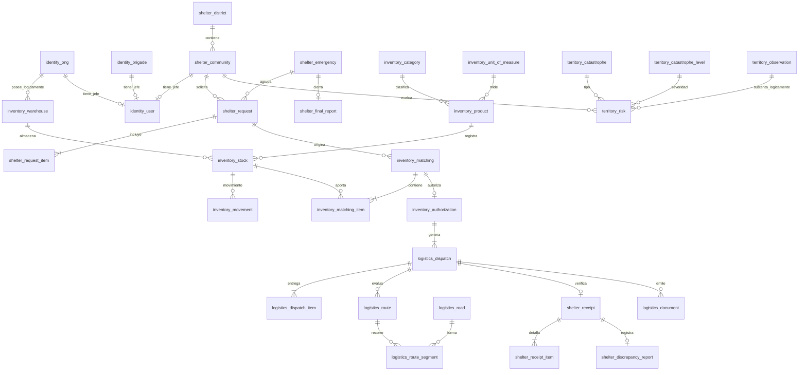

# Modelo relacional global

## 1. Motor y organización de datos

Alivía utiliza **PostgreSQL con Prisma** y una única base de datos organizada en cinco schemas:

- `identity`
- `shelter`
- `inventory`
- `logistics`
- `territory`

Cada schema administra las tablas de su módulo. Las relaciones internas utilizan claves foráneas (FK) físicas, mientras que las referencias entre módulos se representan mediante UUID lógicos y se validan en la capa de aplicación a través de contratos y transacciones controladas.

El modelo incluye brigadas con jefe único, emergencias, informes finales, auditoría de operaciones y observaciones externas. No contempla gestión de flotas, beneficiarios individuales, devoluciones operativas ni reservas de inventario independientes.

## 2. Entidades y relaciones

Las relaciones entre schemas representan dependencias lógicas, no claves foráneas físicas. Las cardinalidades reflejan las restricciones del dominio, incluidas las asociaciones opcionales antes de completar la configuración inicial.

## 3. Convenciones de persistencia

| Elemento                | Convención                                                                                     |
| ----------------------- | ---------------------------------------------------------------------------------------------- |
| Claves primarias        | UUID generado por el servidor o la base de datos.                                              |
| Fechas                  | `timestamptz` en UTC, convertido al huso horario local en la interfaz.                         |
| Cantidades              | `numeric(18,3)` no negativo, con precisión según la unidad del producto.                       |
| UBIGEO                  | Texto de seis caracteres para conservar ceros iniciales.                                       |
| Estados y catálogos     | Enums por schema para valores fijos; catálogos editables para productos, criticidad y niveles. |
| Auditoría               | Eventos de inserción, sin modificación ni eliminación por usuarios operativos.                 |
| Archivos generados      | Binarios en almacenamiento externo; ubicación y checksum registrados en la base de datos.      |
| Aislamiento por entidad | Consultas restringidas según usuario autenticado, rol y titularidad del recurso.               |

## 4. Restricciones de integridad

### 4.1. Unicidad y relaciones

| Entidad                   | Restricción                                                                                           |
| ------------------------- | ----------------------------------------------------------------------------------------------------- |
| `identity.user`           | `ong_id`, `community_id` y `brigade_id` únicos cuando no son nulos, garantizando un jefe por entidad. |
| `shelter.request_item`    | `UNIQUE(request_id, product_id)`                                                                      |
| `shelter.receipt`         | `UNIQUE(dispatch_id)`                                                                                 |
| `shelter.receipt_item`    | `UNIQUE(dispatch_item_id)`                                                                            |
| `inventory.authorization` | `UNIQUE(matching_id)`                                                                                 |
| `logistics.dispatch_item` | `UNIQUE(matching_item_id)` por línea autorizada.                                                      |
| `logistics.route_segment` | `UNIQUE(route_id, sequence)`                                                                          |
| `logistics.document`      | `UNIQUE(dispatch_id, type)`                                                                           |
| `shelter.final_report`    | `UNIQUE(emergency_id)` y `UNIQUE(operation_key)`                                                      |

Las autorizaciones, retiros y eventos de cierre requieren claves idempotentes para impedir efectos duplicados.

### 4.2. Invariantes de cantidades

- Las cantidades físicas y la disponibilidad calculada no pueden ser negativas.
- Los compromisos autorizados pendientes de retiro no pueden superar las existencias utilizables correspondientes.
- Cada línea de recepción debe cumplir `0 <= conforme <= recibida <= enviada`.
- Una misma cantidad comprometida o retirada no puede contabilizarse dos veces.

Las restricciones que involucran datos de distintos módulos se verifican mediante operaciones coordinadas en la capa de aplicación.

## 5. Transacciones y consistencia

Las operaciones críticas deben preservar la integridad de los datos ante concurrencia, errores y reintentos.

- **Autorización:** utiliza bloqueo o aislamiento transaccional suficiente para revalidar stock y cobertura antes de registrar el compromiso.
- **Retiro:** coordina el descuento de `Inventory` y la transición de `Logistics` mediante una única transacción en la misma base de datos, identificada por una clave de operación única.
- **Recepción:** registra las líneas y el estado final antes de desencadenar la generación idempotente de documentos. Un fallo documental no revierte la recepción; la generación permanece reintentable.
- **Referencias entre módulos:** se validan por identificador, titularidad y coherencia de las relaciones, sin acceder directamente a repositorios privados de otros módulos.

## 6. Evolución del esquema

Las migraciones Prisma deben revisarse antes de su aplicación. Las restricciones que el ORM no pueda representar completamente se implementan mediante SQL versionado, incluidos índices parciales y comprobaciones adicionales.

La evolución del modelo debe conservar los registros históricos y utilizar identificadores estables, sin depender de nombres territoriales como claves operativas.
