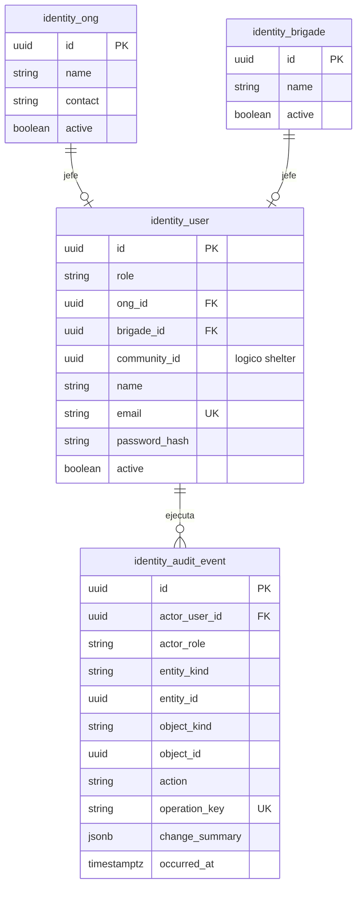

# Persistencia del módulo Identity

## 1. Responsabilidad

El módulo `Identity` administra usuarios, ONG, brigadas, roles y auditoría de operaciones autenticadas.

Cada usuario tiene un único rol, definido mediante el enum `Role` con los valores persistidos:

- `defensaCivil`
- `comuna`
- `brigada`
- `ong`

Las pertenencias a ONG y brigadas se gestionan mediante relaciones internas. La vinculación con comunidades de `Shelter` utiliza referencias lógicas validadas por la capa de aplicación.

## 2. Modelo físico

El schema `identity` contiene cuatro tablas:

- **`identity.ong`:** organizaciones titulares de almacenes y propuestas.
- **`identity.brigade`:** unidades logísticas con jefe responsable, sin administrar conductores ni vehículos.
- **`identity.user`:** cuentas con rol, credenciales y pertenencia a una entidad.
- **`identity.audit_event`:** historial de operaciones con actor, contexto, objeto afectado y momento de ejecución.

## 3. Restricciones de rol y cardinalidad

| Rol            | Pertenencia obligatoria | Pertenencias prohibidas      |
| -------------- | ----------------------- | ---------------------------- |
| `ong`          | `ong_id` único          | `community_id`, `brigade_id` |
| `comuna`       | `community_id` único    | `ong_id`, `brigade_id`       |
| `brigada`      | `brigade_id` único      | `ong_id`, `community_id`     |
| `defensaCivil` | Ninguna                 | Todas                        |

La integridad se garantiza mediante:

- Restricciones `CHECK` condicionales para asegurar la pertenencia correspondiente a cada rol.
- Índices `UNIQUE` parciales sobre identificadores de pertenencia no nulos, impidiendo asignar varios jefes a una entidad.
- Claves foráneas físicas para `user.ong_id` y `user.brigade_id`.
- Validación de `community_id` mediante contratos de aplicación con `Shelter`, sin FK física entre módulos.
- Restricción de unicidad sobre `user.email`.

## 4. Autorización y protección de credenciales

El servidor verifica el rol y la titularidad en cada operación. Por ejemplo, un usuario con rol `ong` solo puede acceder a propuestas vinculadas a su `ong_id`.

Defensa Civil no tiene acceso a almacenes, lotes, existencias ni movimientos privados de ONG.

Las credenciales deben cumplir las siguientes condiciones:

- Almacenar contraseñas mediante un hash resistente, como Argon2id, con parámetros calibrados.
- No devolver `password_hash` en las respuestas de la API.
- Excluir contraseñas, JWT, cookies y secretos de los registros de aplicación.

## 5. Auditoría e idempotencia

`identity.audit_event` conserva el actor, su rol al ejecutar la acción, la entidad contextual, el recurso afectado, el cambio realizado y la fecha de ejecución.

Los eventos deben cumplir estas condiciones:

- Las operaciones críticas utilizan una `operation_key` única para evitar efectos duplicados ante reintentos.
- Solo la aplicación inserta eventos; los usuarios operativos no pueden modificarlos ni eliminarlos.
- Las correcciones generan nuevos registros sin sobrescribir los anteriores.
- La identidad de los actores y objetos permanece vinculada mediante identificadores, aunque cambien sus nombres visibles.
- El historial puede consultarse por personal técnico autorizado para reconstruir las operaciones.
