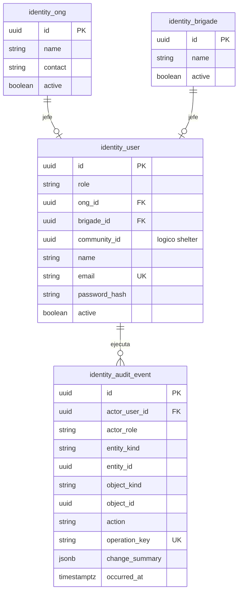

# Persistencia del módulo Identity

## 1. Responsabilidad

Identity es propietario de cuentas, pertenencia a ONG/brigada, roles y trazabilidad de acciones autenticadas. La vinculación con comunidades del dominio Shelter se realiza mediante referencia lógica y restricciones verificadas por comandos de aplicación. Una cuenta tiene un único rol del enum `Role` con valores persistidos exactos: `defensaCivil`, `comuna`, `brigada`, `ong`.

## 2. Modelo físico

## 3. Tablas y atributos

- **`identity.ong`:** `id`, `name`, `contact`, `active`; identifica cada ONG con almacenes y propuestas.
- **`identity.brigade`:** `id`, `name`, `active`; representa la unidad logística y a su único responsable, sin modelar conductores o vehículos.
- **`identity.user`:** `id`, `role`, `ong_id?`, `brigade_id?`, `community_id?`, `name`, `email`, `password_hash`, `active`. `email` es único, `password_hash` nunca se retorna en consultas.
- **`identity.audit_event`:** actor, rol en ese momento, entidad contextual, acción, objeto, cambio y fecha; `operation_key` única para eventos críticos. Solo la aplicación inserta registros; no hay edición ordinaria.

## 4. Restricciones de rol y cardinalidad

| Rol | Pertenencia exigida | Pertenencia prohibida |
|---|---|---|
| `ong` | `ong_id` único | `community_id`, `brigade_id` |
| `comuna` | `community_id` único | `ong_id`, `brigade_id` |
| `brigada` | `brigade_id` único | `ong_id`, `community_id` |
| `defensaCivil` | Ninguna | Todas las pertenencias |

Se utilizan `CHECK` condicionales por rol y `UNIQUE` parcial sobre identificadores no nulos. En PostgreSQL, las FKs físicas son `user.ong_id` y `user.brigade_id`. `community_id` se valida frente al identificador de Shelter mediante servicio de aplicación, ya que no hay FK cruzada por contrato.

## 5. Autorización y privacidad

La presencia de `role='ong'` no habilita propuestas ajenas: cada operación compara `ong_id` de la sesión con el propietario de los recursos. Defensa Civil nunca puede consultar lotes, existencias, movimientos ni almacenes privados. Contraseñas deben almacenarse mediante hash resistente como Argon2id con parámetros calibrados; logs nunca incluirán contraseñas, JWT, cookies ni secretos.

## 6. Auditoría

El evento conserva actor y objeto aun cuando la entidad cambie su nombre visible. Las acciones críticas que originan dos solicitudes repetidas deben compartir idempotencia, no crear dos eventos funcionalmente equivalentes. Las correcciones generan un nuevo evento; los eventos anteriores permanecen consultables por personal técnico autorizado.
