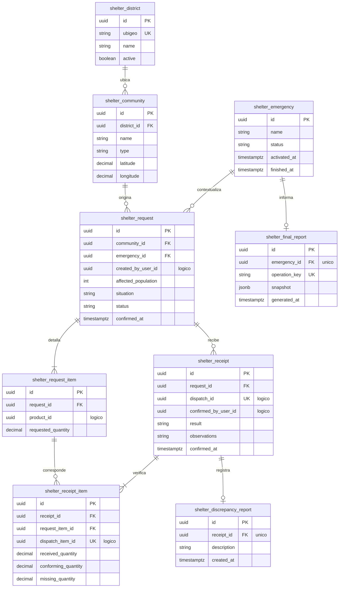

# Persistencia del módulo Shelter

## 1. Responsabilidad

El módulo `Shelter` administra distritos, comunidades, escenarios de emergencia, solicitudes, recepciones y discrepancias comunitarias. También conserva el informe consolidado generado tras el cierre del escenario.

Es propietario de estos registros, pero no modifica inventarios ni determina rutas. Las relaciones con otros módulos se gestionan mediante referencias lógicas validadas por la capa de aplicación.

## 2. Modelo físico

## 3. Restricciones de persistencia

| Entidad                      | Restricciones                                                                                                                                                                                                                       |
| ---------------------------- | ----------------------------------------------------------------------------------------------------------------------------------------------------------------------------------------------------------------------------------- |
| `shelter.district`           | `ubigeo` único, almacenado como texto de seis dígitos para preservar ceros iniciales.                                                                                                                                               |
| `shelter.community`          | `type` admite `COMUNA`, `ALBERGUE` o `CASERIO`. Las coordenadas son opcionales y deben corresponder a datos verificables.                                                                                                           |
| `shelter.emergency`          | Estado inicial `ACTIVE` mediante configuración autorizada. La transición a `FINISHED` ocurre únicamente por el evento preconfigurado `EMERGENCIA_FINALIZADA`, no por recepciones ni observaciones externas.                         |
| `shelter.request`            | Una comunidad puede registrar varias solicitudes. Estados `OPEN`, `IN_PROGRESS` y `CLOSED`; `affected_population >= 0`. Se conserva la fecha de confirmación y no se permite edición o cancelación posterior por el jefe de Comuna. |
| `shelter.request_item`       | `UNIQUE(request_id, product_id)` y `requested_quantity > 0`. El producto pertenece lógicamente al catálogo de `Inventory`.                                                                                                          |
| `shelter.receipt`            | `UNIQUE(dispatch_id)`. Resultado `CONFORMING` o `WITH_OBSERVATIONS`. Requiere llegada registrada del despacho.                                                                                                                      |
| `shelter.receipt_item`       | `UNIQUE(dispatch_item_id)`. Cantidades no negativas y condición `conforming <= received <= dispatched`. El servidor calcula `missing = dispatched - received`.                                                                      |
| `shelter.discrepancy_report` | Máximo un reporte interno por recepción con observaciones, sin generar un PDF independiente.                                                                                                                                        |
| `shelter.final_report`       | Una instantánea por emergencia, con `emergency_id` y `operation_key` únicos. El contenido no se recalcula al consultar ni se publica antes del cierre.                                                                              |

El campo `snapshot` del informe final conserva el corte temporal y los resultados consolidados de solicitudes, autorizaciones, cantidades enviadas, recepciones conformes, brechas y observaciones.

## 4. Referencias entre módulos

Las relaciones externas se almacenan mediante UUID lógicos, sin claves foráneas físicas entre schemas.

| Referencia                      | Módulo propietario | Entidad relacionada                |
| ------------------------------- | ------------------ | ---------------------------------- |
| `request.created_by_user_id`    | `Identity`         | Usuario que confirma la solicitud. |
| `request_item.product_id`       | `Inventory`        | Producto del catálogo.             |
| `receipt.confirmed_by_user_id`  | `Identity`         | Usuario que confirma la recepción. |
| `receipt.dispatch_id`           | `Logistics`        | Despacho recibido.                 |
| `receipt_item.dispatch_item_id` | `Logistics`        | Línea de despacho verificada.      |

La capa de aplicación valida existencia, titularidad y correspondencia de las referencias antes de registrar operaciones que las involucren.

## 5. Integridad de recepción y cobertura

Las cantidades de recepción distinguen:

- **`received_quantity`:** unidades recibidas físicamente, incluidas las dañadas.
- **`conforming_quantity`:** unidades recibidas que cumplen las condiciones esperadas.
- **`missing_quantity`:** diferencia entre las unidades enviadas y las recibidas físicamente.

Una recepción finalizada conserva sus discrepancias sin reactivar automáticamente el matching por las cantidades faltantes o no conformes.

Las necesidades que nunca obtuvieron autorización pueden continuar siendo elegibles mientras el ciclo de atención permanezca abierto. El estado `CLOSED` finaliza dicho ciclo, pero no implica satisfacción completa ni elimina los saldos históricos.
