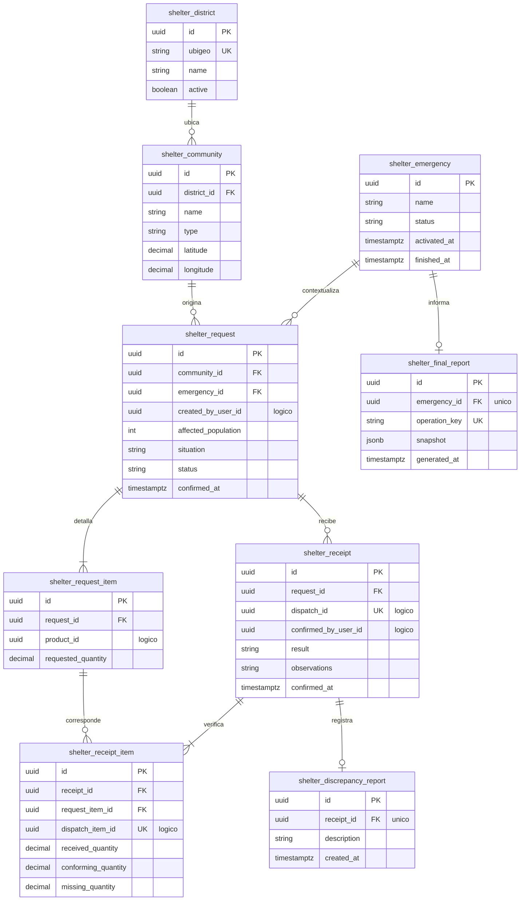

# Persistencia del módulo Shelter

## 1. Responsabilidad

Shelter administra distritos, comunidades, emergencia activa, solicitudes y recepción finalizada de despachos. Es propietario de la discrepancia comunitaria y de la instantánea consolidada que se publica tras el evento de cierre preconfigurado. No modifica stock ni decide rutas.

## 2. Relaciones físicas internas

## 3. Reglas de las tablas

- **Distrito:** UBIGEO es texto de seis dígitos, único y sin pérdida de ceros iniciales.
- **Comunidad:** `type` adopta `COMUNA`, `ALBERGUE`, `CASERIO`; coordenadas son datos opcionales verificables, no supuestos territoriales.
- **Emergencia:** inicia en `ACTIVE` mediante configuración autorizada del escenario, finaliza en `FINISHED` solo por `EMERGENCIA_FINALIZADA` preconfigurado. No se deduce por recepción ni por evento sísmico observado.
- **Solicitud:** una comunidad tiene múltiples solicitudes. Estado `OPEN`, `IN_PROGRESS` o `CLOSED`. `affected_population >= 0`; fecha de confirmación guardada; después de confirmar no se edita ni cancela por Comuna.
- **Línea:** `UNIQUE(request_id, product_id)` y `requested_quantity > 0`. Producto referenciado lógicamente al catálogo de Inventory.
- **Recepción:** `dispatch_id UNIQUE`; `result` es `CONFORMING` o `WITH_OBSERVATIONS`. La llegada debe existir previamente.
- **Línea de recepción:** `dispatch_item_id UNIQUE`, cantidades no negativas, `conforming <= received <= dispatched` y `missing = dispatched - received` calculado en servidor.
- **Discrepancia:** cero o un reporte interno por recepción con observaciones. No existe PDF separado de discrepancias.
- **Informe final:** una fila por emergencia; `snapshot` contiene corte fechado de demanda, autorizado, enviado, conforme y brechas con observaciones. No se recalcula al consultar ni se publica antes del cierre.

## 4. Referencias lógicas

`request.created_by_user_id` y `receipt.confirmed_by_user_id` corresponden a Identity; `request_item.product_id` a Inventory; `receipt.dispatch_id` y `receipt_item.dispatch_item_id` a Logistics. Los servicios validan existencia, pertenencia y correspondencia de renglones antes de crear una recepción.

## 5. Política de recepción y demanda

El registro `received_quantity` cuenta productos físicamente presentes aunque dañados; `conforming_quantity` cuenta los aceptados. Una discrepancia no reingresa al matching. La parte de una solicitud que nunca fue autorizada puede continuar en evaluación mientras existan operaciones activas. `CLOSED` refleja final del ciclo y no implica entrega íntegra ni eliminación de faltantes históricos.

## 6. Extensiones mínimas adoptadas

`emergency`, `request.emergency_id` y `final_report` son adiciones para representar de forma coherente el contexto y la publicación final ya definidos. La instantánea evita depender del estado mutable posterior al cierre. No se incorpora un módulo de administración de emergencias para los usuarios operativos.
