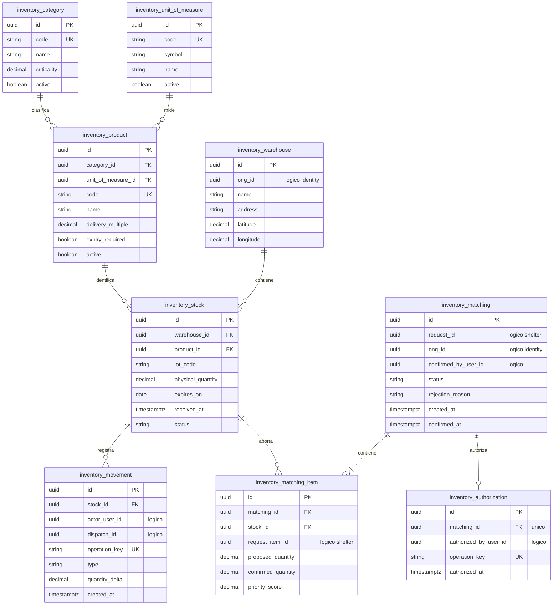

# Persistencia del módulo Inventory

## 1. Responsabilidad

Inventory es propietario del catálogo de productos, almacenes ONG, lotes físicos, movimientos de stock, propuestas de matching, decisiones y autorizaciones de salida. No es propietario de los despachos ni de las recepciones.

## 2. Modelo de relaciones

## 3. Catálogo, lotes y movimientos

- Producto tiene una categoría, una unidad principal y un múltiplo de entrega. No se sustituyen productos ni convierten automáticamente unidades.
- Criticidad de categoría es parámetro normalizado en `[0,1]`, mantenido mediante carga de catálogo verificada.
- Lote tiene `lot_code`, fecha de vencimiento si aplica, estado `USABLE`, `BLOCKED`, `QUARANTINED`, `EXPIRED`, cantidad física no negativa y almacén propietario.
- El matching selecciona lotes `USABLE` con entrega posible antes de vencimiento bajo orden FEFO (`expires_on` ascendente, luego `received_at`, luego UUID).
- Los tipos técnicos de movimiento `ENTRY`, `WITHDRAWAL`, `ADJUSTMENT`, `RETURN` pueden mantenerse en el enum heredado; `RETURN` no se expone como procedimiento operativo de la primera versión.
- Un ajuste que deje stock físico por debajo de compromisos vigentes se rechaza.

## 4. Estados y operaciones

`MatchingStatus`: `PROPOSED` → `CONFIRMED` → `AUTHORIZED`, o `PROPOSED` → `REJECTED`. Revalidaciones fallidas se devuelven como conflicto sin convertir propuestas obsoletas en autorizaciones válidas.

`CONFIRMED` es decisión de cantidad por ONG y no reserva stock. La autorización crea un compromiso a partir de cantidades confirmadas, con operación atómica. Al retirar, Logistics solicita un descuento físico único a Inventory y se registra `WITHDRAWAL` con `operation_key UNIQUE`.

## 5. Algoritmo de matching de referencia

El puntaje es calculado por línea de necesidad:

`score = 0.50 * criticality + 0.30 * min(affected_population / 1000,1) + 0.20 * min(age_days / 7,1)`

- `criticality` usa la categoría del producto y se limita a `[0,1]`.
- `age_days = max(0, floor((now - confirmed_at)/86400s))`.
- Se ordena por `score DESC`, `confirmed_at ASC`, `request_item.id ASC`.
- Por cada necesidad elegible se calcula su porción nunca cubierta descontando recepción conforme y compromiso autorizado no concluido, y excluyendo porciones cerradas con discrepancia.
- Los lotes compatibles se visitan por FEFO y se respeta `delivery_multiple`; propuestas no cambian stock.
- La ONG destinataria confirma como máximo lo propuesto. Rechazos y cantidades reducidas permiten explorar otras existencias sin dar doble cobertura.

Los coeficientes son una **decisión algorítmica de referencia**, no una priorización oficial de población vulnerable. La lógica debe permitir reconfiguración controlada manteniendo la versión de reglas utilizada en cada propuesta.

## 6. Disponibilidad y concurrencia

`disponible_lote = physical_quantity_utilizable - suma(confirmed_quantity de autorizaciones vigentes aun no retiradas para ese lote)`.

No existe tabla `reservation`; un compromiso se deduce de `matching_item` asociado a autorización y ausencia de retiro. Antes de autorizar, el comando comprueba stock y cobertura de la solicitud en transacción serializable o mediante bloqueo equivalente sobre filas/líneas relevantes. Un reintento con igual clave no crea una nueva autorización. No se prometen bloqueos intermodulares sin una transacción coordinada.

## 7. Referencias lógicas

`warehouse.ong_id`, `matching.ong_id` apuntan a Identity; `matching.request_id` y `matching_item.request_item_id` a Shelter; `movement.dispatch_id` a Logistics. En cada operación se comprueba que lote, solicitud, organización y autorización sean coherentes.
