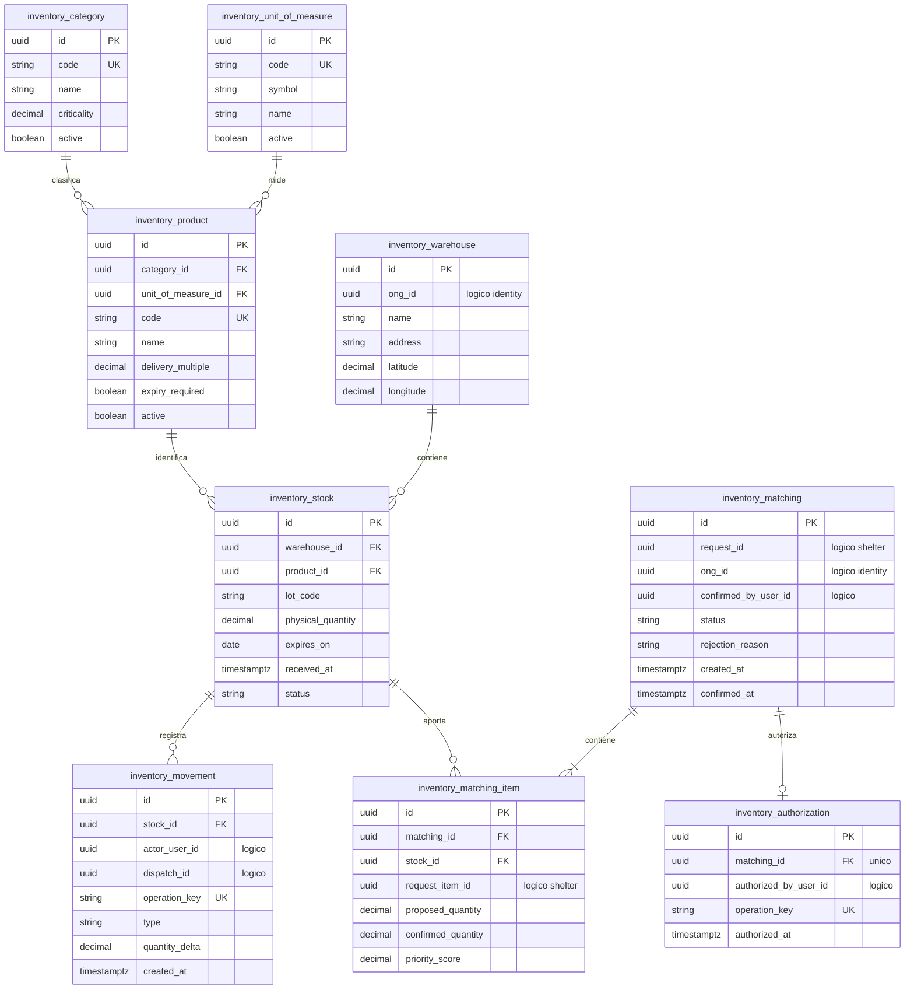

# Persistencia del módulo Inventory

## 1. Responsabilidad

El módulo `Inventory` administra el catálogo de productos, los almacenes de ONG, los lotes, los movimientos de inventario, las propuestas de matching y las autorizaciones de salida.

Controla la disponibilidad y los compromisos de existencias, mientras que los despachos y las recepciones pertenecen a `Logistics` y `Shelter`, respectivamente.

## 2. Modelo físico

## 3. Restricciones de catálogo e inventario

| Elemento        | Restricción                                                                                                                                                    |
| --------------- | -------------------------------------------------------------------------------------------------------------------------------------------------------------- |
| Producto        | Pertenece a una categoría, utiliza una unidad de medida definida y establece un múltiplo de entrega. No se permiten sustituciones ni conversiones automáticas. |
| Criticidad      | Valor normalizado en `[0,1]`, administrado mediante carga verificada del catálogo.                                                                             |
| Lote            | Identificado por producto, almacén y código. Su cantidad física no puede ser negativa y registra vencimiento cuando corresponde.                               |
| Estado del lote | `USABLE`, `BLOCKED`, `QUARANTINED` o `EXPIRED`. Solo las existencias utilizables pueden asignarse.                                                             |
| Selección FEFO  | Prioriza lotes aptos por `expires_on ASC`, seguido de `received_at ASC` y UUID ascendente, cuando corresponda aplicar vencimiento.                             |
| Ajustes         | Deben conservar movimientos trazables y no pueden reducir las existencias por debajo de los compromisos vigentes.                                              |

Los movimientos registran las variaciones físicas del inventario. Los ingresos, ajustes y retiros confirmados deben conservar su causa, responsable y fecha.

## 4. Estados de propuestas y autorizaciones

El estado `MatchingStatus` sigue las transiciones:

`PROPOSED` → `CONFIRMED` → `AUTHORIZED`

O bien:

`PROPOSED` → `REJECTED`

| Estado       | Significado                                                          |
| ------------ | -------------------------------------------------------------------- |
| `PROPOSED`   | Propuesta calculada, sin compromiso de inventario.                   |
| `CONFIRMED`  | Cantidades aceptadas por la ONG, todavía sin autorización de salida. |
| `AUTHORIZED` | Aporte autorizado que compromete existencias disponibles.            |
| `REJECTED`   | Propuesta rechazada, con motivo registrado.                          |

La autorización se realiza mediante una operación independiente que revalida disponibilidad y cobertura de forma atómica. Si las condiciones han cambiado, se rechaza sin convertir una propuesta obsoleta en un compromiso válido.

El descuento físico ocurre únicamente tras el retiro completo confirmado por la brigada. `Inventory` registra entonces un movimiento `WITHDRAWAL` con `operation_key` única, evitando duplicados.

## 5. Algoritmo de matching de referencia

La prioridad se calcula por línea de necesidad:

`score = 0.50 × criticality + 0.30 × min(affected_population / 1000, 1) + 0.20 × min(age_days / 7, 1)`

Donde:

- `criticality`: criticidad normalizada de la categoría, limitada a `[0,1]`.
- `affected_population`: población afectada de la solicitud.
- `age_days = max(0, floor((now - confirmed_at) / 86400s))`.

Las necesidades se ordenan mediante `score DESC`, `confirmed_at ASC` y `request_item.id ASC`.

Para generar propuestas, el algoritmo:

1. Identifica cantidades elegibles, excluyendo recepciones conformes, compromisos vigentes y porciones cerradas con discrepancias.
2. Selecciona existencias compatibles siguiendo FEFO y respetando `delivery_multiple`.
3. Genera propuestas por ONG sin comprometer ni descontar inventario.
4. Mantiene elegibles las cantidades rechazadas o reducidas que nunca fueron autorizadas, evitando duplicar cobertura.

La puntuación es una **política algorítmica de referencia**, no una clasificación oficial de urgencia humanitaria. Su configuración debe permitir cambios controlados y conservar la versión de reglas aplicada a cada propuesta.

## 6. Disponibilidad y concurrencia

La disponibilidad se calcula por lote:

`disponible_lote = physical_quantity_utilizable - compromisos_autorizados_pendientes_de_retiro`

Los compromisos se derivan de las cantidades confirmadas en `matching_item` que cuentan con autorización vigente y todavía no han sido retiradas. No se utiliza una tabla independiente de reservas.

Antes de autorizar, el sistema verifica inventario y cobertura mediante una transacción serializable o un mecanismo de bloqueo equivalente sobre los registros involucrados.

La operación debe garantizar que:

- La disponibilidad nunca sea negativa.
- Las autorizaciones concurrentes no comprometan las mismas existencias por encima de lo disponible.
- Los reintentos con una misma clave idempotente no creen autorizaciones adicionales.
- Las validaciones entre módulos se coordinen dentro de una transacción consistente.

## 7. Referencias entre módulos

Las relaciones externas utilizan UUID lógicos, sin claves foráneas físicas entre schemas.

| Referencia                            | Módulo propietario | Entidad relacionada                 |
| ------------------------------------- | ------------------ | ----------------------------------- |
| `warehouse.ong_id`                    | `Identity`         | ONG propietaria del almacén.        |
| `matching.ong_id`                     | `Identity`         | ONG destinataria de la propuesta.   |
| `matching.confirmed_by_user_id`       | `Identity`         | Usuario que confirma el aporte.     |
| `authorization.authorized_by_user_id` | `Identity`         | Usuario que autoriza la salida.     |
| `movement.actor_user_id`              | `Identity`         | Usuario asociado al movimiento.     |
| `matching.request_id`                 | `Shelter`          | Solicitud que origina la propuesta. |
| `matching_item.request_item_id`       | `Shelter`          | Línea de necesidad propuesta.       |
| `movement.dispatch_id`                | `Logistics`        | Despacho asociado al retiro.        |

La capa de aplicación verifica la existencia, titularidad y correspondencia de estas referencias antes de confirmar operaciones.
