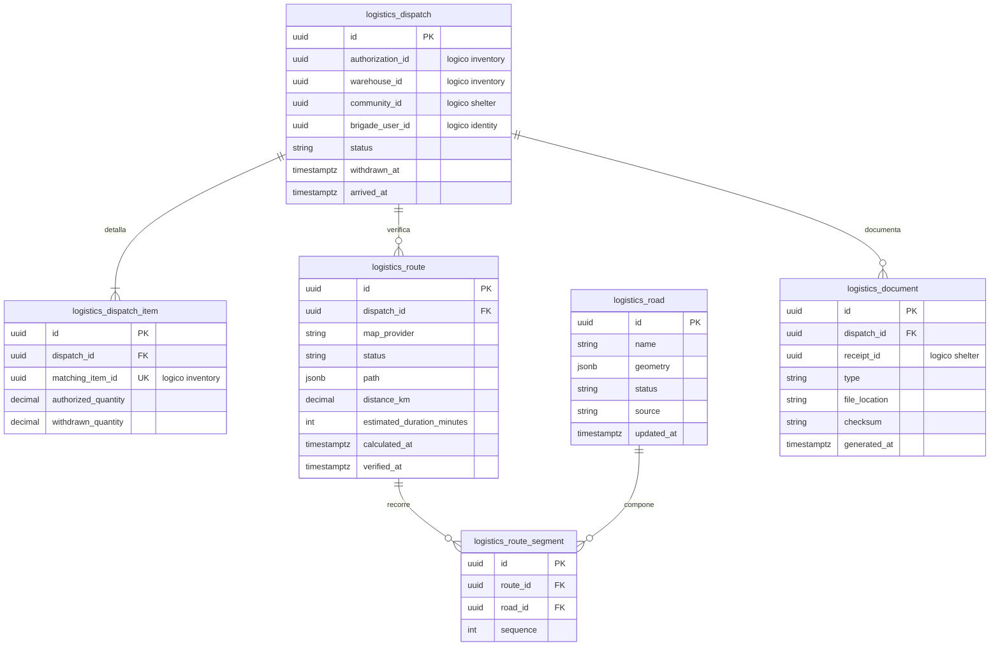

# Persistencia del módulo Logistics

## 1. Responsabilidad

Logistics registra despachos por almacén, sus renglones, rutas verificadas, red vial conocida, retiro completo, llegada y documentos generados al concluir la recepción. La ONG autoriza aportes en Inventory; el jefe de Brigada no modifica cantidades autorizadas ni administra vehículos en la aplicación.

## 2. Modelo de datos

## 3. Despachos y operaciones

- `DispatchStatus`: `AUTHORIZED`, `WITHDRAWN`, `ARRIVED`, `FINALIZED`.
- Cada despacho tiene un almacén de origen. Una autorización puede generar más de un despacho si involucra varios almacenes; cada renglón autorizado corresponde a un único despacho.
- `withdrawn_quantity` pasa de cero a exactamente `authorized_quantity` al verificar la retirada completa; no se permite retiro parcial.
- Una llegada se registra únicamente después del retiro confirmado; no equivale a recepción conforme.
- Las diferencias de cantidades se almacenan en Shelter y no reescriben las cantidades enviadas por Logistics.

## 4. Rutas y estado vial

`RouteStatus`: `AVAILABLE`, `UNAVAILABLE`, `OUTDATED`; `RoadStatus`: `PASSABLE`, `IMPASSABLE`, `UNKNOWN`.

- El cálculo toma origen de almacén y destino de comunidad, usando un proveedor cartográfico y las restricciones viales identificadas por fuente y fecha.
- Se omiten los tramos `IMPASSABLE`; rutas que dependan de tramos `UNKNOWN` quedan `UNAVAILABLE`.
- La verificación vence a treinta minutos; al vencer, la ruta pasa a `OUTDATED` y necesita reevaluación antes del retiro.
- `route_segment` conserva el orden exacto y `UNIQUE(route_id, sequence)`; una ruta no disponible puede carecer de segmentos.
- El estado vial reportado y el camino calculado no garantizan transitabilidad física. Si no hay ruta verificada, la operación queda bloqueada.

## 5. Documentos finales

| Tipo | Formato | Contenido |
|---|---|---|
| `MANIFEST_EXCEL` | XLSX | Origen, destino, despachos, productos, unidades, cantidades enviadas y responsable. |
| `DELIVERY_ACT_PDF` | PDF | Detalle de recibidas, conformes, diferencias, observaciones, fecha y responsables. |

Se generan **después** de finalizar recepción y conservan `receipt_id` lógico, `file_location`, checksum y fecha. `UNIQUE(dispatch_id,type)` asegura que reintentos no creen duplicados. Los binarios se almacenan fuera de la BD en almacenamiento de objetos con permisos estrictos; la tabla mantiene metadatos.

## 6. Integridad intermodular

El retiro se confirma solo si Inventory devolvió un descuento transaccional idempotente del mismo despacho; si falla, no se publica `WITHDRAWN`. La finalización se produce al validar el resultado de recepción de Shelter. Los transportistas e incidencias del trayecto son operados por la brigada fuera de la aplicación, no se agregan tablas de flota o incidencias de viaje.
