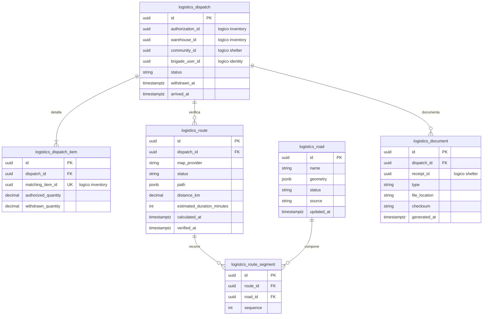

# Persistencia del módulo Logistics

## 1. Responsabilidad

El módulo `Logistics` administra despachos por almacén, líneas de productos autorizados, rutas, información vial, retiros, llegadas y documentos generados tras finalizar la recepción.

Las autorizaciones pertenecen a `Inventory` y las recepciones a `Shelter`. La brigada verifica los retiros y registra las llegadas, sin modificar las cantidades autorizadas.

## 2. Modelo físico

## 3. Despachos y transiciones

El estado `DispatchStatus` sigue esta secuencia:

`AUTHORIZED` → `WITHDRAWN` → `ARRIVED` → `FINALIZED`

Las operaciones cumplen las siguientes restricciones:

- Cada despacho corresponde a un único almacén. Una autorización puede originar varios despachos, pero cada línea autorizada pertenece a uno solo.
- El retiro debe ser completo: `withdrawn_quantity` pasa de cero a `authorized_quantity`, sin admitir cantidades parciales.
- El estado `WITHDRAWN` solo se confirma cuando `Inventory` ha realizado el descuento físico transaccional e idempotente del despacho.
- La llegada se registra después del retiro confirmado y no implica recepción conforme.
- El estado `FINALIZED` requiere una recepción finalizada y validada por `Shelter`. Las discrepancias se conservan en ese módulo sin modificar las cantidades enviadas.

## 4. Rutas y restricciones viales

Los estados utilizados son:

- **`RouteStatus`:** `AVAILABLE`, `UNAVAILABLE`, `OUTDATED`.
- **`RoadStatus`:** `PASSABLE`, `IMPASSABLE`, `UNKNOWN`.

El cálculo de rutas considera el almacén de origen, la comunidad destinataria y las restricciones viales identificadas por fuente y fecha.

Una ruta se considera utilizable únicamente si:

- No incluye tramos `IMPASSABLE`.
- No depende de tramos `UNKNOWN`.
- Su verificación tiene menos de treinta minutos de antigüedad.

Al vencer ese plazo, la ruta pasa a `OUTDATED` y requiere una nueva evaluación antes de confirmar el retiro.

`logistics.route_segment` conserva el orden de los tramos mediante `UNIQUE(route_id, sequence)`. Las rutas no disponibles pueden carecer de segmentos.

La evaluación utiliza información vial conocida y no garantiza transitabilidad física. Sin una ruta válida y vigente, el retiro permanece bloqueado.

## 5. Documentos finales

Los documentos se generan después de finalizar la recepción, independientemente de que su resultado sea conforme o con observaciones.

| Tipo               | Formato | Contenido                                                                           |
| ------------------ | ------- | ----------------------------------------------------------------------------------- |
| `MANIFEST_EXCEL`   | XLSX    | Origen, destino, despacho, productos, unidades, cantidades enviadas y responsable.  |
| `DELIVERY_ACT_PDF` | PDF     | Cantidades recibidas y conformes, diferencias, observaciones, fecha y responsables. |

Cada documento conserva la referencia lógica `receipt_id`, la ubicación del archivo, su checksum y la fecha de generación.

La restricción `UNIQUE(dispatch_id, type)` impide crear documentos duplicados ante reintentos.

Los archivos se almacenan fuera de PostgreSQL, en un servicio de almacenamiento de objetos con permisos restringidos. La tabla `logistics.document` conserva únicamente sus metadatos.
