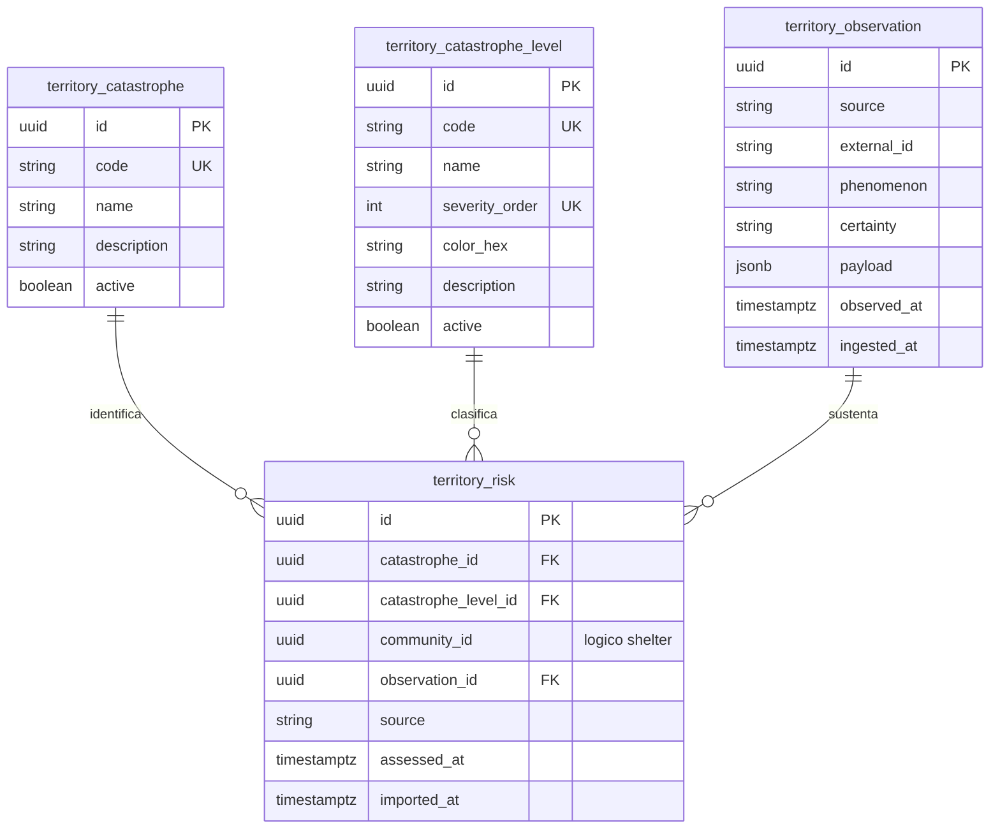

# Persistencia del módulo Territory

## 1. Responsabilidad

El módulo `Territory` administra el catálogo de tipos de desastre, los niveles de riesgo, las evaluaciones históricas por comunidad y las observaciones procedentes de fuentes externas.

La información territorial se mantiene independiente del estado de atención humanitaria. Las observaciones externas no declaran emergencias ni modifican automáticamente su estado formal.

## 2. Modelo físico

## 3. Restricciones de persistencia

| Entidad                       | Restricciones                                                                                                                                                                                            |
| ----------------------------- | -------------------------------------------------------------------------------------------------------------------------------------------------------------------------------------------------------- |
| `territory.catastrophe`       | Catálogo de fenómenos como sismos, inundaciones y deslizamientos, identificados mediante códigos únicos.                                                                                                 |
| `territory.catastrophe_level` | Escala configurable con código, orden de severidad único y color de representación. Los niveles permiten comparar severidades dentro de un fenómeno, sin asumir equivalencia entre desastres diferentes. |
| `territory.observation`       | Conserva fuente, fenómeno, contenido original limitado, certeza y fechas de observación e ingesta. Admite `OBSERVED`, `ESTIMATED` y `UNVERIFIED`.                                                        |
| `territory.risk`              | Relaciona comunidad, tipo de desastre, nivel, fuente y fecha de evaluación. `observation_id` puede ser nulo para registros precargados por administración técnica.                                       |

Las observaciones deben evitar duplicados mediante `UNIQUE(source, external_id)` cuando exista un identificador del proveedor. En caso contrario, se utiliza una huella determinista basada en fuente, fenómeno y fecha.

La referencia `risk.community_id` pertenece lógicamente a `Shelter` y se valida mediante contratos de aplicación, sin FK física entre módulos.

## 4. Vigencia y representación territorial

Las evaluaciones conservan su historial y se consultan por `community_id`, tipo de desastre, fuente y `assessed_at DESC`.

Una evaluación importada tardíamente no reemplaza otra más reciente. La visualización debe cumplir las siguientes condiciones:

- Identificar la fuente y fecha de cada evaluación.
- Presentar los riesgos por fenómeno y fuente, sin consolidarlos en un único nivel global.
- Representar el estado de atención humanitaria de forma independiente del riesgo territorial.
- No deducir la transitabilidad de una carretera a partir del riesgo de una comunidad, ya que el estado vial pertenece a `Logistics`.

## 5. Ingesta de información externa

Los adaptadores deben utilizar fuentes con condiciones de acceso y uso verificadas, validando procedencia, fecha, fenómeno, ubicación y duplicados antes de incorporar sus datos.

Las fuentes consideradas incluyen:

- **CENSIS/IGP:** observaciones sísmicas.
- **SENAMHI:** información meteorológica e hidrológica.
- **NASA FIRMS:** detecciones de focos de calor, sin considerarlas confirmaciones automáticas de incendios.

Las observaciones sin ubicación fiable se conservan como datos no georreferenciables y no generan evaluaciones de riesgo atribuidas a comunidades sin sustento.

## 6. Control de acceso

Defensa Civil dispone de consultas territoriales de solo lectura, sin permisos para modificar evaluaciones ni administrar fuentes externas.

Los catálogos y las importaciones corresponden a la administración técnica o a procesos de integración autorizados.

`Territory` no administra inventarios ni expone operaciones que permitan modificarlos.
