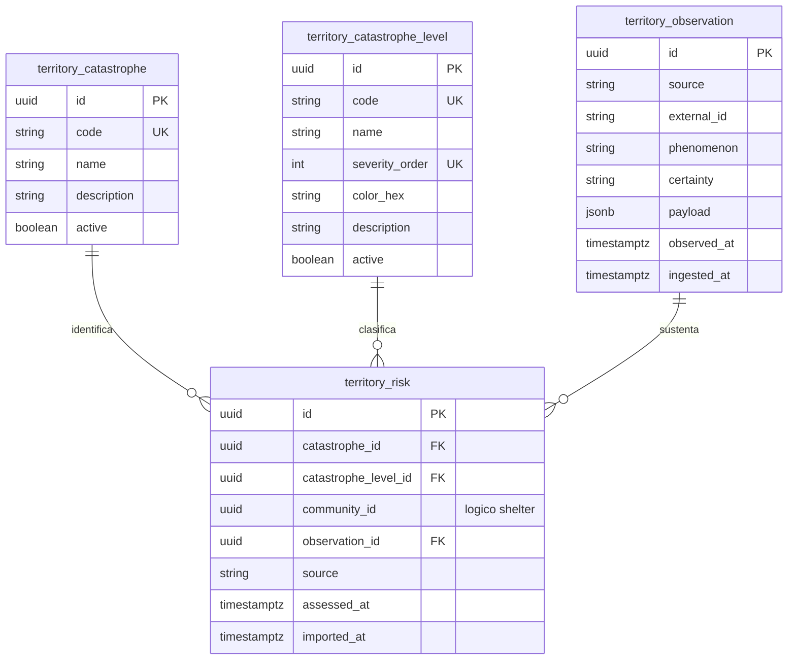

# Persistencia del módulo Territory

## 1. Responsabilidad

Territory conserva el catálogo de tipos de desastre, la escala de niveles de riesgo y el historial de evaluaciones por comunidad. Adicionalmente registra observaciones externas importadas con procedencia y fecha. Los datos externos informan riesgo, pero no cambian automáticamente el estado formal de emergencia ni la situación de atención humanitaria.

## 2. Modelo de datos

## 3. Catálogos y observaciones

- `catastrophe`: clasificación independiente como sismo, inundación o deslizamiento; no se representa como texto libre por evaluación.
- `catastrophe_level`: nivel, orden de severidad y color configurable. La escala común permite comparar niveles **dentro de un fenómeno**, no inferir equivalencia automática entre desastres distintos.
- `observation`: `(source,external_id)` único cuando el proveedor entrega identificador; en caso contrario se usa una huella determinista de fuente, fenómeno y fecha. Conserva dato original limitado, fecha de observación, fecha de ingesta y atributo de certeza `OBSERVED`, `ESTIMATED`, `UNVERIFIED`.
- `risk`: vincula comunidad lógica, fenómeno, nivel, fuente y fecha; `observation_id` puede ser nulo si el dato fue precargado por administración técnica.

## 4. Vigencia y visualización

Una evaluación importada tardíamente no sustituye a otra evaluada más recientemente. Las capas del mapa se consultan por `community_id`, desastre, fuente y `assessed_at DESC`. Se muestran por separado riesgo territorial y avance humanitario. No existe un color de riesgo global único mezclando catástrofes heterogéneas. El estado de la carretera es dato logístico y no puede deducirse del nivel de riesgo de la comunidad.

## 5. Entrada de datos externos

Los adaptadores consumen fuentes con autorización y contratos comprobados; validan fecha, tipo, ubicación, duplicados y procedencia. CENSIS/IGP y SENAMHI son referencias oficiales para observaciones peruanas; NASA FIRMS puede aportar detecciones de focos de calor, no confirmaciones de incendios por sí solas. Datos sin ubicación fiable quedan registrados como observación no georreferenciable y no generan riesgo de comunidad ficticio.

## 6. Acceso

Defensa Civil consulta vistas territoriales de solo lectura. Los catálogos y la importación los gestiona la administración técnica o el proceso autorizado de integración, no una pantalla editora de Defensa Civil. El modelo no contiene inventarios ni permite modificarlos por medio de esta consulta.
