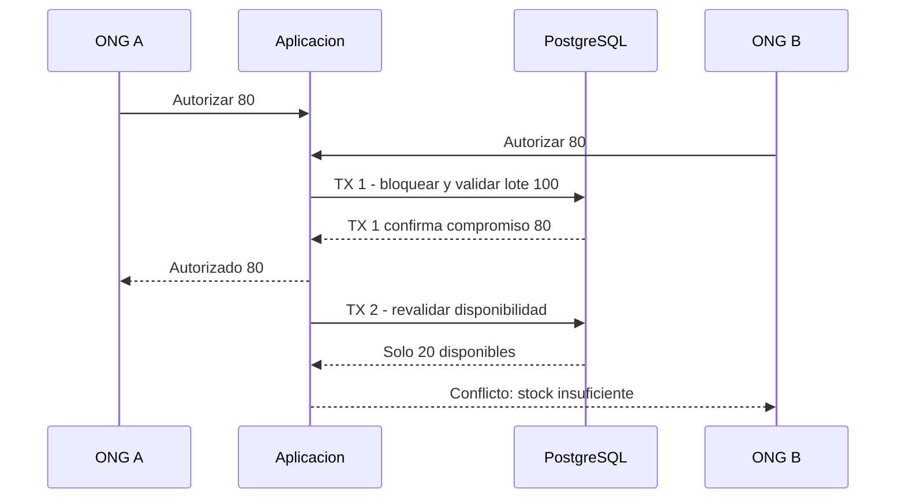

# Integridad transaccional y políticas SQL

## 1. Propósito

Definir cómo preservar consistencia entre existencias, autorizaciones, despachos, recepciones y auditoría cuando la aplicación ejecuta operaciones simultáneas o recibe solicitudes repetidas.

## 2. Límites transaccionales

| Operación | Filas y contratos involucrados | Requisito de atomicidad |
|---|---|---|
| Autorizar | Matching confirmado, lotes y cobertura de solicitud | Validar y comprometer en la misma transacción. |
| Retirar | Despacho y lote con stock físico | Descontar una sola vez y actualizar estado conjuntamente. |
| Recepcionar | Cabecera, líneas y discrepancia | Registrar recepción única y todas las líneas o nada. |
| Publicar final | Emergencia e informe de corte | Crear exactamente una instantánea y marcar cierre. |

## 3. Concurrencia de autorización

El orden concreto de llegada no importa: la invariancia es que no se autoricen 160 unidades sobre 100 disponibles.

## 4. Claves y comprobaciones

- Las operaciones críticas reciben `Idempotency-Key` UUID estable por intento lógico; la clave se asocia a actor, tipo de comando y recurso.
- Solicitud repetida con igual clave y mismo contenido devuelve el resultado anterior; con contenido distinto devuelve conflicto.
- Las claves `UNIQUE` y `CHECK` se mantienen en PostgreSQL, no solo en validación de TypeScript.
- Se usan transacciones SQL con bloqueo de filas relevantes o aislamiento `SERIALIZABLE` y política explícita de reintento de serialización.
- Las inserciones de eventos críticos comparten transacción con la operación de dominio; una generación documental fallida se reintenta fuera de la transacción con un identificador único.

## 5. Conciliación y auditoría

Se conserva bitácora de cambios y movimientos con valores anterior/posterior cuando aplique. Una tarea periódica de comprobación detecta posibles inconsistencias `physical < committed`, despachos retirados sin movimiento, recepciones sin despacho llegado, archivos faltantes y resúmenes de cobertura incompatibles. La comprobación **detecta** inconsistencias; no altera silenciosamente los hechos históricos.

## 6. Migraciones y restauración

Antes de aplicar cambios incompatibles se guarda respaldo verificado, se revisan operaciones activas y se prueba migración sobre una copia representativa. Prisma administra migraciones versionadas y SQL complementario para índices parciales y CHECK. Una restauración se valida mediante consulta de recuentos y conciliación de saldos, no solo por iniciar el motor.
