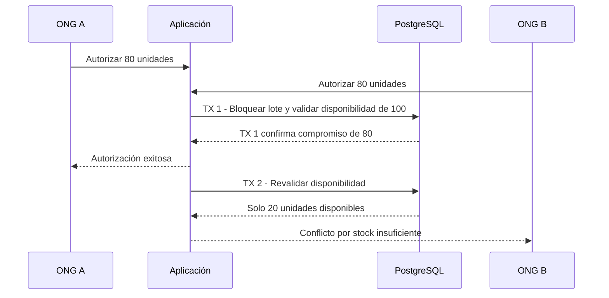

# Integridad transaccional y políticas SQL

## 1. Propósito

Establecer los mecanismos que garantizan la consistencia entre inventarios, autorizaciones, despachos, recepciones y auditoría, incluso ante operaciones concurrentes, fallos o solicitudes repetidas.

## 2. Límites transaccionales

| Operación            | Recursos involucrados                                 | Garantía de atomicidad                                                               |
| -------------------- | ----------------------------------------------------- | ------------------------------------------------------------------------------------ |
| Autorizar            | Propuesta confirmada, lotes y cobertura de solicitud. | Validar disponibilidad y registrar el compromiso en una misma transacción.           |
| Retirar              | Despacho y existencias físicas.                       | Descontar inventario una sola vez y actualizar el estado del despacho conjuntamente. |
| Recepcionar          | Recepción, líneas y discrepancias.                    | Registrar todos los datos de la recepción o revertir la operación completa.          |
| Finalizar emergencia | Emergencia e informe consolidado.                     | Registrar el cierre y generar una única instantánea final.                           |

## 3. Control de concurrencia

Las autorizaciones concurrentes deben respetar la disponibilidad real, independientemente de su orden de ejecución. En el ejemplo, **no pueden comprometerse 160 unidades cuando únicamente existen 100 disponibles**.

## 4. Idempotencia y restricciones SQL

Las operaciones críticas deben cumplir las siguientes condiciones:

- **Clave idempotente:** cada operación lógica utiliza una `Idempotency-Key` UUID estable, vinculada al actor, comando y recurso.
- **Solicitudes repetidas:** una petición con la misma clave y contenido devuelve el resultado anterior. Si el contenido difiere, se rechaza por conflicto.
- **Integridad en PostgreSQL:** las restricciones `UNIQUE` y `CHECK` se aplican en la base de datos, no únicamente mediante validaciones de TypeScript.
- **Control de concurrencia:** las transacciones utilizan bloqueo de filas relevantes o aislamiento `SERIALIZABLE`, con una política explícita para reintentar conflictos de serialización.
- **Auditoría transaccional:** los eventos críticos se registran dentro de la misma transacción que la operación correspondiente.
- **Documentos:** la generación se ejecuta fuera de la transacción principal y admite reintentos idempotentes mediante identificadores únicos, sin revertir operaciones ya confirmadas.

## 5. Conciliación y auditoría

Los movimientos y eventos conservan los valores anteriores y posteriores cuando corresponda, permitiendo reconstruir las operaciones.

Una tarea periódica de conciliación debe detectar:

- Existencias físicas inferiores a los compromisos vigentes (`physical < committed`).
- Despachos retirados sin movimiento de inventario asociado.
- Recepciones vinculadas a despachos sin llegada registrada.
- Archivos documentales faltantes.
- Saldos de cobertura inconsistentes.

La conciliación **identifica y reporta inconsistencias**, sin modificar automáticamente registros ni alterar el historial.

## 6. Migraciones y restauración

Prisma administra las migraciones versionadas, complementadas con SQL cuando se requieran índices parciales, restricciones `CHECK` u otras condiciones no representables directamente mediante el ORM.

Antes de aplicar cambios incompatibles, se debe:

1. Disponer de un respaldo verificado.
2. Revisar las operaciones activas que podrían verse afectadas.
3. Probar la migración sobre una copia representativa de los datos.

La restauración se verifica mediante recuentos de registros y conciliación de saldos. El inicio exitoso del motor de base de datos no constituye por sí solo una recuperación válida.
