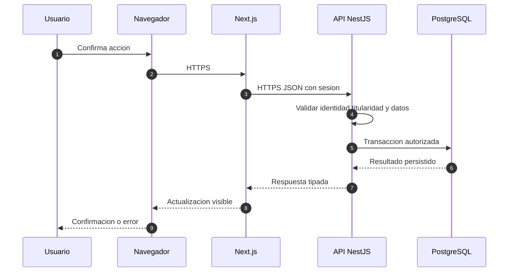

# Comunicación entre navegador y servidor

## 1. Modelo de interacción

Alivía es una aplicación web con cliente Next.js y API NestJS independientes. El navegador se comunica con el frontend mediante HTTPS; el frontend entrega solicitudes JSON a la API mediante HTTPS. La API autoriza la operación, ejecuta casos de uso y utiliza PostgreSQL mediante repositorios de datos. Las fuentes externas se consultan desde servicios del backend, no desde navegadores que expongan credenciales.

## 2. Protocolo y formato

- Transporte externo: HTTPS con TLS válido. HTTP redirige a HTTPS.
- API primaria: REST JSON, rutas versionadas con prefijo `/v1`; las URLs son un contrato técnico configurable, no identidad de una vista ni nombre de archivo.
- Identificador de recurso: UUID. Fechas en ISO 8601/UTC. Cantidades decimales como cadenas normalizadas al intercambiar información monetaria o de stock precisa, evitando errores de coma flotante.
- Código de respuesta: `200` lectura/actualización, `201` alta, `204` operación sin cuerpo, `400` petición mal formada, `401` sin sesión, `403` sin acceso, `404` no existente u oculto, `409` conflicto, `422` datos semánticamente inválidos, `429` demasiadas solicitudes, `500` fallo no previsto.
- Errores: cuerpo basado en `application/problem+json` con `type`, `title`, `status`, `detail`, `instance` y `requestId`. No retornar trazas de stack ni secretos al navegador.

## 3. Sesión y credenciales

El backend emite sesión JWT validada por firma, expiración y audiencia; el navegador la transporta mediante cookie `HttpOnly`, `Secure` y `SameSite=Lax` por un proxy web de mismo sitio. Si el frontend requiere acceso al backend en otro origen, utiliza proxy de servidor en Next.js para reducir complejidad CORS y evita exponer el JWT a JavaScript. Las escrituras que empleen cookies necesitan protección CSRF y validación de origen.

## 4. Idempotencia y coherencia

Acciones como autorizar salida, confirmar retiro o cerrar recepción envían `Idempotency-Key`. El botón queda bloqueado durante solicitud; el estado solo se actualiza después de respuesta confirmada. Ante error de red, el frontend consulta estado actual antes de reintentar. No se infiere éxito a partir de desaparición de un indicador de carga.

## 5. Actualización de vistas

La versión de referencia emplea consultas HTTP revalidadas después de cada acción y actualización periódica moderada para bandejas. WebSocket no forma parte de la primera versión; introducirlo requeriría demostrar la necesidad de eventos realmente instantáneos y definir orden, reconexión y recuperación. No se simula GPS continuo ni detección instantánea de cortes viales.

## 6. Conectividad y accesibilidad

La interfaz debe soportar redes inestables con indicación de conexión, reintentos seguros y mensajes claros. No se ofrece funcionamiento completamente offline con sincronización diferida: una escritura no confirmada por el servidor permanece como no realizada. Las respuestas incluyen etiquetas textuales para estados, no solo colores.
