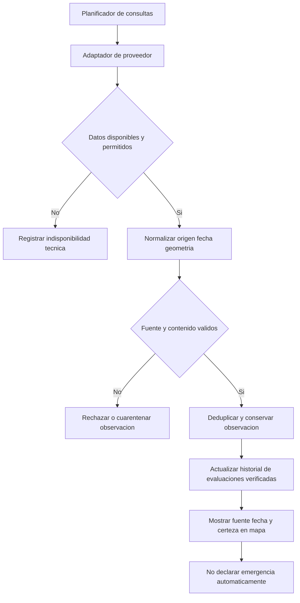

# Integraciones de observaciones, mapas y rutas

## 1. Política de integración

Los adaptadores externos ingresan observaciones técnicas a Alivía y proporcionan cartografía o cálculo de rutas. Ninguna fuente declara automáticamente una emergencia ni autoriza recursos. La información se consume desde procesos del backend con registros de procedencia, fecha de observación, fecha de ingesta, identificador y estado de validación.

## 2. Fuentes seleccionadas

| Fuente | Datos aprovechables | Tratamiento de integración |
|---|---|---|
| Centro Sismológico Nacional, IGP/CENSIS | Reportes de sismos en Perú | Conector únicamente sobre mecanismo público permitido y documentado; si no existe API autorizada, carga técnica verificada de avisos, no extracción no autorizada. |
| SENAMHI | Avisos meteorológicos e hidrológicos | Consumir productos oficiales accesibles con permiso, fecha y área; no inferir inundación confirmada solo desde un pronóstico. |
| NASA FIRMS | Detecciones de focos de calor de sensores satelitales | API con credencial y condiciones vigentes; etiquetar detección de calor, no incendio comprobado. |
| Copernicus Data Space | Observaciones e imágenes de superficie | Uso complementario cuando la cobertura, licencias y procesamiento sean apropiados. No se requiere procesamiento automático de imágenes en la primera versión. |
| OpenStreetMap | Datos geográficos de base | Respetar licencia ODbL y política del servicio de teselas seleccionado. |
| openrouteservice | Cálculo de recorridos, restricciones geométricas | Adaptador de rutas; combinar información disponible con restricciones viales propias verificadas. |

Sitios de referencia: https://censis.igp.gob.pe/ ; https://www.senamhi.gob.pe/ ; https://firms.modaps.eosdis.nasa.gov/ ; https://dataspace.copernicus.eu/ ; https://www.openstreetmap.org/ ; https://openrouteservice.org/ . Son sitios de proveedores, no pruebas de contratación o acceso a cada API.

## 3. Contrato interno de observación

```json
{
 "provider":"NASA_FIRMS",
 "externalId":"identificador-origen",
 "phenomenon":"HOTSPOT",
 "observedAt":"2026-10-18T10:00:00Z",
 "ingestedAt":"2026-10-18T10:05:00Z",
 "certainty":"OBSERVED",
 "location":{"latitude":-5.2,"longitude":-80.6},
 "sourceUrl":"https://sitio-del-proveedor.example/item"
}
```

Los valores son ilustrativos. `OBSERVED` califica la detección reportada; no equivale a impacto confirmado en una comunidad. Campos incompatibles, fuente no identificada o fecha inválida provocan rechazo o cuarentena del dato.

## 4. Flujo de ingesta



**Periodicidad de referencia:** consulta cada quince minutos únicamente cuando el proveedor permita la frecuencia; `ETag`, `If-Modified-Since`, límites y backoff se respetan. Los avisos de fuentes sin mecanismo automático permitido se incorporan mediante carga técnica aprobada. La disponibilidad observada se muestra con su propia fecha de origen, no como «tiempo real».

## 5. Rutas y cierres viales

El cálculo recibe coordenadas de almacén/comunidad y geometrías de restricciones validadas. El resultado incluye proveedor, timestamp, distancia estimada, segmentos, fuentes viales y estado. La ruta se considera vigente treinta minutos; cualquier nuevo bloqueo conocido que intersecte la ruta obliga a reevaluarla. Segmentos `UNKNOWN` o `IMPASSABLE` impiden confirmar retiro. Una ruta sin datos viales suficientes se etiqueta `UNAVAILABLE`, nunca «segura».

## 6. Fallos y degradación

Si un proveedor falla, se conserva la última observación con fecha visible; no se fabrica dato nuevo ni se convierte observación vieja en lectura actual. Si la ruta no puede verificarse, se bloquea el retiro conforme al flujo. La continuidad de inventarios y recepciones ya confirmadas no depende de una consulta externa en tiempo real.
