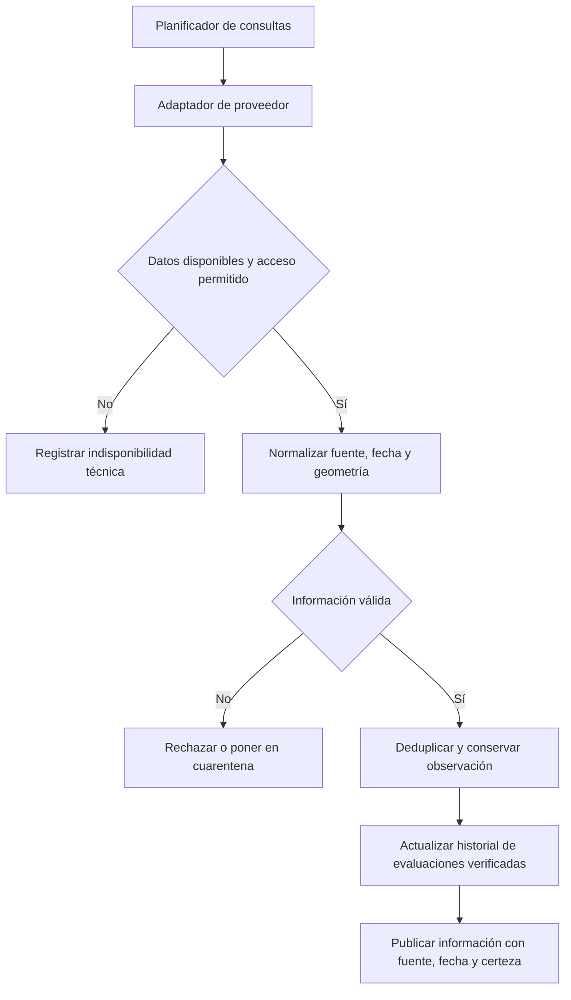

# Integraciones de observaciones, mapas y rutas

## 1. Política de integración

Alivía utiliza adaptadores para incorporar observaciones externas, obtener información cartográfica y calcular rutas. Estas integraciones se ejecutan desde el backend y no autorizan operaciones humanitarias ni declaran emergencias automáticamente.

Los datos incorporados deben conservar su procedencia, identificador de origen, fechas de observación e ingesta, y estado de validación.

## 2. Fuentes y servicios de referencia

| Fuente                | Información                                   | Condiciones de integración                                                                                                                                 |
| --------------------- | --------------------------------------------- | ---------------------------------------------------------------------------------------------------------------------------------------------------------- |
| IGP/CENSIS            | Reportes sísmicos de Perú.                    | Utilizar mecanismos públicos autorizados y documentados. Si no existe una API permitida, recurrir a cargas técnicas verificadas.                           |
| SENAMHI               | Avisos meteorológicos e hidrológicos.         | Consumir información oficial con condiciones de acceso verificadas, conservando fecha y área. Los pronósticos no constituyen confirmaciones de inundación. |
| NASA FIRMS            | Detecciones satelitales de focos de calor.    | Utilizar API con credenciales y permisos vigentes. Las detecciones no equivalen a incendios confirmados.                                                   |
| Copernicus Data Space | Imágenes y observaciones de superficie.       | Integración complementaria sujeta a cobertura, licencias y capacidad de procesamiento. No requiere análisis automático de imágenes en esta versión.        |
| OpenStreetMap         | Cartografía y datos geográficos base.         | Respetar la licencia ODbL y las condiciones del proveedor de teselas.                                                                                      |
| openrouteservice      | Cálculo de rutas y restricciones geométricas. | Proveedor candidato mediante adaptador, complementado con restricciones viales verificadas.                                                                |

**Sitios oficiales de referencia:**

- IGP/CENSIS: https://censis.igp.gob.pe/
- SENAMHI: https://www.senamhi.gob.pe/
- NASA FIRMS: https://firms.modaps.eosdis.nasa.gov/
- Copernicus Data Space: https://dataspace.copernicus.eu/
- OpenStreetMap: https://www.openstreetmap.org/
- openrouteservice: https://openrouteservice.org/

Estas referencias identifican proveedores, sin implicar que existan conexiones, credenciales o acuerdos de servicio establecidos.

## 3. Contrato interno de observación

Las observaciones se normalizan mediante una estructura común que conserva los metadatos necesarios para su identificación y validación.

```json
{
    "provider": "NASA_FIRMS",
    "externalId": "identificador-origen",
    "phenomenon": "HOTSPOT",
    "observedAt": "2026-10-18T10:00:00Z",
    "ingestedAt": "2026-10-18T10:05:00Z",
    "certainty": "OBSERVED",
    "location": {
        "latitude": -5.2,
        "longitude": -80.6
    },
    "sourceUrl": "https://sitio-del-proveedor.example/item"
}
```

Los valores son ilustrativos. `OBSERVED` identifica una detección reportada, sin confirmar automáticamente su impacto sobre una comunidad.

Las observaciones con fuente no identificada, fechas inválidas o datos incompatibles se rechazan o ponen en cuarentena.

## 4. Flujo de ingesta



### Política de consulta

- **Frecuencia de referencia:** cada quince minutos, siempre que el proveedor lo permita.
- **Control de peticiones:** respetar límites, mecanismos `ETag` e `If-Modified-Since` y políticas de _backoff_.
- **Fuentes sin acceso automatizado permitido:** incorporar datos mediante cargas técnicas autorizadas.
- **Vigencia:** mostrar la fecha real de observación, sin presentar información histórica como datos en tiempo real.

Las observaciones importadas solo pueden sustentar evaluaciones territoriales válidas; no generan declaraciones automáticas de emergencia.

## 5. Cálculo de rutas y restricciones viales

El cálculo utiliza las coordenadas del almacén de origen y la comunidad destinataria, junto con las restricciones viales verificadas.

Cada ruta conserva proveedor, fecha de cálculo y verificación, distancia estimada, segmentos, fuentes de información vial y estado.

Para considerarse utilizable debe cumplir:

- No incluir tramos `IMPASSABLE`.
- No depender de tramos `UNKNOWN`.
- Tener una verificación de antigüedad inferior a treinta minutos.

Una verificación vencida o un nuevo bloqueo conocido que afecte el recorrido obliga a reevaluar la ruta.

Si la información vial es insuficiente o no existe un recorrido válido, la ruta se clasifica como `UNAVAILABLE` y se bloquea el retiro.

La evaluación no garantiza la transitabilidad física de las vías.

## 6. Manejo de fallos y degradación

Cuando un proveedor externo no está disponible, Alivía conserva la última información registrada con su fecha de origen, sin generar datos ficticios ni presentarla como actualizada.

Si una ruta no puede verificarse, el retiro permanece bloqueado hasta obtener una evaluación válida.

Las fallas de integración no deben alterar inventarios, recepciones confirmadas ni otros registros operativos previamente persistidos.
