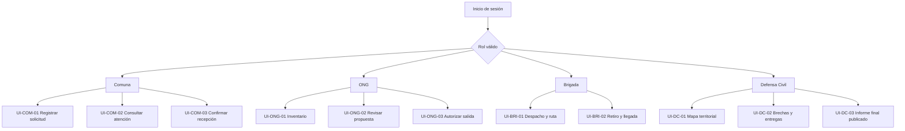

# Navegación conceptual por rol

## 1. Principios de navegación

Alivía organiza sus interfaces según los cuatro roles operativos. Cada vista se identifica mediante un código estable `UI-...`, independiente de su URL, estructura de directorios o herramienta de prototipado.

Las rutas físicas se definen durante la implementación en Next.js. Su modificación no altera el propósito, los datos requeridos ni los criterios de aceptación de una vista.

La navegación presenta únicamente las funciones permitidas para cada rol, mientras que el backend verifica los permisos y la titularidad de los recursos.

## 2. Mapa de navegación

## 3. Matriz de vistas

| ID        | Rol           | Función principal                     | Resultado esperado                                                           |
| --------- | ------------- | ------------------------------------- | ---------------------------------------------------------------------------- |
| UI-COM-01 | Comuna        | Registrar necesidades de productos.   | Solicitud confirmada con identificador y detalle.                            |
| UI-COM-02 | Comuna        | Consultar solicitudes propias.        | Cantidades solicitadas, comprometidas, recibidas y pendientes diferenciadas. |
| UI-COM-03 | Comuna        | Verificar recepción de ayuda.         | Recepción conforme o con observaciones y documentos finales.                 |
| UI-ONG-01 | ONG           | Gestionar inventario.                 | Existencias físicas, utilizables y comprometidas.                            |
| UI-ONG-02 | ONG           | Revisar y responder propuestas.       | Cantidades confirmadas o rechazo motivado.                                   |
| UI-ONG-03 | ONG           | Autorizar aportes confirmados.        | Compromiso registrado sin descuento físico inmediato.                        |
| UI-BRI-01 | Brigada       | Consultar despacho y ruta.            | Recorrido evaluado con estado y fecha de verificación.                       |
| UI-BRI-02 | Brigada       | Confirmar retiro y registrar llegada. | Estados logísticos actualizados con responsable y fecha.                     |
| UI-DC-01  | Defensa Civil | Consultar mapa territorial.           | Riesgos por desastre, nivel, fuente y fecha.                                 |
| UI-DC-02  | Defensa Civil | Consultar atención y brechas.         | Cobertura y entregas diferenciadas del riesgo territorial.                   |
| UI-DC-03  | Defensa Civil | Consultar informe final publicado.    | Resultados consolidados de solo lectura, sin inventarios privados.           |

## 4. Restricciones de acceso

- **Comuna:** no accede a inventarios privados de ONG ni a información operativa de otras comunidades.
- **ONG:** no confirma recepciones comunitarias.
- **Brigada:** no modifica las cantidades autorizadas.
- **Defensa Civil:** dispone exclusivamente de consultas de solo lectura, sin funciones para modificar operaciones o cerrar emergencias.

Las restricciones se aplican en el servidor. Manipular una URL o acceder directamente a un endpoint no concede permisos adicionales.
