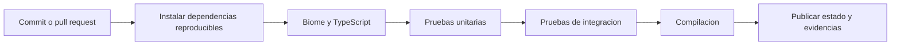

# Control de versiones e integración continua

## 1. Repositorios

Se usan dos repositorios Git de aplicación: frontend y backend. Los contratos HTTP se publican como especificación OpenAPI versionada y se comprueba su compatibilidad. La documentación del sistema se gestiona independientemente de la ruta física de los repositorios de código.

## 2. Flujo de cambios

- Rama principal protegida; implementación en ramas cortas por capacidad.
- Cada cambio se describe con objetivo, comportamiento, pruebas y riesgos.
- No fusionar migración destructiva sin plan de restauración y prueba sobre datos representativos.
- Los cambios funcionales que afectan contratos o estados deben actualizar sus criterios de aceptación antes de integrarse.
- Cada commit conserva cambios coherentes y verificables; no mezclar refactor ajeno con una regla funcional.

## 3. Flujo automatizado de CI



En backend, los ensayos de integración se ejecutan contra PostgreSQL efímero con migraciones aplicadas. En frontend, se utilizan tests de componentes y compilación Next.js. Las pruebas Playwright de flujos transversales pueden ejecutarse en un job de CI con servicios de prueba conectados.

## 4. Comandos de referencia

```bash
pnpm install --frozen-lockfile
pnpm exec biome check .
pnpm exec tsc --noEmit
pnpm test
pnpm build
```

Los scripts reales se definen en cada repositorio; los comandos representan la secuencia de verificación elegida, no evidencia de ejecución. Los pipelines deben fallar si falla alguna verificación obligatoria.

## 5. Gestión de secretos y artefactos

No almacenar tokens, conexiones de BD, llaves de proveedor ni cookies en Git o logs públicos. Los artefactos de CI incluyen resultado de pruebas y versión del commit, no datos privados de emergencias. Las migraciones de producción se ejecutan con permisos acotados y revisión previa; el build no debe aplicar automáticamente migraciones peligrosas sin control.

## 6. Releases

Cada release declara versión de frontend, versión de API, migraciones y pruebas asociadas. Se conserva etiqueta Git y configuración de despliegue requerida para revertir. Un rollback del código no revierte automáticamente un cambio irreversible de datos.
