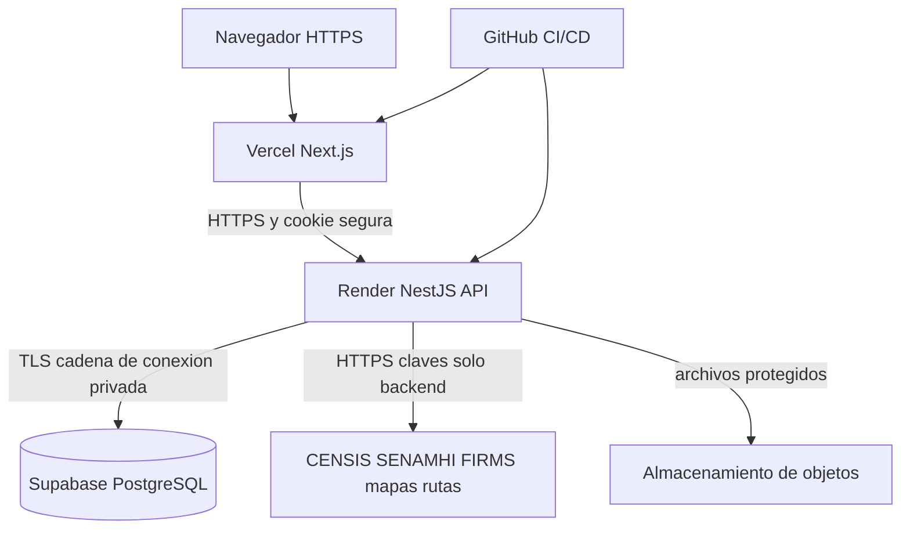

# Topología de infraestructura cloud

## 1. Diseño de despliegue

La solución selecciona frontend Next.js en Vercel, API NestJS en Render y PostgreSQL administrado por Supabase. El frontend y backend se publican desde repositorios Git separados. El navegador accede por HTTPS; el frontend reenvía las operaciones autenticadas al backend y este es el único cliente con credenciales de base de datos.

El enlace a base de datos debe cifrarse y restringirse por credenciales; la etiqueta de red `privada` depende de las capacidades reales del proveedor y no garantiza una conexión privada interproveedor. La API solo se expone por HTTPS y nunca publica `DATABASE_URL` ni claves de servicios en el navegador.

## 2. Entornos

| Entorno | Frontend | API | Base de datos | Datos |
|---|---|---|---|---|
| Desarrollo | Next.js local | NestJS local | PostgreSQL local o instancia aislada | Ficticios |
| Producción de referencia | Vercel | Render Web Service | Supabase administrado | Solo datos autorizados, con respaldo |

No se agrega un ambiente de staging independiente en la topología inicial. Para ensayos de migración destructiva se usa copia aislada de datos no sensibles o restauración anonimizada.

## 3. Justificación de selección

- **Vercel:** despliegue de Next.js, HTTPS y conexión Git; el plan Hobby no debe asumirse apto para servicio público comercial ni continuidad humanitaria.
- **Render:** ejecución Node/NestJS sin administrar máquina virtual directamente. El servicio gratuito duerme por inactividad y no es base suficiente para operación crítica; el nivel de pago se dimensiona después de pruebas.
- **Supabase:** PostgreSQL administrado compatible con Prisma y políticas de respaldo según plan; los proyectos gratuitos pueden suspenderse por inactividad.
- **Proveedor de objetos:** documentos XLSX/PDF almacenados con acceso autorizado y URL firmada; puede emplearse almacenamiento Supabase con claves solo servidor.

Fuentes técnicas: https://vercel.com/docs/plans/hobby ; https://render.com/docs/free ; https://render.com/pricing ; https://supabase.com/docs/guides/platform/free-project-pausing . Las condiciones comerciales de terceros pueden cambiar y no constituyen SLA contractual de Alivía.

## 4. Dimensionamiento

El conjunto inicial de prueba es pequeño, pero no define tráfico productivo. La capacidad se ajusta después de medir p95, memoria, base de datos y disponibilidad. Se evitarán planes que suspendan procesos ante inactividad cuando la instalación tenga responsabilidades operativas reales.

## 5. Límites de seguridad

TLS, secretos fuera de código, cuentas de servicio con privilegios mínimos, controles de acceso de archivos, límites de conexión, copias y monitoreo. Solo la API puede escribir datos operativos; el navegador no dispone de acceso directo a tablas PostgreSQL.
