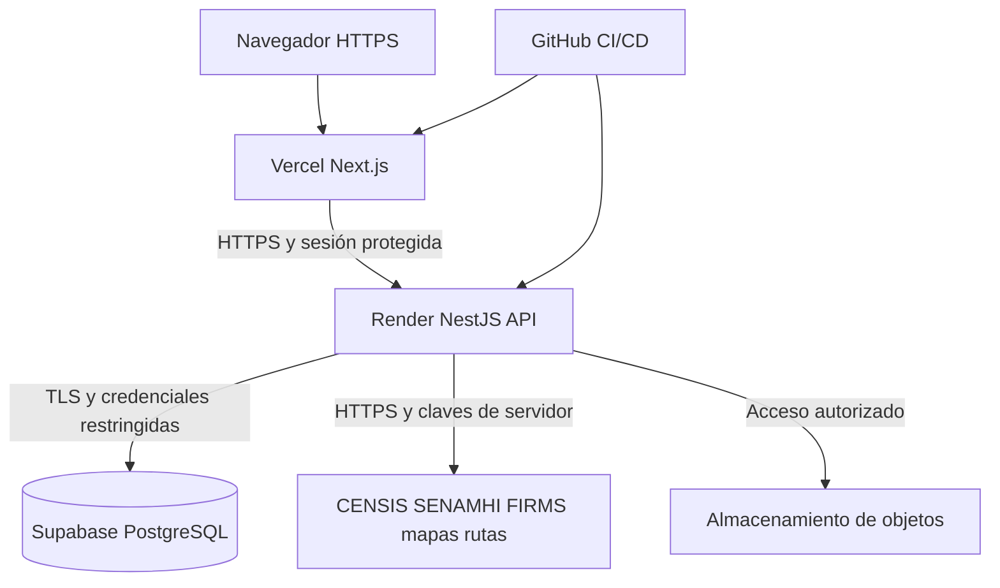

# Topología de infraestructura cloud

## 1. Arquitectura de despliegue

La topología de referencia de Alivía utiliza **Vercel** para el frontend Next.js, **Render** para la API NestJS y **Supabase** para PostgreSQL administrado.

Frontend y backend se despliegan desde repositorios Git independientes. El navegador se comunica mediante HTTPS con Next.js, que canaliza las operaciones autenticadas hacia la API. Solo el backend dispone de credenciales para acceder a la base de datos y los servicios externos protegidos.

La conexión con PostgreSQL debe estar cifrada mediante TLS y protegida por credenciales de acceso restringidas. Una conexión privada entre proveedores solo puede asumirse cuando la infraestructura contratada la permita explícitamente.

La API se expone únicamente mediante HTTPS. Las credenciales de base de datos y las claves de servicios externos nunca se entregan al navegador.

## 2. Entornos

| Entorno                  | Frontend      | Backend            | Base de datos                        | Datos                     |
| ------------------------ | ------------- | ------------------ | ------------------------------------ | ------------------------- |
| Desarrollo               | Next.js local | NestJS local       | PostgreSQL local o instancia aislada | Ficticios                 |
| Producción de referencia | Vercel        | Render Web Service | Supabase PostgreSQL                  | Autorizados, con respaldo |

La topología inicial no contempla un entorno de _staging_ independiente.

Las pruebas de migraciones destructivas deben ejecutarse en entornos aislados, utilizando datos sintéticos o copias restauradas y anonimizadas.

## 3. Selección de proveedores

| Proveedor                     | Justificación                                                               | Consideraciones                                                                                                               |
| ----------------------------- | --------------------------------------------------------------------------- | ----------------------------------------------------------------------------------------------------------------------------- |
| **Vercel**                    | Despliegue de Next.js, HTTPS e integración Git.                             | No asumir que el plan Hobby cumple las condiciones de uso ni los requisitos de continuidad de una operación humanitaria real. |
| **Render**                    | Ejecución de NestJS sin administración directa de máquinas virtuales.       | El servicio gratuito puede suspenderse por inactividad; un plan operativo debe dimensionarse según las pruebas.               |
| **Supabase**                  | PostgreSQL administrado compatible con Prisma.                              | Las políticas de respaldo y suspensión dependen del plan contratado.                                                          |
| **Almacenamiento de objetos** | Conservación de documentos XLSX/PDF con acceso restringido y URLs firmadas. | Puede utilizarse Supabase Storage, manteniendo las credenciales privilegiadas exclusivamente en el servidor.                  |

**Referencias técnicas:**

- Vercel: https://vercel.com/docs/plans/hobby
- Render Free: https://render.com/docs/free
- Render Pricing: https://render.com/pricing
- Supabase: https://supabase.com/docs/guides/platform/free-project-pausing

Las condiciones comerciales y operativas de terceros pueden cambiar. Estas referencias no constituyen garantías de disponibilidad ni acuerdos de nivel de servicio de Alivía.

## 4. Dimensionamiento y continuidad

El conjunto de datos de prueba no representa la carga de producción. La capacidad de infraestructura debe definirse mediante mediciones de:

- Tiempos de respuesta, incluido el percentil 95.
- Consumo de memoria y recursos de procesamiento.
- Conexiones y rendimiento de PostgreSQL.
- Disponibilidad de los servicios.

Una instalación con responsabilidades operativas reales no debe depender de planes que suspendan procesos por inactividad.

## 5. Controles de infraestructura

La topología debe aplicar los siguientes controles:

- **Comunicaciones:** TLS para conexiones externas y acceso a PostgreSQL.
- **Secretos:** credenciales y claves administradas fuera del código fuente.
- **Permisos:** cuentas de servicio con privilegios mínimos.
- **Datos:** acceso directo a PostgreSQL restringido al backend; el navegador no consulta ni modifica tablas.
- **Documentos:** almacenamiento protegido y acceso autorizado mediante la API.
- **Operación:** límites de conexión, respaldos y monitoreo de los servicios.

Estas condiciones forman parte del diseño de referencia y requieren verificación durante el despliegue.
