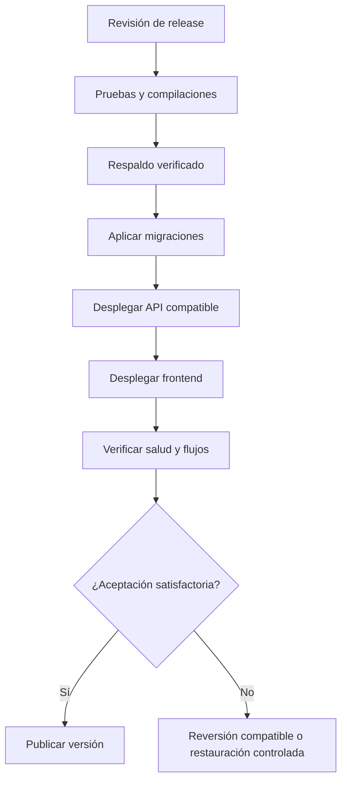

# Procedimiento de despliegue y publicación

## 1. Objetivo

Establecer un procedimiento reproducible para publicar frontend, backend y migraciones de Alivía.

Cada despliegue debe identificar los commits de ambos repositorios, la versión de las migraciones, la configuración utilizada y las evidencias de verificación.

Este procedimiento define la publicación prevista y no implica que exista una instalación operativa.

## 2. Preparación del despliegue

Antes de publicar una versión se debe:

1. **Seleccionar versiones:** identificar los commits revisados de frontend y backend.
2. **Verificar calidad:** ejecutar Biome, TypeScript, pruebas unitarias, pruebas de integración y compilaciones.
3. **Validar secretos:** comprobar su configuración en el gestor del proveedor, sin exponerlos en logs.
4. **Comprobar persistencia:** verificar la conexión del backend con PostgreSQL y disponer de un respaldo reciente.
5. **Revisar migraciones:** evaluar compatibilidad entre esquemas, índices y alternativas de reversión.
6. **Validar comunicaciones:** comprobar HTTPS, DNS, dominios y políticas de cookies y origen.

## 3. Secuencia de publicación

Esta secuencia presupone migraciones compatibles con la versión anterior.

Cuando existan cambios incompatibles, se debe utilizar una transición gradual de **expandir, migrar y contraer**, distribuida entre versiones. Un cambio destructivo requiere una ventana de intervención y un procedimiento de recuperación previamente definido.

La publicación solo se considera completada después de superar las verificaciones de aceptación.

## 4. Validación posterior al despliegue

Las comprobaciones mínimas incluyen:

- **Salud:** respuestas correctas de `/health/live` y `/health/ready`.
- **Autenticación:** inicio de sesión de los cuatro roles y rechazo del acceso a entidades ajenas.
- **Flujo funcional:** solicitud y matching de prueba con datos sintéticos, sin afectar registros reales.
- **Autorización:** consultas de Defensa Civil limitadas a sus permisos, sin exponer inventarios privados.
- **Documentos:** generación de archivos XLSX/PDF de prueba en un entorno aislado.
- **Integraciones:** comprobación de rutas y fuentes externas, sin presentar servicios no disponibles como operativos.
- **Observabilidad y recuperación:** verificación de logs, métricas y mecanismos de respaldo activos.

Los resultados deben registrarse como evidencia de la versión publicada.

## 5. Reversión y recuperación

Ante un fallo crítico, el procedimiento debe:

1. Restringir temporalmente las escrituras que puedan comprometer la integridad de los datos.
2. Conservar logs, evidencias y claves de identificación de operaciones.
3. Revertir a una versión de código compatible con el esquema persistido.
4. Ejecutar las comprobaciones mínimas de funcionamiento e integridad.
5. Registrar el incidente, el tiempo de recuperación, las operaciones afectadas y la conciliación de saldos.

Una migración destructiva puede requerir restauración controlada de PostgreSQL. **Revertir un commit no restaura automáticamente los datos modificados.**

La recuperación debe preservar la trazabilidad y evitar correcciones silenciosas de registros históricos.

## 6. Estado de ejecución

El procedimiento constituye una especificación para futuros despliegues.

No se han proporcionado evidencias de publicaciones reales, restauraciones ni pruebas posteriores al despliegue. Por tanto, ninguna etapa se considera ejecutada o aprobada.
