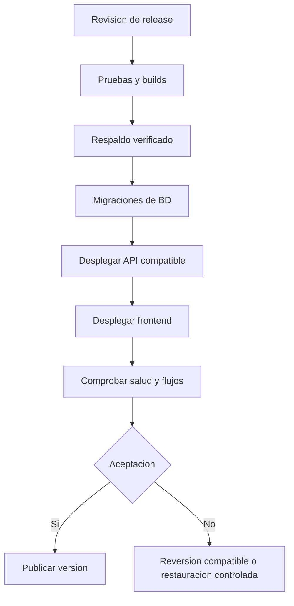

# Procedimiento de despliegue y publicación

## 1. Objetivo

Publicar una versión reproducible de frontend, backend y migraciones sin afirmar que existe ya una instalación operativa. Cada despliegue se identifica con commit, versión de migraciones, configuración y evidencia de comprobaciones críticas.

## 2. Preparación

1. Seleccionar commit y verificar cambios revisados en frontend y backend.
2. Ejecutar Biome, TypeScript, pruebas unitarias, integración y compilaciones.
3. Confirmar secretos en el gestor del proveedor, sin imprimirlos.
4. Confirmar servicio PostgreSQL accesible desde backend y respaldo reciente.
5. Evaluar compatibilidad de migraciones: esquema actual, nuevo esquema, índices y posible rollback.
6. Confirmar URLs HTTPS, DNS, dominios y políticas de cookie/origen.

## 3. Orden de ejecución

El orden presupone migraciones compatibles hacia atrás. Si un cambio rompe compatibilidad, dividirlo en expandir/migrar/contraer a través de versiones; nunca desplegar un esquema incompatible sin ventana y procedimiento controlado.

## 4. Validación posterior

- `/health/live` y `/health/ready` sin fallos.
- Login por cada rol y rechazo de entidad ajena.
- Prueba sintética de solicitud y matching sin datos reales.
- Revisión de permisos de lectura de Defensa Civil y no divulgación de stock.
- Generación de documento de prueba en entorno aislado.
- Verificación de rutas externas sin declarar disponibilidad si fuente está caída.
- Confirmación de logs, métricas y respaldo activo.

## 5. Reversión

Ante fallo crítico: impedir nuevas escrituras peligrosas, conservar logs y claves de operación, revertir a versión de código compatible y ejecutar pruebas mínimas. Una migración destructiva requiere restauración planificada de base, no `git revert` como sustituto. Registrar incidente, tiempo de recuperación, cantidad de operaciones afectadas y verificación de saldos.

## 6. Estado del proceso

Este procedimiento es una secuencia definida para construcción futura. No se han suministrado despliegues reales ni pruebas de publicación; no corresponde declarar ningún paso como ejecutado.
